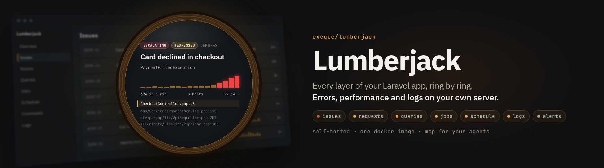
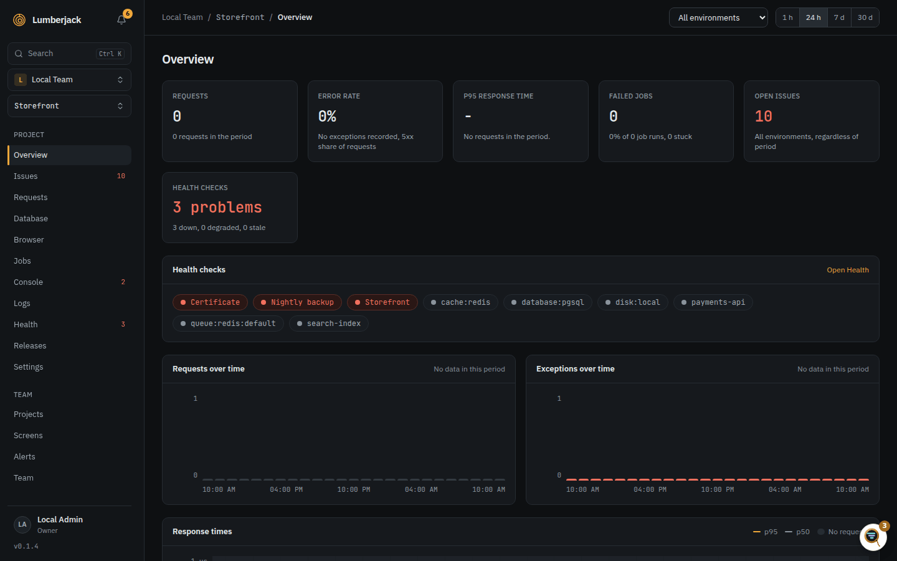
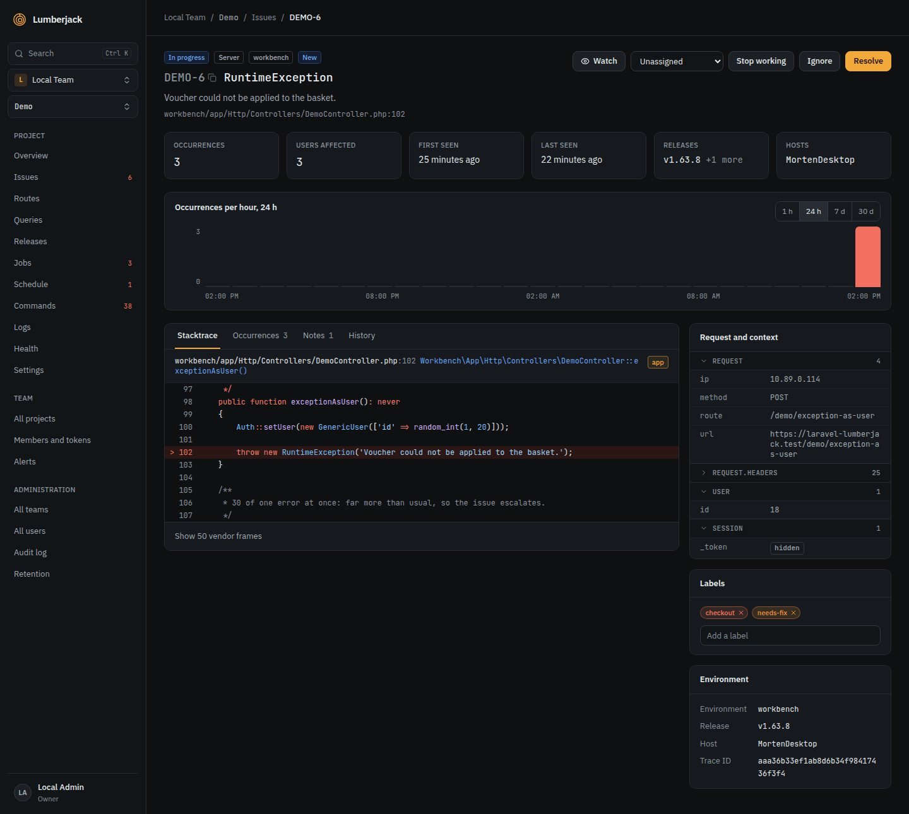
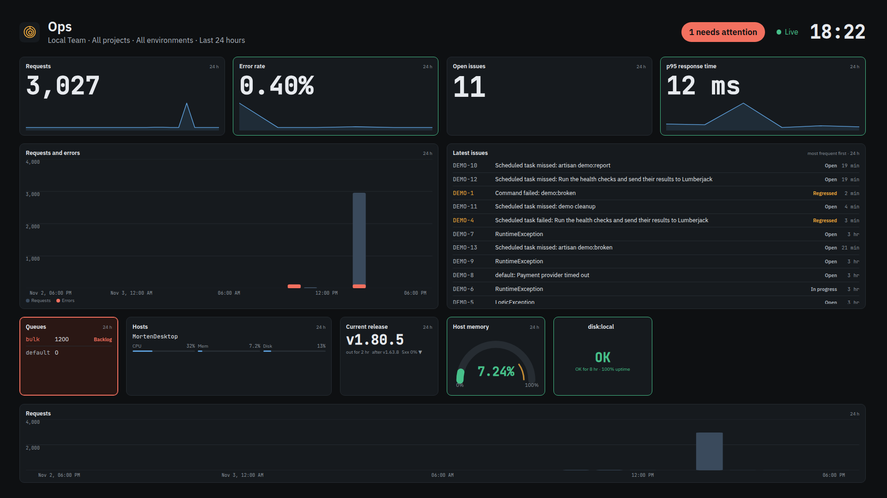

<p align="center"></p>

<p align="center">
<a href="https://github.com/ExeQue/lumberjack/releases"></a>
<a href="https://github.com/ExeQue/lumberjack/actions/workflows/tests.yml"></a>
<a href="https://github.com/ExeQue/lumberjack/actions/workflows/docker.yml"></a>
<a href="https://github.com/ExeQue/lumberjack/actions/workflows/docs.yml"></a>
<a href="https://github.com/ExeQue/lumberjack/blob/main/LICENSE"></a>
</p>

# Lumberjack

Lumberjack watches your apps from your own server, whatever they are built with. It collects errors, logs and
performance data, runs health checks, sends alerts, shows status screens on a TV and lets
AI agents work with your issues over MCP.



## What you can do with it

- **Know when production breaks.** Exceptions, browser errors and error logs become issues,
  and an alert reaches you by email, Slack, Microsoft Teams, Discord, Telegram, ntfy,
  Pushover or a webhook.
- **Find out why a page is slow.** Response times, Web Vitals, queries and N+1 hints per
  route, down to a single trace.
- **Check a release.** See which deploy brought new errors or slowdowns.
- **Watch background work.** See which jobs, scheduled tasks and commands failed or never
  ran, and which queues back up.
- **Check that your sites are up.** Run HTTP, SSL, TCP, DNS and heartbeat checks, and track
  outages and uptime.
- **Search your logs**, or watch them live.
- **Put a status screen on the wall.** Design a dashboard and show it on any TV.
- **Let an AI agent read your errors.** Agents can triage issues, write notes, open issues in
  your repository and draft pull requests.





## Get started

Lumberjack runs as one Docker image, with Postgres and Redis beside it. On a server with
Docker or Podman:

```bash
curl -fsSL https://exeque.github.io/lumberjack/install.sh | sh
```

[Running Lumberjack with Docker](https://exeque.github.io/lumberjack/docs/docker) has the whole setup. Your apps send data
through a [library](https://exeque.github.io/lumberjack/docs/libraries), such as
[`exeque/laravel-lumberjack`](https://exeque.github.io/laravel-lumberjack/) for Laravel, or
straight to the [ingest API](https://exeque.github.io/lumberjack/docs/api) from any language or framework.

## Guides

- [Get alerted when production breaks](https://exeque.github.io/lumberjack/docs/guides/alerting)
- [Find out why a page is slow](https://exeque.github.io/lumberjack/docs/guides/slow-pages)
- [Check a release](https://exeque.github.io/lumberjack/docs/guides/releases)
- [Watch queues, jobs and scheduled tasks](https://exeque.github.io/lumberjack/docs/guides/background-work)
- [Put a status screen on a TV](https://exeque.github.io/lumberjack/docs/guides/status-tv)
- [Let an AI agent work with your errors](https://exeque.github.io/lumberjack/docs/guides/ai-agents)
- [Show Lumberjack data in Grafana](https://exeque.github.io/lumberjack/docs/guides/grafana)

## Reference

- [Running Lumberjack with Docker](https://exeque.github.io/lumberjack/docs/docker): installation, settings, reverse proxy,
  backups and updates.
- [Libraries](https://exeque.github.io/lumberjack/docs/libraries): the libraries your apps send data with.
- [Setup and administration](https://exeque.github.io/lumberjack/docs/administration): first-run setup, recovery,
  administrators and the command line.
- [Teams and accounts](https://exeque.github.io/lumberjack/docs/teams): members, roles, invitations, your profile and
  two-factor authentication.
- [Projects](https://exeque.github.io/lumberjack/docs/projects)
- [Issues](https://exeque.github.io/lumberjack/docs/issues)
- [Alerts](https://exeque.github.io/lumberjack/docs/alerts)
- [Performance and traces](https://exeque.github.io/lumberjack/docs/performance)
- [Releases](https://exeque.github.io/lumberjack/docs/releases)
- [Health](https://exeque.github.io/lumberjack/docs/health)
- [Finding things](https://exeque.github.io/lumberjack/docs/finding-things): search, filters and the command palette.
- [Status screens](https://exeque.github.io/lumberjack/docs/screens) and [widgets](https://exeque.github.io/lumberjack/docs/widgets)
- [MCP](https://exeque.github.io/lumberjack/docs/mcp)
- [Metrics API](https://exeque.github.io/lumberjack/docs/metrics-api): read figures from Grafana, Prometheus or a script.
- [Ingest and API](https://exeque.github.io/lumberjack/docs/api): the endpoints SDKs and agents send to, and their limits.
- [Development](https://exeque.github.io/lumberjack/docs/development): run Lumberjack from source, demo data and screenshots.
