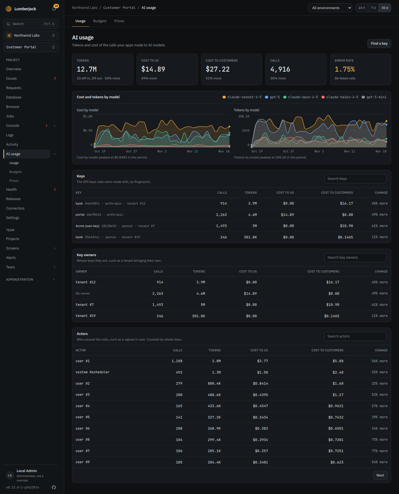
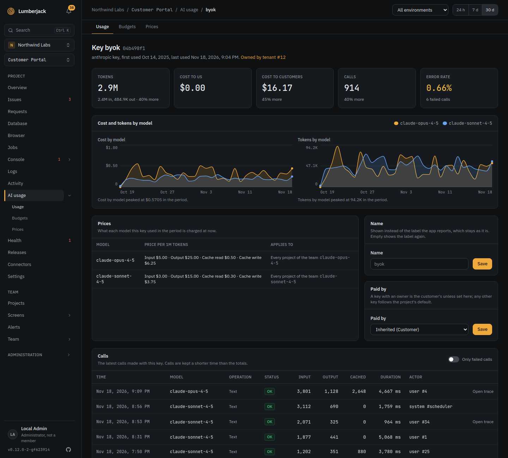
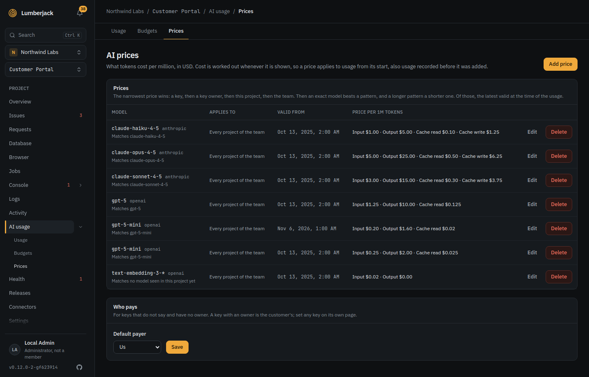
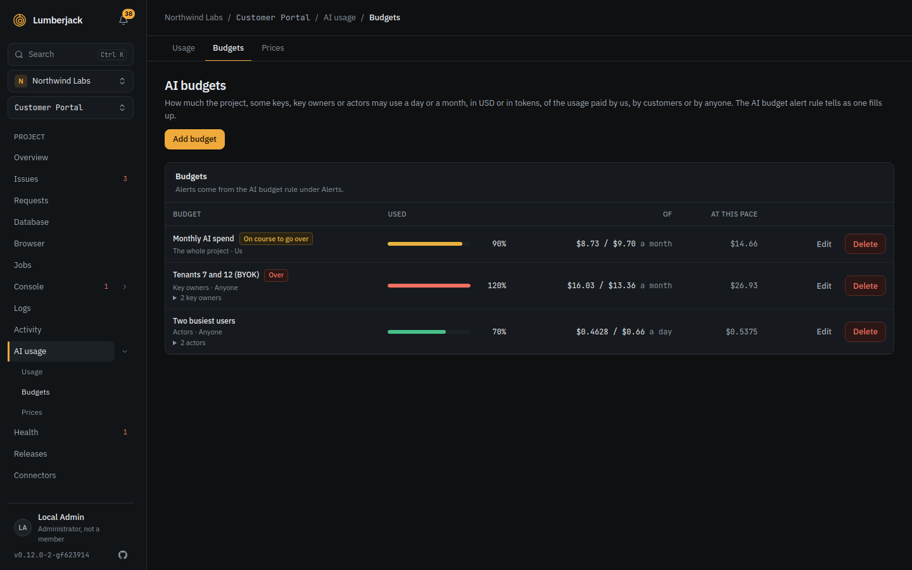
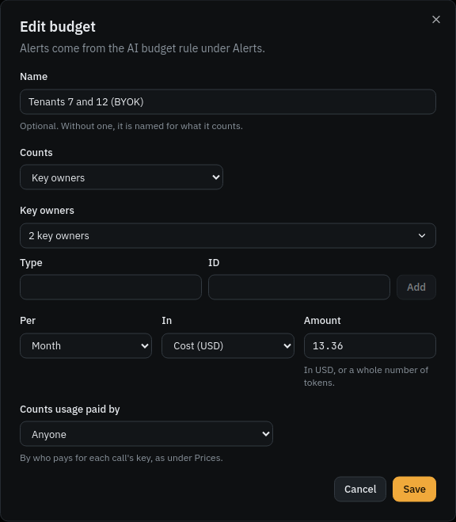

# AI usage

Lumberjack records every call your apps make to an AI model: which provider and model,
how many tokens went in and out, how long it took, whether it failed, which API key it
was made with, whose key that is and who caused the call. The prompt and the answer are
never sent.

## Recording AI calls

The [Laravel library](./libraries.md) records the calls made through `laravel/ai` and
Prism, and has a method to report others by hand; its docs show how. In the raw ingest
API a call is an event of type `ai_call` in a batch, see
[AI call events](./api.md#ai-call-events). Apps instrumented with OpenTelemetry send
their GenAI spans, see [OpenTelemetry](./opentelemetry.md#mapping).

A call has:

- **A provider and a model**, such as `anthropic` and `claude-sonnet-4-5`. A call
  without either is skipped.
- **An operation**: `text`, `structured`, `stream`, `embeddings`, `image`, `audio`,
  `transcription` or `rerank`. An operation Lumberjack does not know yet is kept as
  `text`, so its tokens still count.
- **Tokens**: input, output, cache read, cache write and reasoning, each left empty when
  the provider does not report it. Input is all input, cached tokens included, as
  OpenTelemetry counts it. The library makes every provider report it that way.
- **A status**, ok or error, with the error's name when it failed.
- **The key it was made with**, as a fingerprint, with a label and an owner; see below.
- **An actor**, optional: who caused the call.

Each one also gets the batch's environment, release and host, the trace it was made in,
and, for agents, the invocation and the step within it.

### Every call is recorded

AI calls are accounting, not performance samples. They are always recorded at a sample
rate of 1: the library never samples them, and a request or job that was not sampled
still reports its AI calls.

## Keys

The API key never leaves your app. The app sends a SHA-256 of the provider's driver and the key
(`sha256("anthropic:" + key)`). The driver is the vendor (`openai`, `anthropic`, the value of
`gen_ai.provider.name`), not a name the app gave its connection, so the same key always gets the
same fingerprint. Lumberjack keeps only an HMAC of that hash, made with a
secret of the project's own: the key's **fingerprint**. Neither the key nor the hash the
app sent is stored or logged. The same key gives a different fingerprint in every
project, so a fingerprint says nothing about the key outside the project it belongs to.
The first 8 characters of a fingerprint serve as the key's short id.

The project's secret is made when the project is created and is never rotated: a new
secret would give every key a new fingerprint and cut its history in two.

A key can carry:

- **A label**, such as `prod-primary`, to tell the keys apart.
- **An owner**: whose key it is, as a type and a key, such as `tenant` and `42`, for apps
  where customers bring their own key.

A key keeps its label and owner until a call names new ones; a call without them changes
neither.

You can also give a key a **name** in Lumberjack, on the key's page (it takes the right to
change the project). The name is shown everywhere in place of the label, which stays as the
app reports it and still shows beside the name on the key's page. Calls never change the
name; empty it to show the label again. A key with neither shows by its short id.

## Owner and actor

The **owner** belongs to the key: who pays for it. The **actor** belongs to the call: who
caused it, as a type and a key, such as `App\Models\User` and `17`. The library uses the
signed in user unless the app names another actor. So a tenant's key (the owner) can be
used by many of that tenant's users (the actors), and usage can be counted both per key
and per actor.

A call made with an owned key that names no owner of its own counts as the key owner's,
on the pages and in what it costs. It is the key's current owner that counts, for all of
its calls that named no owner, past ones too: give a key a new owner and its history
moves with it.

Lumberjack only gets the type and key of an owner and an actor, never a name or an email
address.

## Totals

Lumberjack adds every call to two totals, which outlive the calls themselves:

- **Hourly**, per environment, provider, model, key and owner.
- **Daily**, per environment, provider, model, key, owner and actor.

## The AI usage pages

Open a project and pick **AI usage** in the sidebar. Until the project has recorded an AI
call, the page points here.

- **Usage** shows the period's tokens, the cost to you and to your customers, the calls
  and the error rate, each against the period before, with a warning when some tokens
  have no price. Usage is kept by the hour (a day on an actor's page), and the current
  period holds the part of its last hour (on an actor's page, the day) gone by, so the
  period before also holds that share of the hour (on an actor's page, the day) just
  before it: at half past, half of it. Below them, cost and tokens over time per model (the five costliest,
  the rest as one line), and the keys, the key owners and the actors that cost the most,
  each with a search (a key by its name, label, short id, provider or owner; an owner or
  actor by its type and id), pages and the change against the period before.
- A **key's page** shows its usage and cost over time, the price each model it used is
  charged at, who pays for it and its latest calls, all of them or only the failed ones.
- A **key owner's** and an **actor's page** show their usage and cost over time and per
  key.
- A key's, a key owner's and an actor's page also show the [budgets](#budgets) that count
  them, when there are any.
- **Budgets** lists the project's [budgets](#budgets) and how far each is.
- **Prices** lists the prices that apply to the project, its own and its team's, and who
  pays for keys that do not say.

Keys and key owners are counted from the hourly totals. Actors are only in the daily
totals, so their figures count whole days: over 24 hours they show yesterday and today,
and over the last hour today alone, or yesterday and today while that hour reaches back
past midnight. They compare with as many whole days before as they span, and today with the
share of the day before it that has gone by of today.

## Cost

Lumberjack works out what the tokens cost from the [prices](#prices) whenever a page is
shown; cost is never stored. A price added or corrected later therefore also prices the
usage recorded before it, from its **valid from** on.

For each model and key, cost is, per million tokens:

- **Uncached input**: input less the cache reads and writes (never below 0), at the
  input price. Input counts cached tokens, see [A call has](#recording-ai-calls).
- **Cache reads** and **cache writes** at their own prices, or at the input price when
  the price leaves them empty.
- **Output** at the output price. Reasoning tokens are part of the output, as OpenAI and
  Anthropic count them. With a reasoning price, that share of the output is charged at
  the reasoning price instead; without one, it is charged as output.

The hourly totals are priced with the price valid at the start of each hour, the daily
totals with the price valid at the start of each day. So when a price changes in the
middle of a period, each side of the change gets its own price. On the day a price starts
in the middle of the day, the figures from the hourly totals (the totals, the chart, keys and
key owners) and those from the daily totals (actors) can disagree: the hours
after the change get the new price, the whole day the old one. Tokens no price applies
to are counted as unpriced, cost nothing and are named on the page.

## Prices

A price says what a model's tokens cost per million, in the team's currency: input,
output, and optionally cache read, cache write and reasoning. Add them under **AI usage**,
**Prices**; changing them takes administering the team.

A price applies to:

- **Every project of the team**, or **this project** alone.
- **A key owner**: the keys of one owner, such as `tenant` `7`, in this project, and the
  calls made for that owner without a key. A call made with an owned key that names no
  owner of its own gets its key's owner's price.
- **One key** of this project.

It matches a provider (or any, when empty) and a model, by name or by a pattern with `*`,
such as `claude-sonnet-*`. The form shows which of the models the project used in the
last 90 days a pattern matches as you type.

When several prices match a call, the narrowest wins: a key, then a key owner, then the
project, then the team. Between prices as narrow, an exact model name beats a pattern,
one for a provider beats one for any, and a longer pattern beats a shorter one. Of those,
the one valid latest at the time of the usage applies. A narrower price that is not valid
yet leaves the broader one in place until it is.

### Currency

A team has one currency, USD unless changed on the team page (**Members and tokens**,
**Currency**), as an ISO 4217 code such as `EUR`. Prices are not converted when it
changes: they are read in the new currency.

## Who pays

Cost is split into **cost to us** and **cost to customers**, by who pays for each key:

1. What the key's page says, when set.
2. Else the customer, for a key with an owner: an owner means a customer brought the key.
3. Else the project's default, under **Prices**, **Who pays**: us, unless changed.

Calls made without a key follow the project's default, unless they name an owner: then
the customer pays. The payer counts for all of a
key's usage, before the change too.

## Budgets

A budget says how much AI a project may use per **day** or per calendar **month**, as
**cost** in the team's [currency](#currency) or as **tokens**. It counts one of:

- **The whole project.**
- **Keys**: one or more keys of this project, counted together. A key the project has
  forgotten stays in the budget, shown as no longer seen, until you take it out.
- **Key owners**: one or more, such as `tenant` `7` and `tenant` `12`, counted together:
  the calls made for any of them, with or without a key, and the calls made with their keys
  that name no owner of their own. A call is counted once, however many ways it matches.
- **Actors**: one or more, counted together.

Pick keys, owners and actors in the budget's form by searching for them, grouped by
provider or type: a key by its name, label, short id, provider or owner; an owner or actor
by its type and id; `*` stands for any text. Before you type, and for what you type, each
provider or type shows its 20 used most lately, of the 25 providers or types used most
lately. Keys are found however long ago they were used. Owners are the ones calls named in
the last 90 days and the owners of keys, by the day each was last used; actors are the ones
calls named in the last 90 days.
Add an owner or actor not seen yet by its type and id. Changing which ones a budget counts
starts its alerts over.

Add them under **AI usage**, **Budgets**; changing them takes the right to change the
project. The page lists each budget with what it used so far in its current period, the
share of the budget that is, and what it will have used by the period's end at its pace so
far (a straight line from the period's start). A key's, owner's and actor's pages show
the budgets that count them, also a budget that counts others too.

A budget also says whose usage it counts, by [who pays](#who-pays) for each call's key:
**us**, **customers** or **anyone**. A new budget for the whole project or keys counts
what you pay for, one for key owners or actors counts everything; change it in the
budget's form. Cost and tokens are both counted that way.

Days and months begin at midnight UTC, as the daily totals do, so a budget's day is the
same day the totals count. Cost is worked out with the [prices](#prices) as everywhere
else, so tokens without a price count nothing toward a cost budget. Actor budgets are
counted from the daily totals, the others from the hourly ones. Both totals, and the keys
they name, are kept at least from the start of last month whatever their
[retention](./projects#retention) says, so a month and the one just ended can be counted.

The [AI budget alert rule](./alerts#ai-budget) tells as a budget passes its thresholds
(80% and 100% by default) and when it is on course to go over, each once per period.
A period that ended is measured once more to its end, five minutes after it, so what was
spent in its last minutes is told too; that alert goes out on the same terms as any other.
Changing what a budget counts, its period, its basis or whose usage it counts starts its
alerts over. Changing its amount keeps only the thresholds it is still past at the new
amount, so a raised budget tells again as it fills up, and it may warn again of an overrun
to come. An alert still on its way when the budget changes goes out only if it still holds:
one for a threshold the new amount is still past does, one for a budget that now counts
something else does not.

## Finding a key

**Find a key** on the AI usage page opens a key's page from the key itself: paste the
key. Your browser hashes it the way the library does (`sha256(driver + ":" + key)`), once
for each driver the project's keys were reported with, then for the drivers of
`laravel/ai` and Prism (`openai`, `anthropic`, `gemini` and the rest), and sends only
those hashes; the key never leaves the browser. Lumberjack makes the fingerprints from the
hashes as it does for a call and opens the key that matches, or says no call was made with
it. The hash is
not kept. Calls arrive the same way: the hash an app sends is turned into the fingerprint
before the batch is queued, so it is never stored, not even in the queue. Hashing needs a secure page: open Lumberjack over HTTPS.

## Retention

AI usage has its own group in [retention](./projects.md#retention):

| Data type       | Kept by default |
| --------------- | --------------- |
| AI calls        | 30 days         |
| Hourly AI usage | 400 days        |
| Daily AI usage  | 400 days        |

A key is forgotten once it has not been used for longer than the longer of the two
totals is kept.
