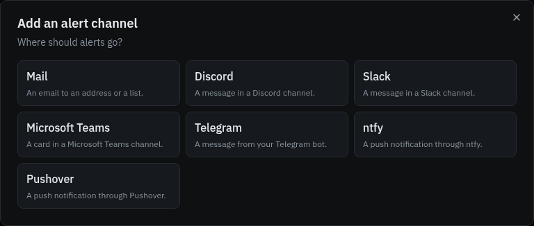
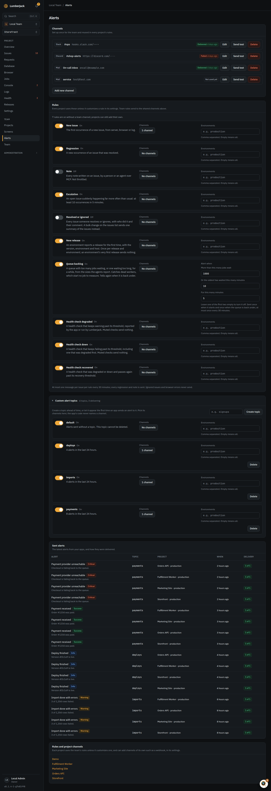
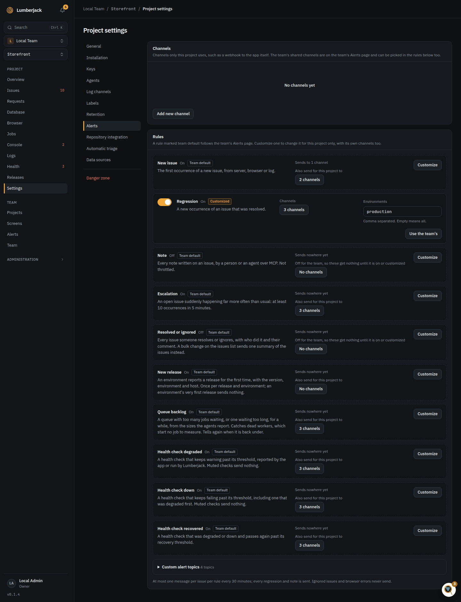

# Alerts

Alerts go to **channels** and are chosen by **rules**: the team's, which every project
uses, and a project's own where it customizes one.

## Channels

Set up a channel once on the team's **Alerts** page and use it in every project.
A project can also have channels of its own, in its settings.

| Type            | What it needs                                                                                                         |
| --------------- | --------------------------------------------------------------------------------------------------------------------- |
| Mail            | An email address.                                                                                                     |
| Discord         | A channel webhook URL, and optionally the sender name.                                                                |
| Slack           | An incoming webhook URL (`https://hooks.slack.com/...`).                                                              |
| Microsoft Teams | A Workflows webhook URL.                                                                                              |
| Telegram        | A bot token and a chat id (a group id starting with `-`, or `@name` of a public channel). The bot has to be a member. |
| ntfy            | The topic URL, on ntfy.sh or your own server, and an access token for a protected topic.                              |
| Pushover        | Your user or group key and an application token from pushover.net/apps.                                               |
| Webhook         | Any public `http://` or `https://` URL. Project channels only.                                                        |

A Discord URL starts with `https://discord.com/api/webhooks/` (or `discordapp.com`), a
Slack URL with `https://hooks.slack.com/`, and a Teams URL has to be `https://`. A
Discord sender name is at most 80 characters and may not contain "discord", "clyde",
`@`, `#`, `:` or backticks, which Discord refuses. When editing a channel, secret
fields stay empty: leave them so to keep the current value.



**Add new channel** opens a short wizard: pick where alerts go, then fill in the
details. Each type explains where to find its URL or keys and shows a preview of a
message (Mail as a Gmail inbox row; Discord, Slack, Teams and Telegram as the message
itself). Editing opens the same dialog at the details.

Discord, Slack, Teams and Telegram messages carry the same content: the headline, the issue
number and title, the message, the location, release and occurrence count, and a link
to the issue.

A delivery that meets a dropped connection, a rate limit (429) or a server error (5xx)
is tried again up to three times within about 8 seconds. Each attempt waits at most 5
seconds for an answer, so one delivery takes half a minute at the very most. One the other side refuses,
such as a removed webhook, fails at once and shows on the channel.

**Send test** delivers a test message so you can check the setup (at most six a minute
per person). Each channel shows
**Not used yet**, **Delivered** or **Failed**, with when.

Only team owners and admins add, change and delete the team's channels and rules.

Webhook, Teams and ntfy URLs may not point at private or reserved addresses (this
server, the network behind it, carrier-grade NAT, NAT64 and 6to4 forms of those). The
host is checked when the channel is saved and again on every send, and the delivery
connects to the address that was checked, so a host whose DNS answer changes cannot be
turned inward. Redirects are not followed. Set `ALERTS_WEBHOOKS_ALLOW_PRIVATE=true` to
allow private addresses, for example in local development. It is separate from
`LUMBERJACK_HEALTH_ALLOW_PRIVATE`, which only opens health checks.

## Rules

A rule is on or off, sends to the channels you pick, and can be limited to some
environments (comma separated, empty means all). There is one rule per type:

| Rule                   | Sends                                                                   | Default |
| ---------------------- | ----------------------------------------------------------------------- | ------- |
| New issue              | The first occurrence of a new issue.                                    | On      |
| Regression             | A new occurrence of a resolved issue, or an ignored issue coming back.  | On      |
| Escalation             | An issue that suddenly happens far more often than usual.               | On      |
| Note                   | Every note written on an issue, by a person or an agent.                | Off     |
| Resolved or ignored    | Every issue someone resolves or ignores.                                | Off     |
| Queue backlog          | A queue with too many jobs waiting, or one waiting too long.            | On      |
| Health check degraded  | A [health check](./health#alerts) that keeps warning or starts failing. | On      |
| Health check down      | A health check that keeps failing.                                      | On      |
| Health check recovered | A health check that is ok again.                                        | On      |

New issue and Escalation send at most one message per issue, rule and channel every 30
minutes. Every regression, note and status change is sent. Ignored issues and browser
errors never send an alert.

A rule that is on also decides when members hear of new issues, health checks and queue
backlogs in their own [notifications](./teams#notifications), even with no channel
picked; turning it off stops those too.

A message carries the first line of the issue's latest note, so a triage result
travels with the alert. A regression names who resolved the issue and when. A comment given
when resolving or ignoring goes with the **Resolved or ignored** message, not as a
separate note, while that rule is on.



### Team rules and project overrides

The team has one rule per alert type, on its **Alerts** page under **Rules**. Every
project uses them, so a new project alerts like the others from the start. Team rules
send to the team's shared channels only, since they serve every project. Only team
owners and admins change them.



In a project's settings, under **Alerts**, each type shows either:

- **Team default**: what the team's rule does (on or off, its channels and
  environments), read only. Below it, the project can add channels of its own, or
  shared channels the team's rule does not use (**+ channel (this project)**), without
  customizing the rule. These add-ons follow the team's rule: while it is off they get
  nothing, so to send anyway, customize it. **Customize** gives the project a rule of
  its own for that type, starting as a copy of the team's with the add-ons among its
  channels, to change for this project only.
- **Customized**: the project's own rule, edited in place. Changes to the team's rule
  no longer reach it. **Use the team's** deletes it, after asking, and the project
  follows the team's rule again. Channels the team's rule does not send to, such as the
  project's webhook, become add-ons on it, so a reset never quietly drops one.

A new shared channel is added to the team's rules that are on by default. A new project
channel is added to the rules that count for the project for those types: as an add-on
where the project uses the team's rule, directly where it has customized one.

### Resolved or ignored

The status change rule sends every issue someone resolves or ignores, with who did it
(a user, or an MCP token as `name (MCP)`) and the comment they gave. Re-opening and
taking an issue in progress send nothing.

Resolving or ignoring several issues at once from the issues list sends **one summary**
instead of a message per issue: who did it, how many, and up to 10 of the issues by
number and title (`+5 more` for the rest), with a link to the issues list filtered to
the new status. Selecting a single issue sends the normal message for it. A rule limited
to some environments summarizes only the issues whose latest occurrence is in one of
them, the same issues it would have sent one by one.

### Queue backlog

Agents report the size of the app's queues every minute (see the
[Jobs page](./performance#queues)). The queue backlog rule fires when a queue has more
than **1,000 jobs** waiting, or its oldest job has waited more than **10 minutes**, for
**5 minutes**; each of the three can be changed on the rule, and either threshold left
empty to turn it off. It sends once when the backlog starts and once when the queue is
back under, and starts again at most once every 30 minutes, so a queue that hovers
around a threshold does not flood the channel. The rule takes every queue the agents
report; environments do not apply to it.

A queue can have its own thresholds: **Alert** next to it in the Jobs page's
[Queues card](./performance#queues) sets the jobs waiting, the oldest wait and how long,
for that queue only, or mutes it so it never alerts. A field left empty keeps the rule's,
so a queue that only needs more patience can set just the minutes. They belong to the
project and apply whichever rule counts for it, the team's or its own; the project's
Alerts settings list them under the rules. The alert names the thresholds it used, with
"(this queue)" when they are the queue's own. Setting them needs the right to change
the project.

This is the alert that catches dead workers: with no worker running, no job starts, so
no wait time is measured, but the queue size keeps growing. The check runs every minute
(`php artisan lumberjack:check-queue-backlogs` in the schedule) on the latest sample
of each queue, from whichever host reported it last.

## Webhooks

A webhook channel POSTs JSON to your endpoint, so your app can react, for example by
turning a status banner on while an issue escalates.

```json
{
    "version": "1",
    "sent_at": "2026-11-03T10:12:00+00:00",
    "event": "new_issue",
    "project": { "id": "...", "slug": "shop", "name": "Shop" },
    "environment": "production",
    "issue": {
        "id": "...",
        "reference": "SHOP-42",
        "title": "Illuminate\\Database\\QueryException",
        "message": "SQLSTATE[40001]: Deadlock found when trying to get lock",
        "status": "open",
        "source": "server",
        "escalating": false,
        "occurrences": 1,
        "first_seen_at": "...",
        "last_seen_at": "...",
        "url": "https://lumberjack.example.com/projects/.../issues/..."
    },
    "burst": null,
    "status_change": null,
    "note": null
}
```

`event` is the rule (`new_issue`, `regression`, `escalation`, `status_change`, `note`,
`bulk_status_change`, `queue_backlog`, `health_degraded`, `health_down`, `health_recovered`) or `test`. `status_change` and `note` are filled in
for those events.

A bulk status change lists every issue it changed (the chat messages name 10), with the
new `status` (`resolved` or `ignored`) and who did it:

```json
{
    "version": "1",
    "sent_at": "2026-11-03T10:12:00+00:00",
    "event": "bulk_status_change",
    "project": { "id": "...", "slug": "shop", "name": "Shop" },
    "status": "resolved",
    "actor": "Morten",
    "issues": [
        {
            "id": "...",
            "reference": "SHOP-42",
            "title": "Illuminate\\Database\\QueryException"
        },
        { "id": "...", "reference": "SHOP-43", "title": "TypeError" }
    ],
    "url": "https://lumberjack.example.com/projects/.../issues?status=resolved"
}
```

A queue backlog has no issue; its body carries the queue and the thresholds instead,
with `state` either `started` or `recovered`:

```json
{
    "version": "1",
    "sent_at": "2026-11-03T10:12:00+00:00",
    "event": "queue_backlog",
    "project": { "id": "...", "slug": "shop", "name": "Shop" },
    "queue": {
        "connection": "redis",
        "name": "default",
        "state": "started",
        "size": 1240,
        "oldest_age_s": 840,
        "since": "2026-11-03T10:05:00+00:00",
        "url": "https://lumberjack.example.com/projects/.../jobs"
    },
    "thresholds": { "size": 1000, "age_minutes": 10, "sustain_minutes": 5 }
}
```

A health check has no issue either; `check.state` is `down`, `degraded` or
`recovered`, and `hosts` lists the servers it fails on (empty for checks Lumberjack
runs):

```json
{
    "version": "1",
    "sent_at": "2026-11-03T10:12:00+00:00",
    "event": "health_down",
    "project": { "id": "...", "slug": "shop", "name": "Shop" },
    "environment": "production",
    "check": {
        "id": "...",
        "name": "disk:s3",
        "slug": "disk:s3",
        "source": "reported",
        "type": null,
        "state": "down",
        "message": "The disk is not writable.",
        "hosts": ["web-1"],
        "since": "2026-11-03T10:10:00+00:00",
        "url": "https://lumberjack.example.com/projects/.../health?check=..."
    }
}
```

Every request is signed with the channel's secret, shown once when the channel is
created:

- `X-Lumberjack-Event`: the event.
- `X-Lumberjack-Timestamp`: when it was sent.
- `X-Lumberjack-Signature`: `sha256=` and the HMAC-SHA256 of
  `{timestamp}.{body}` with the secret.

An SDK may verify these for you; see its docs.
