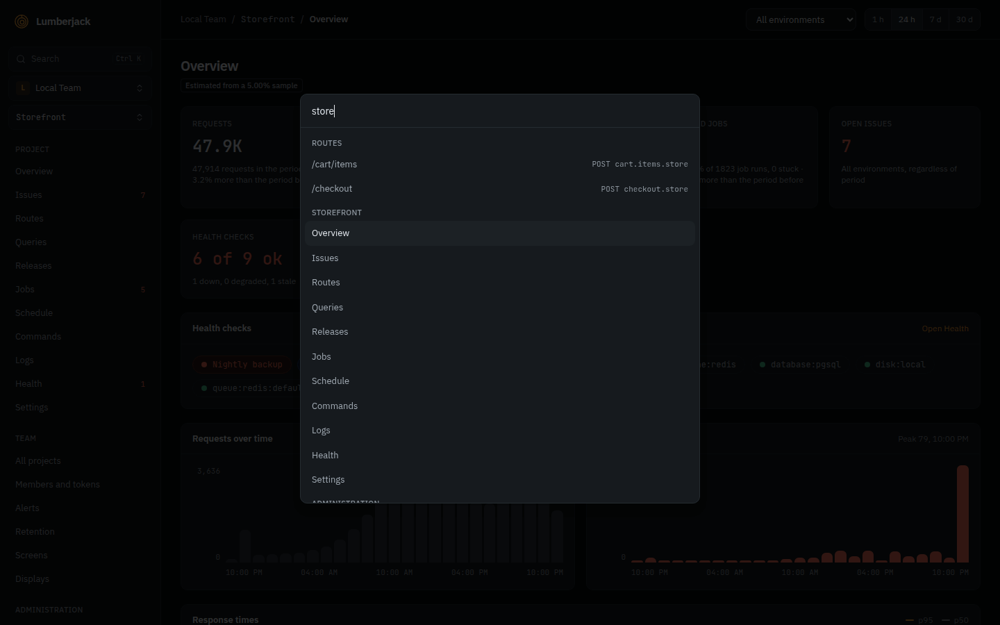

# Finding things

## The sidebar

The sidebar keeps related pages behind one entry; each of them shows the others as tabs
under the top bar:

| Entry   | Tabs                          |
| ------- | ----------------------------- |
| Console | Jobs, Schedule, Commands      |
| Screens | Screens, Displays             |
| Team    | Members and tokens, Retention |

Overview, Issues, Requests, Database, Browser, Jobs, Logs, Health and Releases (the project), and Projects and Alerts (the
team) are pages of their own. An entry's badge adds up its tabs' counts; each tab shows
its own.

**Settings**, last in the project's list, opens the project's settings, whose menu also
lists the **Data sources**; members, who cannot change the settings, see **Data sources**
there instead (read only). The
**Administration** section, for system administrators, folds away and opens on its own
on an administration page.

## The command palette

Press `Ctrl+K` (`⌘K` on a Mac), or click **Search** at the top of the sidebar.

Without typing anything you can jump to:

- any page of the project you are in,
- the team and administration pages,
- another project in the team,
- another team (this switches team).

Type at least two characters and the palette also searches the project you are in:

| What            | Matched on                                        | Opens                            |
| --------------- | ------------------------------------------------- | -------------------------------- |
| Issues          | title, message or number (`DEMO-42`, `#42`, `42`) | the issue                        |
| Routes          | route, route name or URL, seen in the last 7 days | the route on the Requests page   |
| Jobs            | class name, run in the last 7 days                | the job on the Jobs page         |
| Commands        | command name, run in the last 7 days              | the command on the Commands page |
| Scheduled tasks | task name                                         | the Schedule page                |
| Traces          | the exact trace id                                | the trace                        |

Each kind shows at most 5 results. Use the arrow keys and `Enter`, or click a result.

## Search syntax

The same rules apply to the palette and the search fields of issues, routes, queries
and users:

- A term matches anywhere in the text, regardless of case: `checkout` finds
  `/api/checkout/{order}`.
- `*` stands for any number of characters: `/api/*/refund` finds
  `/api/orders/{order}/refund`, and `App\Jobs\*Invoice` finds `App\Jobs\SendInvoice`.
- Every other character, `%` and `_` included, is searched for as itself.

The Logs page is different: it searches whole words, see [Logs](./performance#logs).
