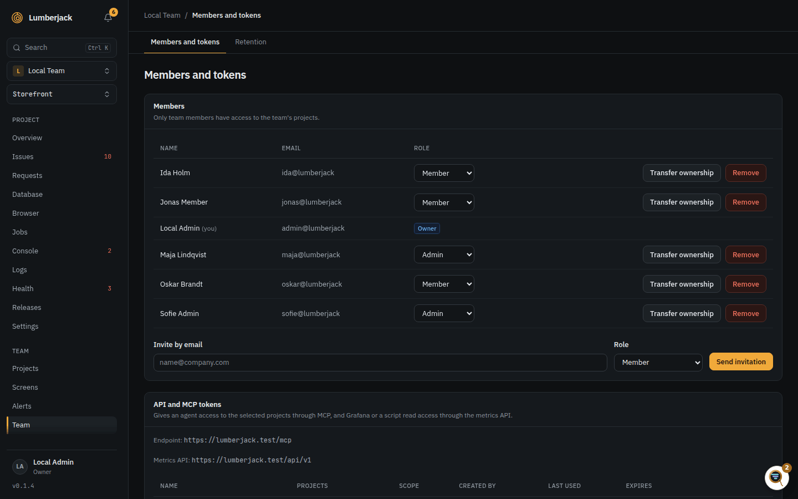
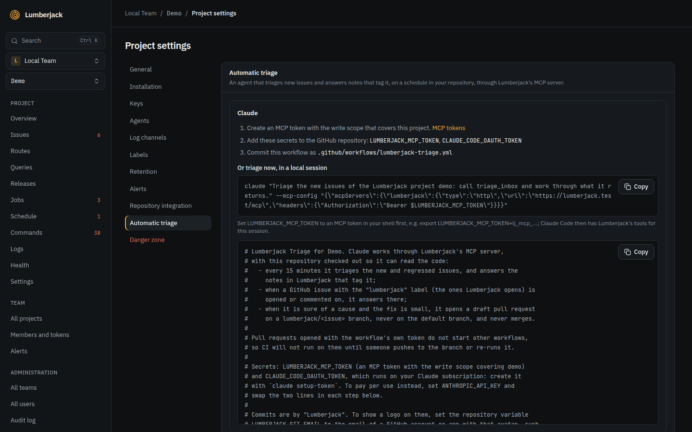

# Let an AI agent read your errors

Lumberjack has an MCP server. Connect Claude Code, Codex, Cursor, VS Code, Claude Desktop or another MCP client, and
the agent can read your issues, traces, logs and performance data, and help fix them.

## 1. Create a token

You need to be a team owner or admin.

1. Open **Team** in the sidebar. **API and MCP tokens** is on the **Members and tokens**
   tab.
2. Click **New token** and fill in:
    - **Name**: shown on every note and change the agent makes.
    - **Projects**: the projects the agent may see.
    - **Permissions**: what the agent may do, per area. **Read only** is the default;
      the **Triage** preset can also change issues: status, assignee, labels, notes and
      GitHub issues. See [Permissions](../mcp.md#permissions).
    - **Expires**: when the token stops working.
3. Click **Create token** and copy it. It starts with `lj_mcp_` and is shown once.



A token acts as the person who created it, never more, and stops working when that person is no
longer an owner or admin of the team.

## 2. Connect your client

::: warning The token is a secret
Never put the token itself in a file you commit, such as `.mcp.json`. Keep it in an environment
variable or your client's secret store.
:::

The dialog with the new token, and the **Connect a client** button on the team page, show the setup
for Claude Code, Codex, Cursor, VS Code and Claude Desktop with your address filled in.
For Claude Code, in your repository:

```bash
export LUMBERJACK_MCP_TOKEN=lj_mcp_...
claude mcp add --transport http --scope project --header 'Authorization: Bearer ${LUMBERJACK_MCP_TOKEN}' lumberjack https://your-lumberjack/mcp
```

Put the `export` line in a shell profile that is not in a dotfiles repository, so the
variable is there next time. The other
clients, and a tip for more than one token, are in [Connecting](../mcp.md#connecting).

**When it works:** asked "Which Lumberjack projects can you see?", the agent lists your
projects, and the token's **Last used** on the team page updates.

## 3. Ask it things

Name the project by its slug, or let the agent look it up.

- "What are the newest open issues in `shop`, and which one affects the most users?"
- "Show me issue SHOP-42 and find the cause in this repository."
- "Why is `POST /checkout` slow? Look at its slowest requests and their queries."
- "Which jobs failed in the last 24 hours, and why?"
- "Search the logs for `payment declined` around trace 4f2a...."
- "What's in my triage inbox?"

With a token that can change issues, such as **Triage**:

- "Mark SHOP-42 as in progress, assign it to me and add a note with what you found."
- "Create a GitHub issue for SHOP-42."

## 4. Triage automatically

A project's **Settings** has an **Automatic triage** section with a GitHub Actions
workflow. It runs Claude Code in your repository every 15 minutes, triages new and
regressed issues through MCP, and answers notes that tag it. It can open a draft pull
request for a small fix. It never resolves an issue or merges.



It needs a token that can change issues, two repository secrets and the workflow file, as the settings
show. GitHub has to reach your Lumberjack, so it must be on a public URL.

## Limits

| What            | Limit                        |
| --------------- | ---------------------------- |
| Calls per token | 120 a minute                 |
| Token name      | 100 characters               |
| Token expiry    | 30, 90 or 365 days, or never |

## Reference

- [MCP](../mcp.md): tokens, every tool, and automatic triage.
- [Issues](../issues.md): statuses, notes and watching.
