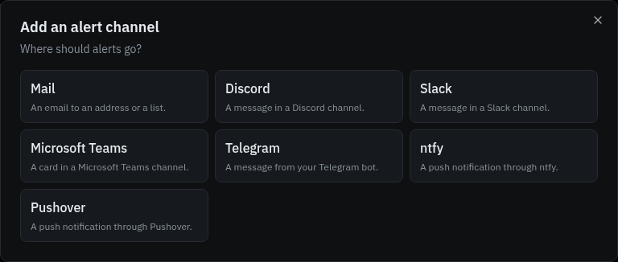
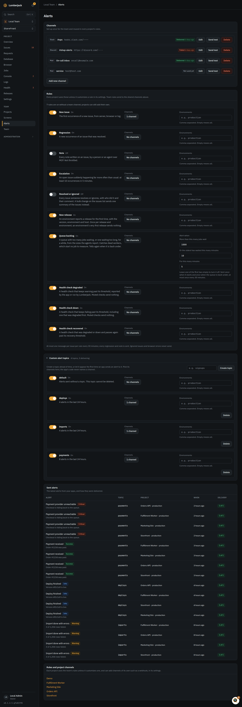
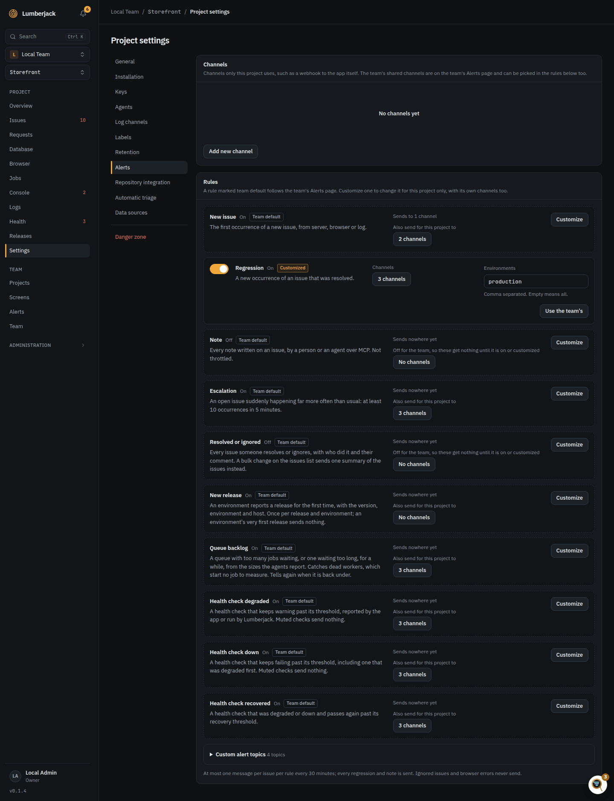

# Get told when production breaks

Send new errors, regressions, failing health checks and stuck queues to the right people.
You need to be a team owner or admin to add channels and change rules.

## 1. Connect a channel

A channel is where alerts go. It belongs to the team, and every project can use it.

1. Open **Team** in the sidebar, then **Alerts**.
2. Click **Add new channel** and pick where alerts go:

    | Channel         | You need                                                |
    | --------------- | ------------------------------------------------------- |
    | Mail            | An email address.                                       |
    | Slack           | An incoming webhook URL.                                |
    | Discord         | A channel webhook URL.                                  |
    | Microsoft Teams | A Workflows webhook URL.                                |
    | Telegram        | A bot token and a chat id. The bot must be in the chat. |
    | ntfy            | A topic URL, and an access token for a protected topic. |
    | Pushover        | Your user or group key and an application token.        |
    | Webhook         | Your own endpoint. Set it up in a project's settings.   |

3. Follow the hint in the dialog to find the URL or keys, name the channel and save.
4. Click **Send test** on the channel.

**When it works:** the channel shows **Delivered** with the time. **Failed** means the other
side refused the message: check the URL or keys.

## 2. Turn on the rules you want

Under **Rules** on the same page, each rule is on or off and sends to the channels you
tick. A new channel is added to the rules that are on.

| Rule                   | Tells you about                                          | Default |
| ---------------------- | -------------------------------------------------------- | ------- |
| New issue              | The first occurrence of a new error.                     | On      |
| Regression             | A resolved issue that happens again.                     | On      |
| Escalation             | An issue that suddenly happens far more often.           | On      |
| Queue backlog          | A queue with too many jobs waiting, or waiting too long. | On      |
| Health check degraded  | A health check that keeps warning or starts failing.     | On      |
| Health check down      | A health check that keeps failing.                       | On      |
| Health check recovered | A health check that is ok again.                         | On      |
| Note                   | Every note written on an issue.                          | Off     |
| Resolved or ignored    | Every issue someone resolves or ignores.                 | Off     |

To alert only on production, type `production` in **Environments**. Empty means every
environment.

A new issue or escalation sends at most one message per issue every 30 minutes.
Ignored issues and browser errors never send an alert.

## 3. Send one project somewhere else

In the project's **Settings**, then **Alerts**:

- **+ channel (this project)** under a rule marked **Team default** also sends this
  project's alerts to another channel.
- **Customize** changes the rule for this project; **Use the team's** goes back.
- The project can add its own channels, such as a **Webhook** to your own app.

## 4. Catch dead workers with the queue backlog rule

The **Queue backlog** rule fires when a queue has more than 1,000 jobs waiting, or the
oldest job has waited more than 10 minutes, for 5 minutes. Change the numbers on the
rule, or per queue with **Alert** in the **Queues** card of the project's **Jobs** page.
See [Watch background work](./background-work.md).

## 5. Watch the things your app depends on

Add health checks on the project's **Health** page with **Add check**: **HTTP**, **SSL
certificate**, **TCP port**, **DNS record**, or a **Heartbeat** your cron job calls. Your
app can also report its own checks (database, cache, disks, queues) through the SDK. They
alert through the three **Health check** rules, only after several bad results in a row.
See [Health](../health.md).

## Error rate and response time

There is no alert rule on a project's error rate or p95. To get close:

- **Escalation** fires when one error suddenly happens far more often than usual.
- An **HTTP** health check with **Warn when slower than (ms)** warns when a page gets
  slow, and fails on the wrong status.
- Alert on the Prometheus gauges `lumberjack_error_rate` and
  `lumberjack_request_duration_p95_seconds` in Prometheus or Grafana.
  See [Send metrics to Grafana](./grafana.md).

## 6. Choose what you hear yourself

Each person also picks their own notifications:

1. Click your name at the bottom of the sidebar, then **Profile and settings**,
   then **Notifications**.
2. Pick a preset (**Quiet**, **Balanced** or **Everything**), or set **Mail**, **In app**
   and **Browser** per row: new issues, health checks, queue backlogs, scheduled tasks,
   agents, releases, and issues you watch.
3. For notifications while Lumberjack is closed, click **Enable on this device** in each
   browser or phone.

Personal notifications for new issues, health checks and queue backlogs follow the
team's rules: turning a rule off stops them too.

## Reference

- [Alerts](../alerts.md): every channel, rule, override and the webhook body.
- [Health](../health.md): check types, thresholds and states.
- [Teams and accounts](../teams.md): personal notifications and the notification center.
