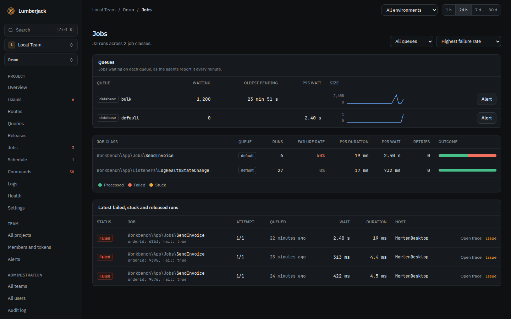
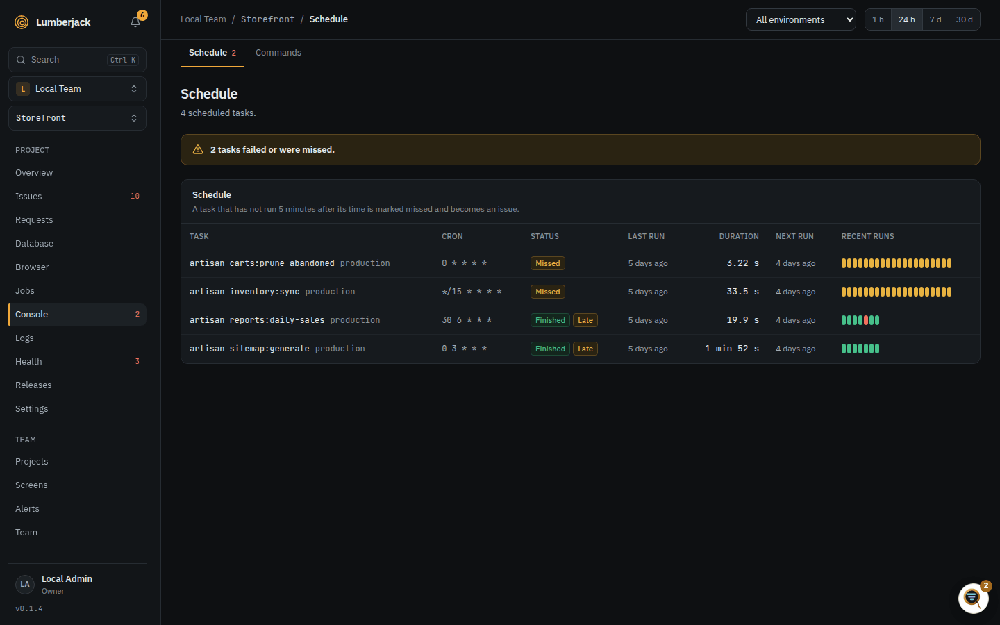
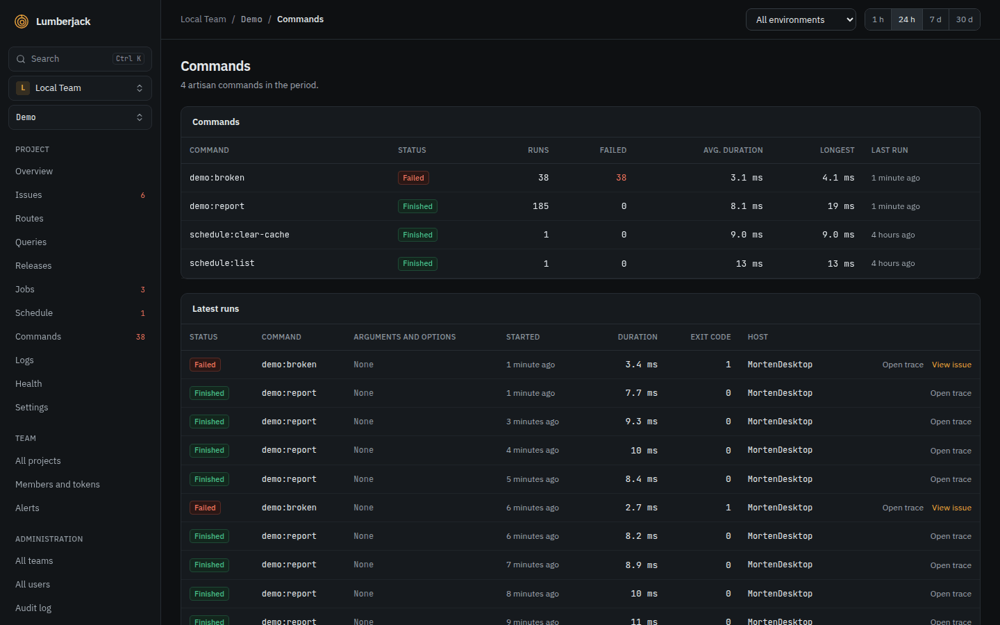

# Watch queues, jobs, scheduled tasks and commands

Know when background work fails, gets stuck, piles up or does not run at all. The
Laravel SDK records jobs, scheduled tasks and commands by itself.

## Failed and stuck jobs

Open **Jobs** in the sidebar. Each job class shows its runs, failure rate, p95
duration and p95 wait.



1. Sort by **Highest failure rate**.
2. Below the job classes, **Latest failed, stuck and released runs** lists the bad
   runs with their parameters.
3. **Open trace** shows a run's queries, log lines and exception; **Issue** opens the
   error it became.

A job is **Stuck** when it has been processing far longer than its timeout, which usually
means a worker died mid-job. A banner at the top counts them.

A failed job's exception is an issue, so the **New issue** and **Regression** alert rules
cover it.

## Queue backlog and dead workers

The SDK's agent reports your queue sizes every minute. List the queues in the app's
environment, as `connection:queue` or a queue on the default connection:

```dotenv
LUMBERJACK_QUEUES=default,redis:emails
```

Without it, the agent watches the default connection's default queue.

The **Queues** card on the Jobs page shows, per queue, the jobs **Waiting**, the
**Workers** on it, the **Oldest pending** job and the **p95 wait**. Workers turn red when
jobs wait and no worker runs.

**Get told:** the **Queue backlog** alert rule fires when a queue has more than 1,000
jobs waiting, or its oldest job has waited more than 10 minutes, for 5 minutes, and sends
again when the queue is back under. This also catches dead workers.

For other limits on one queue, click **Alert** next to it in the Queues card. An empty
field keeps the rule's value; **Mute: never alert for this queue** turns it off.

## Missed and failed scheduled tasks

Open **Schedule** in the sidebar. Each task shows its cron, latest status, last and next
run, and its last 20 runs. A task's detail lists its runs with exit code and host.



- **Failed**: the task threw an exception or ended with a non-zero exit code.
- **Missed**: the task had not started 5 minutes after its time. The scheduler may
  not be running at all.

A failed or missed task becomes an issue, so the **New issue** and **Regression** rules
cover it. For yourself, turn on the **Scheduled tasks** row in your notifications.

**Forget task** removes a task that is gone from the app. Only owners and admins can do
this.

## Commands

Open **Commands** in the sidebar for every Artisan command the app ran, except queue
workers: runs, failures, duration, and the latest runs with their arguments, exit code
and host.



## Health checks for queues and cron jobs

Health checks alert through the **Health check** rules.

**From the app.** Register a queue check in a service provider. It warns and fails at
the sizes you give, and fails when jobs wait with no worker:

```php
Lumberjack::healthChecks()
    ->queue('redis', queue: 'emails', warnAt: 500, failAt: 2000)
    ->failedJobs(withinMinutes: 60);
```

**From Lumberjack.** For a cron job or backup outside Laravel's scheduler, add a
**Heartbeat** check on the project's **Health** page with **Add check**, and call its
ping URL at the end of the job:

```bash
php artisan backup:run && curl -fsS -m 10 https://lumberjack.example.com/api/health/ping/...
```

The check fails when no ping came within its interval plus the grace.

**When it works:** the checks show green on the **Health** page. Stop a worker or skip
a ping and the check turns degraded, then down.

## Your own notifications

Under your name at the bottom of the sidebar, **Profile and settings**, **Notifications**,
the **Queue backlogs**, **Scheduled tasks**, **Health checks** and **Agents** rows decide
how you hear of each. **Agents** tells you when a server's agent stops sending its
heartbeat.

## Reference

- [Performance and traces](../performance.md): the Jobs, Queues, Schedule and Commands
  pages.
- [Alerts](../alerts.md): the queue backlog rule and per-queue thresholds.
- [Health](../health.md): check types, thresholds and states.
