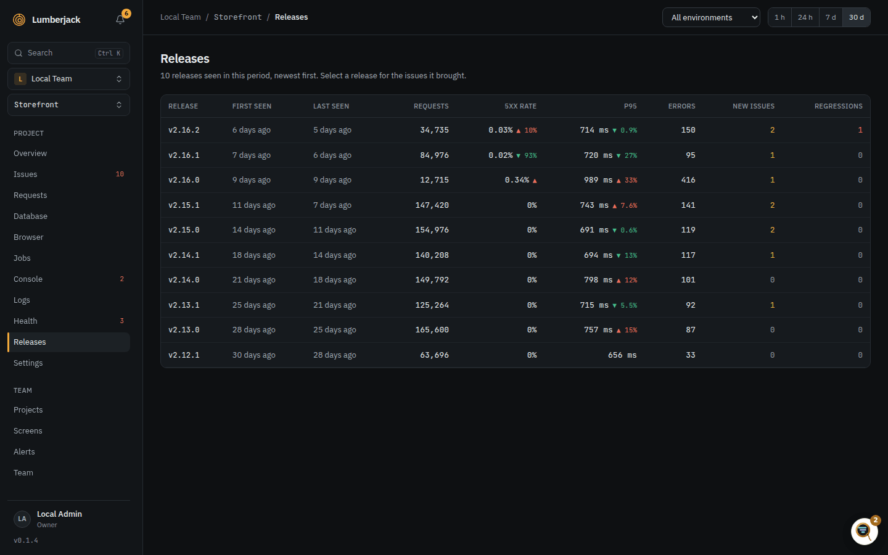
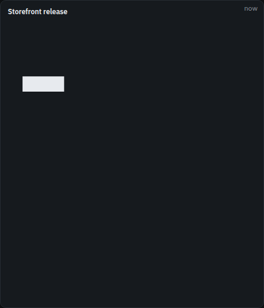

# Check whether a release went well

See whether a new release brought new errors, regressions, more server errors or slower
responses than the one before.

## 1. Report the release

Every request, error and job carries the release it ran on.

**Laravel SDK.** The package uses the current Git commit, or the commit Composer installed
`vendor` from when the deploy has no `.git`. To set it yourself, such as to a version
number (at most 64 characters), put it in the app's environment:

```dotenv
LUMBERJACK_RELEASE=v2.14.0
```

**Browser script.** Give the script tag the same release, so browser errors and Web
Vitals carry it too:

```html
<script
    src="https://lumberjack.example/sdk/v1.js"
    data-key="lj_pub_..."
    data-environment="production"
    data-release="v2.14.0"
    defer
></script>
```

The Laravel package's `@lumberjack` Blade directive fills in the release for you. See
[Projects](../projects.md) for the script's attributes.

**When it works:** the release shows on the project's **Releases** page once the first
requests on it come in.

## 2. Compare it with the release before

Open **Releases** in the sidebar. Every release seen in the period is a row, newest
first.



Read the new release's row against the one below it:

- **5xx rate** and **p95** have an arrow: red and up when worse, green and down when
  better.
- **New issues**: errors that first appeared on this release.
- **Regressions**: resolved issues that came back on this release.
- **Errors**: all error occurrences on this release.

Pick the environment at the top, and a short period such as 1 h to keep to the hours
around the deploy.

## 3. Look at what it broke

The release's detail lists **New issues in** that release. **Issues last seen in this
release** opens the issues list filtered to it; the list's **Release** filter does the
same for any of the 20 newest releases.

**When it went well:** no new issues, no regressions, and green or no arrows next to
the 5xx rate and p95.

## 4. Get told about new releases

To get a notification when a project reports a new release, click your name at the bottom
of the sidebar, then **Profile and settings**, then **Notifications**, and turn on the
**Releases** row.

New issues and regressions reach the team's channels through the **New issue** and
**Regression** alert rules. See [Get told when production breaks](./alerting.md).

## 5. Show the release on a status screen

On a [status screen](./status-tv.md):

- A **Stat** widget with **Current release** shows the release running now, how long it
  has been out, and its 5xx rate against the release before.
- Every data widget over a period has a **Release** setting under **Scope**: **All**,
  **Current only** or **Previous**, so two charts side by side can compare them.
- A **Chart** can **Split by** **Release**, one line per release.



## Reference

- [Releases](../releases.md): every column of the Releases page.
- [Issues](../issues.md): statuses, regressions and the issue page.
- [Widgets](../widgets.md): the Stat and Chart widgets and their scope.
