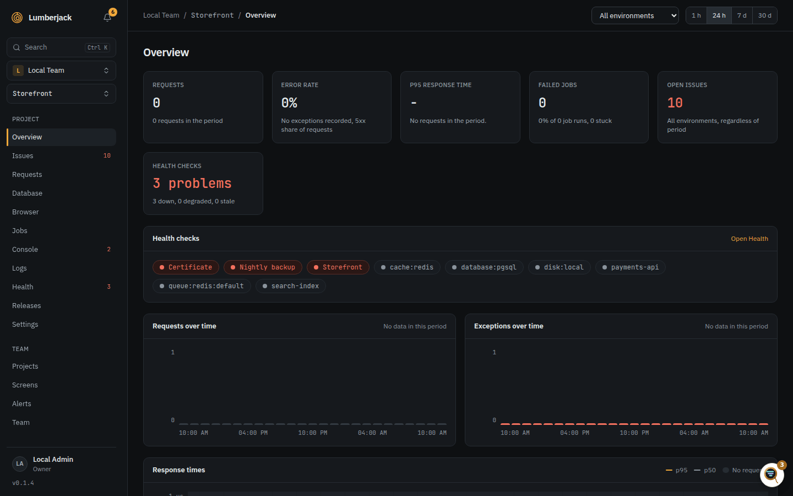
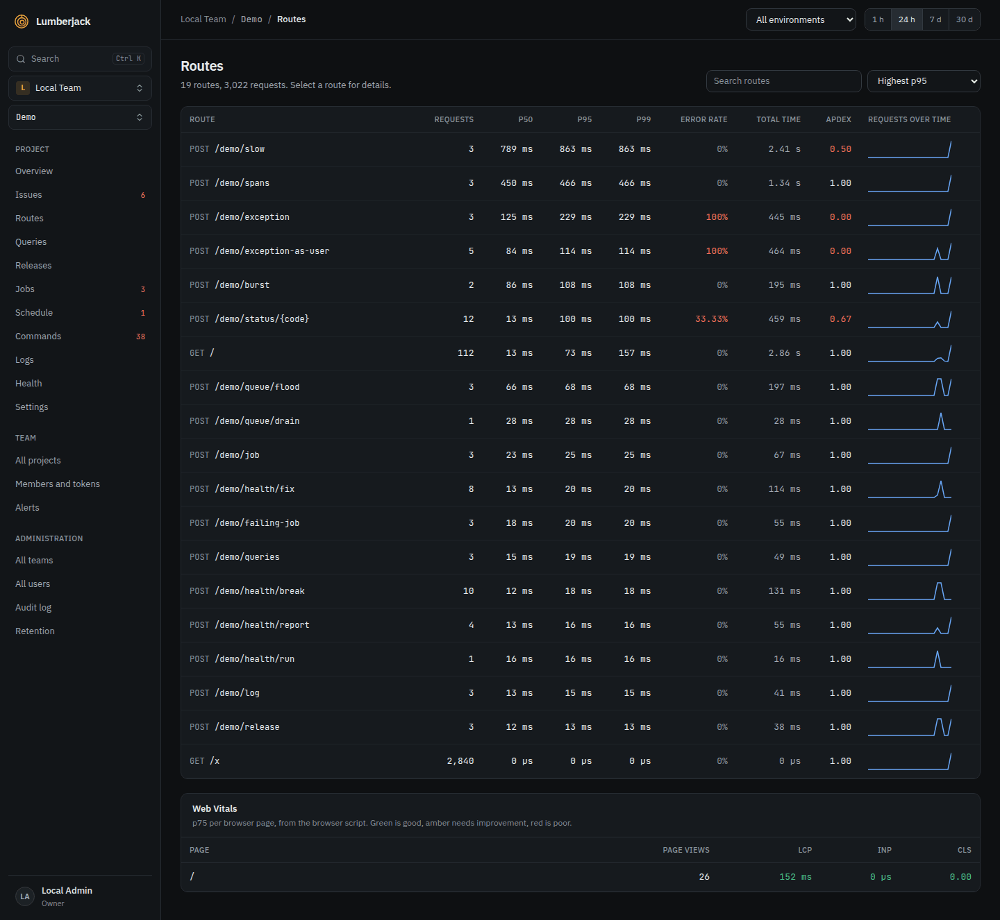
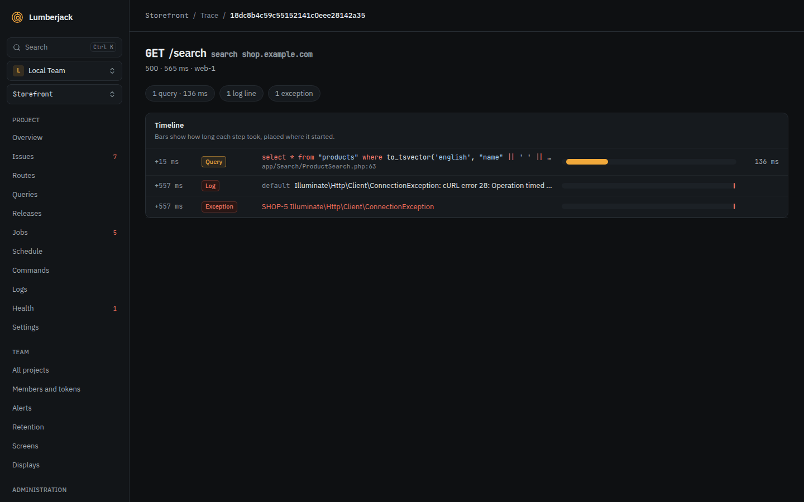
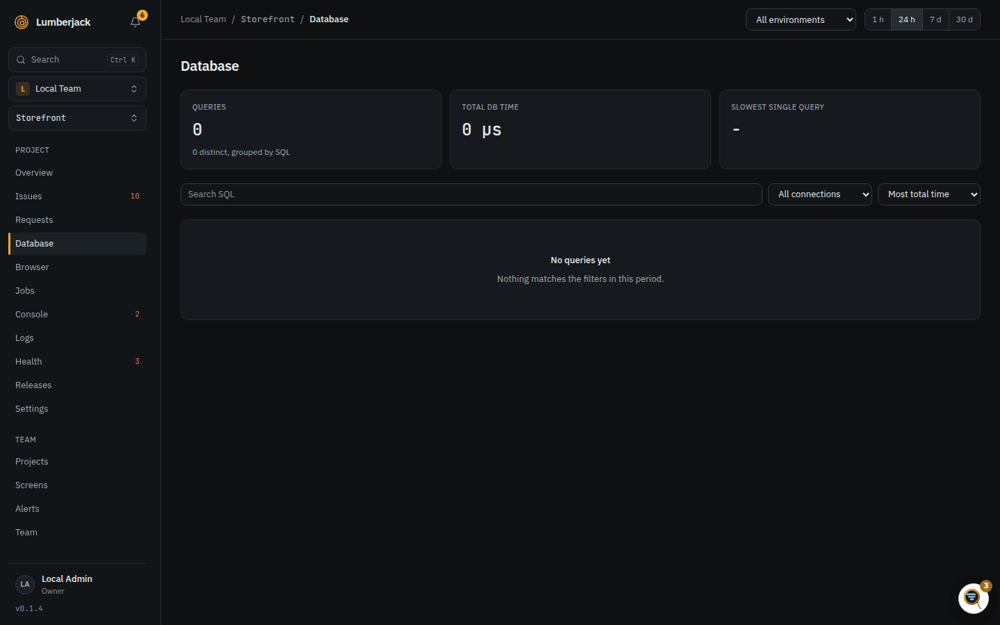

# Find out why a page is slow

Go from "the site feels slow" to the route, the request and the query that cause it.
Each step narrows it down.

Pick the **period** (1 h, 24 h, 7 d, 30 d) and the **environment** at the top of each
page. Pick `production` unless you are chasing a problem somewhere else.

## 1. Check the overview

Open the project's **Overview**. The p95 card shows how slow the slowest 5% of
requests are, with the p50 and p99 under it, and how it changed since the period
before. The response time chart shows when it got slow, and **Slowest routes (p95)**
lists the worst routes.

**What to look for:** a p95 that went up against the period before, or a jump in the
chart at a certain time. A jump right after a deploy points at a release: see
[Check whether a release went well](./releases.md).

## 2. Find the route

Open **Requests** in the sidebar. The table is sorted by **Highest p95**.

- Sort by **Most total time** to find the routes that cost the most overall: a route
  that is a bit slow but called all the time.
- Sort by **Lowest Apdex** to find the routes people wait on most.
- Type in **Search routes or names** to find one route, by URI or by name
  (`orders.show`).

Click a route. The detail shows its p50 and p95 over the period, its status codes,
and its **Slowest requests**, each with how many queries it ran.

**What to look for:** a request with hundreds of queries, or a p95 far above the p50.

## 3. Open a trace

Click the trace id of a slow request. The trace shows everything that request did on
one time axis: its queries, cache reads and writes, outgoing HTTP calls, mails,
notifications, log lines and exceptions. Each bar starts where the step started and is
as long as it took.

**What to look for:**

- One long bar: a slow query or a slow outgoing call.
- A long row of short, identical queries: an N+1.
- Many cache misses on a page that should be cached.
- Gaps with nothing in them: time spent in PHP itself.

The summary above the timeline counts the queries, outgoing calls, cache operations and
misses, so a busy request stands out at once.

## 4. Find the queries

Open **Database** in the sidebar. Queries are grouped by their SQL, so one query with
different values is one row.

- Sort by **Most total time** to find where the database spends its time.
- Sort by **Highest p95** to find the single slowest queries.
- **Most from** shows the line in your app that ran the query most often.

A query marked **N+1** ran 5 times or more in one request or job. The badge says how
many times per request. Fix it by loading the data at once, with eager loading.

## 5. Compare with before

- The overview cards compare every number with the period before. Switch the period
  to 7 d or 30 d to see a slow trend.
- **Releases** puts each release's p95 next to the one before it. A red arrow means it
  got worse.
- On a status screen, a **Chart** widget can **Overlay the previous period** behind the
  current one, and a **Stat** can **Compare with** the same time yesterday or last week.
  See [Widgets](../widgets.md).

## 6. Check what the visitor sees

Server time is only part of it. Open **Browser** in the sidebar to see Core Web Vitals
from real visitors: LCP, INP and CLS, by page and by device. A page with a fast server
but a poor LCP is slow in the browser. This needs the
[browser script](../projects.md) on your pages.

## When numbers are estimates

A busy app may record only a share of its requests. The pages then say **Estimated
from a 10% sample**, for example. Request counts and error rates stay exact. The
percentiles come from the sampled requests. See [Performance and traces](../performance.md).

## Reference

- [Performance and traces](../performance.md): every page, Apdex, sampling and traces.
- [Finding things](../finding-things.md): the search syntax and pasting a trace id in the
  command palette.
