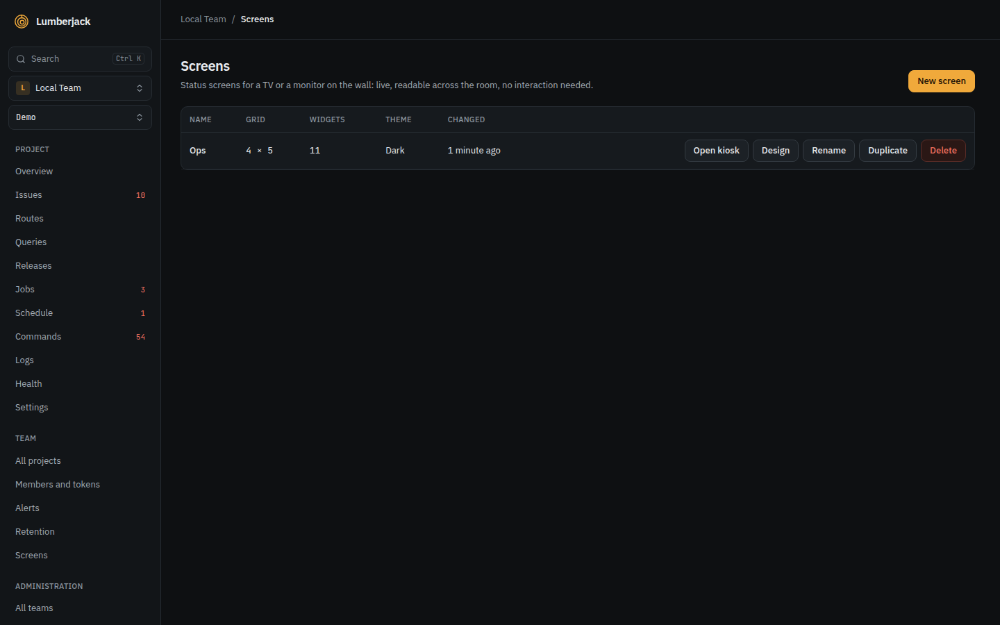
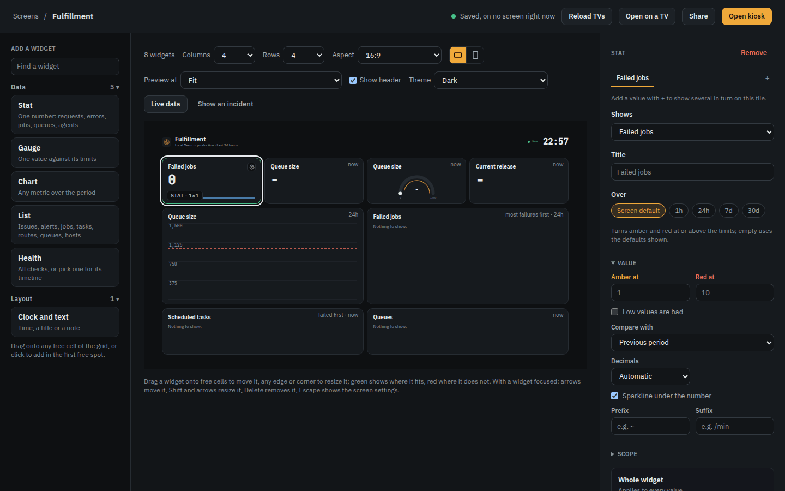
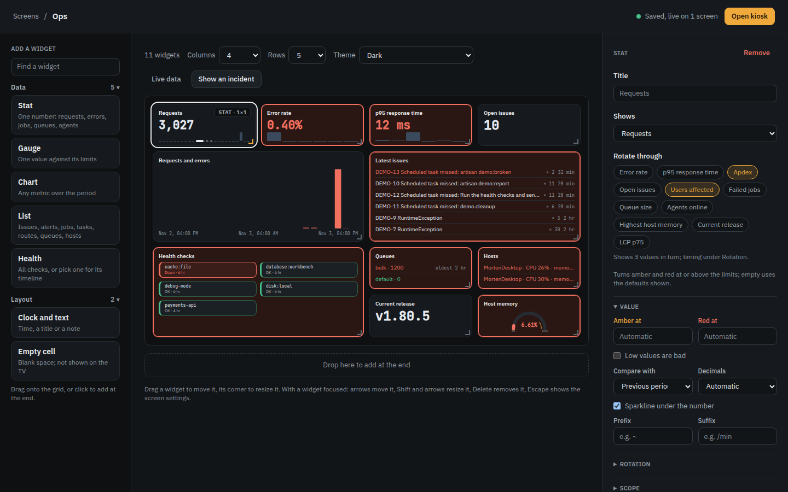
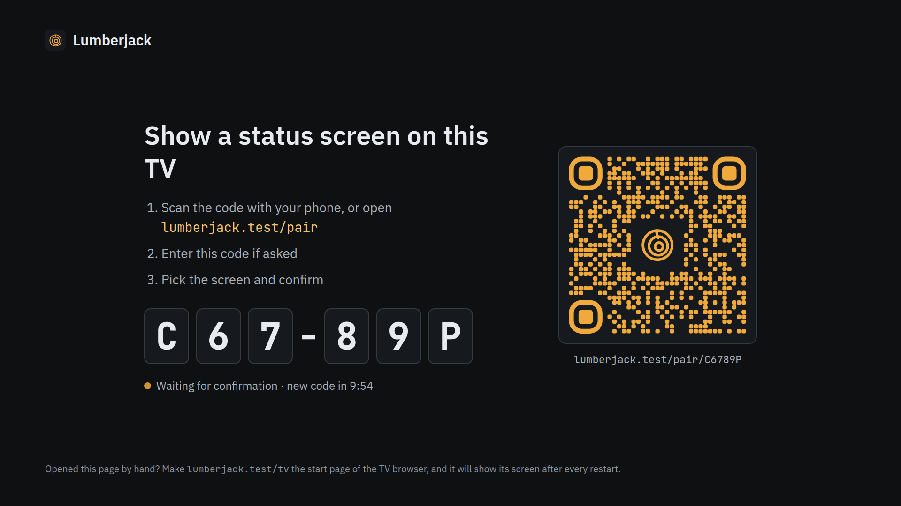
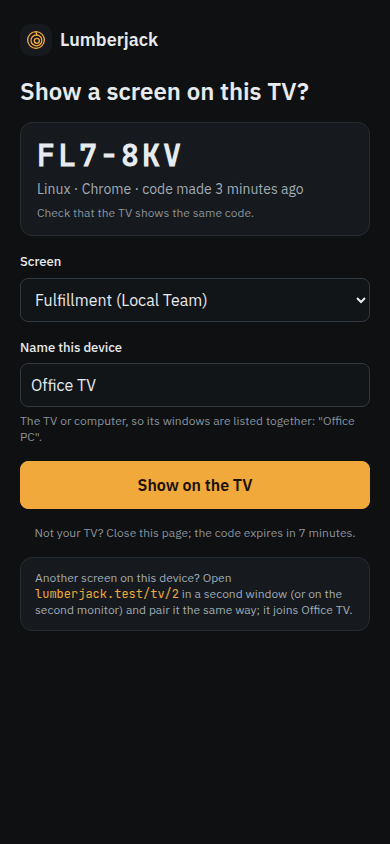
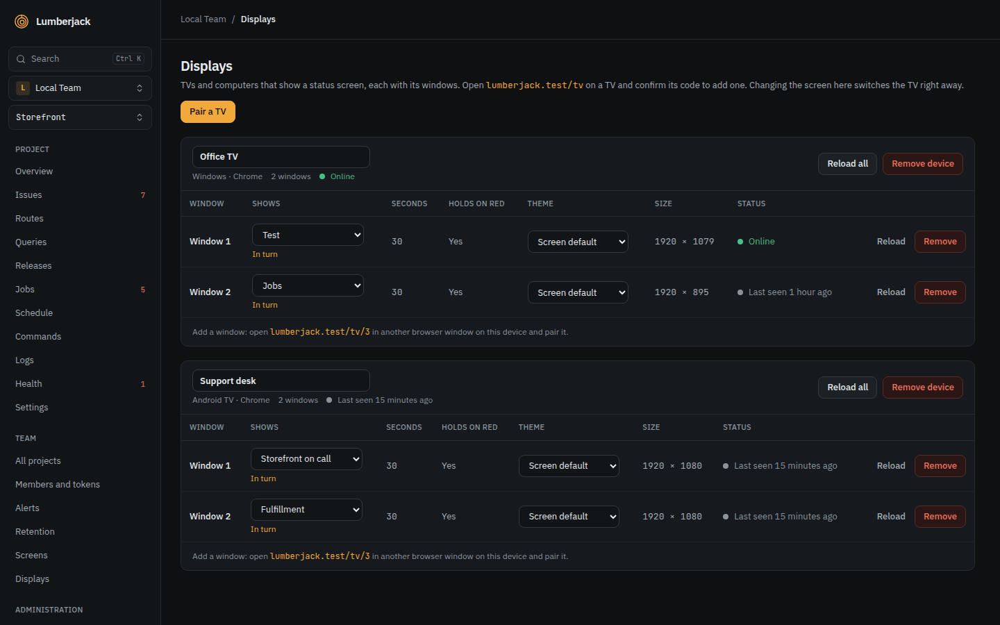

# Put a status screen on a TV

Show requests, errors, issues, queues and health checks on a TV in the office, live
and readable from across the room.

Every member can make and design screens. Pairing a TV and sharing a screen by link
need a team owner or admin.

## 1. Create a screen

1. Open **Screens** in the sidebar and click **New screen**.
2. Give it a name, such as "Ops", and pick a layout to start from:

    | Layout             | Shows                                                         |
    | ------------------ | ------------------------------------------------------------- |
    | Overview           | Traffic, errors, latency, issues, health, queues and hosts.   |
    | On call            | Errors, newest issues, failing checks and alerts.             |
    | Infrastructure     | CPU, memory and disk per host, agents and every health check. |
    | Jobs and schedules | Failed jobs, queue sizes and how scheduled tasks ran.         |
    | Empty              | An empty grid to fill yourself.                               |

    Templates your team saved show here too, marked **Saved by the team**.

3. The designer opens.

## 2. Add and arrange widgets

The designer has the widget types on the left, the screen in the middle and the
settings of the selected widget on the right.

1. Click the grid's background to open the screen's settings. Pick the **projects**,
   **environment** and **period** the widgets show, and set **Columns**, **Rows** and
   **Aspect** to match the TV.
2. Drag a widget type onto a free cell, or click it to add it in the first free spot.
   Drag a widget's edges to resize it.
3. Select a widget and pick what it shows under **Shows**: for example a **Stat** with
   **Error rate**, a **Chart** of **p95 response time**, a **List** of the newest issues,
   or a **Health** widget with your checks.
4. Set **Amber at** and **Red at** where the defaults do not suit you. A tile turns
   amber or red past them.

Every change saves itself, and every TV showing the screen follows within a second.

To see how the screen looks when things go wrong, click **Show an incident**. **Live
data** goes back to the real numbers.

## 3. Pair the TV

Nothing long is typed on the TV.

1. On the TV's browser, open `/tv` on your Lumberjack, for example
   `lumberjack.example.com/tv`. It shows a six character code and a QR code.
2. On your phone, scan the QR code, or open `/pair` and type the code. Sign in if
   asked.
3. Pick the screen, name the TV ("Office TV") and press **Show on the TV**.
4. The TV shows the screen at `/tv/1`. Make `/tv/1` the start page of the TV's browser,
   so it comes back after a restart.

**When it works:** the screen fills the TV, the header says it is live, and numbers
update by themselves. If Lumberjack cannot be reached, the screen says **Offline since**
and dims the numbers until it is back.

**Open on a TV** in the designer shows the same steps, and lets an admin put the screen
on an already paired TV with **Show here**.

## 4. Manage the TVs

**Screens > Displays** lists every paired TV, whether it is online, and what it shows.
For each window you can:

- switch it to another screen under **Shows**;
- show several screens **In turn**, 10 seconds to an hour each. A screen with something
  red stays until it clears;
- force a **Theme**, for a bright room;
- turn the picture for a TV hung sideways, under **Rotation**;
- **Identify** it, to tell TVs apart on a wall;
- **Reload** it.

One computer can drive up to nine windows, such as two monitors: open `/tv` in a second
window and click **Add another window**.

## 5. Share a screen by link

For a signage system that only takes a URL, use a share link instead of pairing:

1. In the designer, click **Share**, then **Share with a link**.
2. Copy the `/s/...` link. Anyone with it can see the screen without signing in.

Issue titles, alert channel names and health check messages are left out, unless you
tick **Show issue titles and names, not only counts**. **New link** replaces the link and
**Stop sharing** turns it off.

Prefer pairing where you can: a paired TV needs no link that could be passed on.

## Reference

- [Status screens](../screens.md): the designer, pairing, displays, share links,
  templates and export.
- [Widgets](../widgets.md): every widget and its settings.
