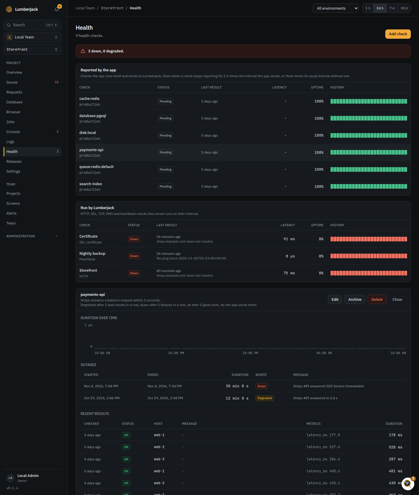

# Health

The **Health** page of a project shows whether the things your app depends on work:
its database, cache, queues and disks, the URLs people visit and their certificates.
Checks come from two places and work the same once a result is in.

| Source              | Where it runs                        | Set up                            |
| ------------------- | ------------------------------------ | --------------------------------- |
| Reported by the app | Inside the app, sent through ingest  | In the app, through its SDK       |
| Run by Lumberjack   | This server, on an interval you pick | On the Health page, **Add check** |

## Checks the app reports

The SDK runs checks inside the app and sends their results with the rest of its data.
See the SDK's documentation for registering and scheduling checks.

A check is known by its **slug** (`database:pgsql`, `disk:s3`, `queue:redis:default`)
within an environment. A new slug becomes a new check on its first result, with nothing
to set up in Lumberjack, shown under a name made from the slug (`queue:event-processing`
reads as **Queue: Event Processing**, `database:mysql` as **Database: MySQL**) until you give
it one. A slug uses lowercase letters, digits and `: . _ -`, at most
100 characters. A result with another slug or an unknown status is ignored.

Each result has a status (`ok`, `warning` or `failed`), a message, up to 20 numeric
metrics and how long the check took. The `latency_ms` metric is shown as the check's
latency.

A result may also carry `interval_minutes`, from 1 to 1440: send it when the check runs
less often than every minute. The Health page shows it next to the check
(**every 15 min**), and it sets when the check goes [stale](#stale-checks).

### Database metrics

A check that watches a database may send these metrics with each result:

| Metric            | Meaning                                |
| ----------------- | -------------------------------------- |
| `size_bytes`      | The database's size on disk, in bytes  |
| `connections`     | Connections open right now             |
| `max_connections` | Connections the database server allows |

The Health page shows them next to the latency (**13.8 MB · 4 of 100 conns**). They also
feed the database widgets of [status screens](./screens#widgets) and the `db_size`,
`db_connections` and `db_connections_used` series of the [metrics API](./metrics-api#series),
whatever the check's slug.

When several servers report the same slug, each server has its own state and the check
shows the worst of them. The row lists the hosts with their status, and the details
show each host's last result.

### Stale checks

A check that stops reporting shows as **stale** in gray, not as down. A check is stale
when no result came in for:

- 2.5 times its `interval_minutes`, when it sends one;
- otherwise 3 times its usual spacing;
- 15 minutes while its spacing is not known yet.

A stale check has no uptime and sends no alerts until its next result. Its strip turns
gray from its last result on, and the banner at the top counts stale checks next to the
down and degraded ones. **Archive** puts
away a check that will not report again, for example after you renamed its slug.

### Cleaning up

- **Hosts** that stop reporting a check, such as a replaced pod, are removed from it
  after 24 hours.
- **Reported checks** that sent nothing for 7 days are archived. An archived check that
  reports again comes back with its history.
- **Delete** in a check's details deletes it with its results and outages. If the app
  still runs it, it comes back as a new check, so remove it from the app first.

## Checks Lumberjack runs

**Add check** offers eight types. Each runs every 1, 5, 15 or 60 minutes and can have an
environment label. Only team owners and admins add, edit, archive and delete checks.

| Type              | Checks                                                                                                                                                                                                                                                                                                                                                                                                                                                                                                                                                                                                                                                                                                       |
| ----------------- | ------------------------------------------------------------------------------------------------------------------------------------------------------------------------------------------------------------------------------------------------------------------------------------------------------------------------------------------------------------------------------------------------------------------------------------------------------------------------------------------------------------------------------------------------------------------------------------------------------------------------------------------------------------------------------------------------------------ |
| HTTP              | A URL answers with the expected status, optionally with a text in the body. A JSON path can require a value in the response, so `status` must be `ok`. Warns when slower than a limit you set.                                                                                                                                                                                                                                                                                                                                                                                                                                                                                                               |
| SSL               | A host's certificate: warns a number of days before it expires and fails close to it.                                                                                                                                                                                                                                                                                                                                                                                                                                                                                                                                                                                                                        |
| TCP               | A port accepts a connection.                                                                                                                                                                                                                                                                                                                                                                                                                                                                                                                                                                                                                                                                                 |
| DNS               | A name has records of a type, optionally one with the value you expect.                                                                                                                                                                                                                                                                                                                                                                                                                                                                                                                                                                                                                                      |
| Heartbeat         | A dead man's switch: your cron job or backup calls a secret URL when it is done; the check fails when no call came within its interval plus a grace.                                                                                                                                                                                                                                                                                                                                                                                                                                                                                                                                                         |
| Domain expiry     | When a domain's registration runs out: warns a number of days before and fails close to it. Read from RDAP, or whois where the registry has no RDAP (`.dk`, `.io`, `.se`). Some registries publish no date (`.de`, `.eu`), and then the check fails and says so. Answers are kept for 6 hours.                                                                                                                                                                                                                                                                                                                                                                                                               |
| SMTP server       | Greets a mail server, checks that it answers and offers the encryption you chose, and verifies its certificate. Sends no mail. Many hosts block outgoing port 25, so prefer 587 or 465.                                                                                                                                                                                                                                                                                                                                                                                                                                                                                                                      |
| Data source value | A number from one of the project's [data sources](./data-sources) against a warn and a fail limit. A JSON or Prometheus source is read at a path after each fetch; a source from Umami, mosparo, GitHub, Vipps MobilePay or a connected app that answers with one number is read over a period (an hour, a day, 7 or 30 days) after each pull, and the check keeps that period pulled, as a screen showing it would. The check's own interval only notices a source no longer fetched in time: two of the source's fetch intervals and a minute, for a connected source two of its pulls and a minute. It fails when the fetch failed or there is no number, and records the value, so its history shows it. |

| Type              | Fields (default)                                                                                                                                                                                                                              |
| ----------------- | --------------------------------------------------------------------------------------------------------------------------------------------------------------------------------------------------------------------------------------------- |
| HTTP              | URL, method (GET, HEAD or POST; GET), expected status (200), body contains, JSON path and JSON value, warn when slower than (1 to 60,000 ms), timeout (1 to 15 s; 10)                                                                         |
| SSL               | Host, port (443), warn days before expiry (14), fail days before expiry (3)                                                                                                                                                                   |
| TCP               | Host, port, timeout (1 to 15 s; 5)                                                                                                                                                                                                            |
| DNS               | Name, record type (A, AAAA, CNAME, MX, TXT; A), expected value                                                                                                                                                                                |
| Heartbeat         | Grace (0 to 1,440 minutes; 5)                                                                                                                                                                                                                 |
| Domain expiry     | Domain, warn days before expiry (30), fail days before expiry (7)                                                                                                                                                                             |
| SMTP server       | Host, port, encryption (STARTTLS, TLS or None; STARTTLS), timeout (1 to 15 s; 10)                                                                                                                                                             |
| Data source value | Data source; path (a JSONPath, or a selector for Prometheus) for a fetched source, or period for a connected one; breached when the value is (>, >=, <, <=, =, !=; >), warn at, fail at. Without limits the source only has to give a number. |

Every check also has a description and the thresholds described under
[Status](#status), each from 1 to 100. The name is optional: without one, a check is named
from its settings, like **SSL: example.com** or **DNS: example.com (MX)**. A heartbeat has
nothing to be named from, and a data source check only a path or a period, so they need one.

A heartbeat check shows its ping URL and a `curl` line to copy. The URL takes `GET`
or `POST` without a body, at most 60 times a minute:

```bash
php artisan backup:run && curl -fsS -m 10 https://lumberjack.example.com/api/health/ping/...
```

### Private networks

HTTP, SSL and TCP checks only reach public addresses. A host that resolves to a
private, loopback, link-local or otherwise reserved address is rejected, in IPv4 and
IPv6. Redirects are followed up to three times, each checked the same way.

To watch internal services, turn this off:

```dotenv
LUMBERJACK_HEALTH_ALLOW_PRIVATE=true
```

## Status

A single bad result does not change a check's status. Three thresholds move it, each
counted per host:

- After **degrade after** (2) bad results in a row (warnings or failures) it is
  **degraded**.
- After **down after** (5) failed results in a row it is **down**. A warning in
  between restarts that count, so a check that only warns never goes down.
- On a good result after that it is **recovering**: still part of the outage. After
  **recover after** (5) good results in a row it is **ok** again. A bad result while
  recovering puts it back where it was, degraded or down.

A **down after** below **degrade after** counts as **degrade after**. Set both the same
to go straight from ok to down on failures.

A check that was ok, fails every minute and then passes again, with the defaults:

| Minute | Result | Status     |
| ------ | ------ | ---------- |
| 1      | failed | ok         |
| 2      | failed | degraded   |
| 3 to 4 | failed | degraded   |
| 5      | failed | down       |
| 6      | ok     | recovering |
| 7 to 9 | ok     | recovering |
| 10     | ok     | ok         |

It sends a degraded alert at minute 2, a down alert at minute 5 and a recovered alert
at minute 10. Recovering sends no alert.

Checks the app reports send their own thresholds. In the check's details you can
override them per slug; leave all three empty to use the app's again. The details also
hold a display name, a description and **mute**: a muted check is still shown but sends
no alerts.



### Outages and uptime

An **outage** starts when a check becomes degraded or down and ends when it is ok
again, so it stays open while the check is recovering. The details list the last 20
outages with their duration and worst status, the last 50 results and a chart of how
long the check took. Restore an archived check from the **Archived** list.

**Uptime** is the share of the period, picked at the top of the page, in which the
check was not down, counted from when the check was added. Degraded time counts as up;
recovering time counts as part of the outage. The strip on each row has one segment per
part of the period, colored by the worst status in it. Down time inside a
[maintenance window](#maintenance-windows) does not count, up to the window's expected
end; the outage is still listed, marked **Maintenance**.

### On the overview and sidebar

The project overview shows how many checks are ok, and every check as a chip, worst
first: down in red, degraded in amber, recovering in blue, stale and pending in gray.
Hover a chip for its last message. The sidebar counts the checks that are degraded or
down.

## Alerts

Three alert rules send health alerts. All are on by default, and each has its own
channels and environments:

| Rule                       | Sent when                                                   |
| -------------------------- | ----------------------------------------------------------- |
| **Health check degraded**  | A check keeps warning or starts failing                     |
| **Health check down**      | A check keeps failing, also when a degraded check goes down |
| **Health check recovered** | A check is ok again                                         |

The rules are independent: with **Health check degraded** off, the later down and
recovered alerts are still sent.

Each step for the worse is sent at once: ok to degraded, and degraded to down. Going
from recovering back to degraded or down is not a new alert. Muted and archived checks
send no alerts. See [Alerts](./alerts#webhooks) for the webhook body. During a
[maintenance window](#maintenance-windows), up to its expected end, checks are treated as muted.

## Maintenance windows

A maintenance window tells Lumberjack that an environment of the project is down on
purpose, for a deploy or planned work. A window covers one environment, or every
environment of the project when it has none. It comes from one of two places:

- **Planned**: **Plan maintenance** on the Health page, with the environment, start,
  planned end and an optional message, or over [MCP](./mcp). Planning one needs the right
  to change the project. A window planned wholly in the past is saved as ended, a record
  of maintenance that was.

Team admins change a window that has not ended with **Edit**, and end an open one with
**End now**, whether planned or reported. A planned window that has not started yet has
no **End now** and cannot be deleted; move it with **Edit**, or cancel it with the MCP
tool `end_maintenance_window`, which ends it where it would have started.

- **Reported by the app**: a `maintenance` event with `state` `start` or `end`, see
  [Ingest](./api#maintenance-events). The Laravel library sends them on `artisan down`
  and `artisan up` with no setup.

Only an `end` event or **End now** closes a window. An `end` closes only windows that
started before it, and a `start` older than the environment's last `end` (held back by the
agent, say) is ignored. Requests, heartbeats and good
results never do, and a window never closes on its own.

While a window is open:

- Health checks of its environment, and checks without an environment, are treated as
  muted until the window's expected end: no degraded, down or recovered alerts. On the
  first result after the window ends, or after its expected end, they alert as usual, so
  a check still down then sends its down alert.
- Queue backlogs of the project send nothing until the expected end: queues report no
  environment, so any window of the project mutes them.
- Every other alert is still sent, marked as sent during maintenance, see
  [Alerts](./alerts#maintenance).
- Errors that come in are flagged **Under maintenance**, see [Issues](./issues#the-issues-list).
- Down time does not count against uptime or the SLO widget, up to the expected end.

### Expected end and overrun

Each window has an expected end: a planned window's end, or for one the app reports,
its `expected_minutes` or `expected_until`, else the project's **Default maintenance
length** (30 minutes, in the project's [settings](./projects#settings)).

Once the expected end passes and the window is still open, it shows as **Overrun** and
the **Maintenance overrun** [alert rule](./alerts#rules) fires at once, with no grace
period. It repeats every **Repeat overrun alert** minutes (30 by default, in the
project's settings) until the window ends. Down time after the expected end counts
against uptime again. When the window ends after an overrun alert, one more message
says how long it ran over.

The windows show as bands on the project's charts, on the Releases page and in the
health history, and screens show **In maintenance** on the health and overview widgets.

## Reading states from the app

The app can read the state of its reported checks, for example to skip a broken
dependency. Lumberjack answers in two places, with the same body:

- **The agent's heartbeat.** `POST /api/ingest/heartbeat` answers with the states
  under `health`. An agent that sends `environment` gets the checks of that
  environment; without it, those of every environment.
- **`GET /api/health`**, with the server token as a bearer token, for apps without an
  agent. `?environment=` and `?slug=` narrow the list. A missing or unknown token gets
  a 401. More than 120 requests a minute per project get a 429.

```json
{
    "checks": [
        {
            "slug": "disk:s3",
            "environment": "production",
            "state": "down",
            "since": "2026-11-03T09:12:00+00:00",
            "message": "No space left on device",
            "hosts": [
                { "host": "web-1", "state": "ok" },
                { "host": "web-2", "state": "down" }
            ]
        }
    ],
    "at": "2026-11-03T09:15:04+00:00"
}
```

| Field         | Meaning                                                                                  |
| ------------- | ---------------------------------------------------------------------------------------- |
| `slug`        | The check's slug                                                                         |
| `environment` | Its environment, `null` for a check sent without one                                     |
| `state`       | `ok`, `degraded`, `down`, `recovering`, `stale` or `pending` (no result yet)             |
| `since`       | When it entered the state; for `stale`, its last result. `null` when nothing came in yet |
| `message`     | The latest result's message, `null` when it had none                                     |
| `hosts`       | Only when several servers report the slug: each server's own state                       |
| `at`          | When the answer was made                                                                 |

Only checks the app reports are listed, without archived ones.

## Limits

| What                                | Limit                                                                  |
| ----------------------------------- | ---------------------------------------------------------------------- |
| Checks Lumberjack runs, per project | 50. Set `LUMBERJACK_HEALTH_MAX_CHECKS` to change it                    |
| Timeout of a check                  | 15 seconds                                                             |
| Body an HTTP check searches         | The first megabyte                                                     |
| Metrics per reported result         | 20                                                                     |
| Heartbeat pings                     | 60 a minute                                                            |
| `GET /api/health`                   | 120 requests a minute per project                                      |
| Kept results and outages            | 14 days and 365 days by default, see [retention](./projects#retention) |
