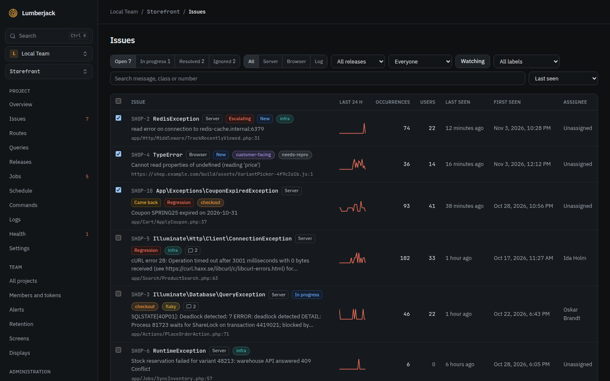
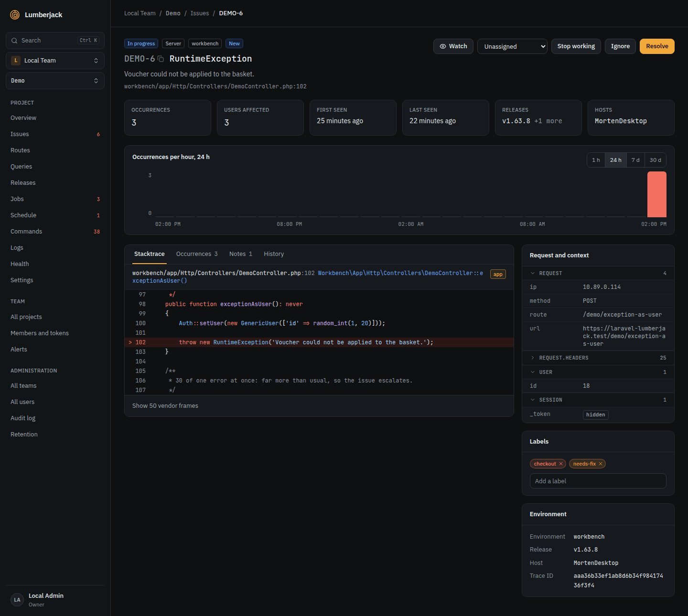
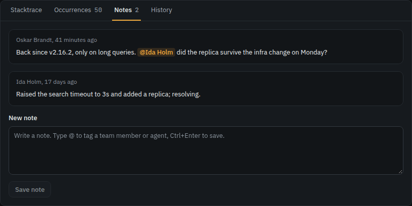

# Issues

An issue collects every occurrence of one error. Every exception, browser error, failed
job, failed or missed scheduled task, failed command and error log line becomes an
issue.

## Grouping

| Source  | Grouped by                                                |
| ------- | --------------------------------------------------------- |
| Server  | The exception class or title, and the first in-app frame. |
| Browser | The error's title, its message and the top frame.         |
| Log     | The log channel and the message.                          |

IDs and numbers in messages are ignored, so `Order 4711 not found` and
`Order 4712 not found` are one issue. A fingerprint sent by the SDK overrides all of
this.

A bundler puts a hash in the bundle's file name, so the top frame of a browser error
changes with every build. With the build's [source maps](./projects#source-maps)
uploaded, the frames are turned back into the original source before grouping, and the
same error stays one issue across deploys. Errors received before their map was
uploaded keep their minified frames.

Only log lines of level **error** and above become issues. A line whose context carries
an exception becomes a Server issue; any other becomes a Log issue titled
`<channel>: <message>`, cut to 200 characters.

## The issues list

| Filter   | Choices                                                                               |
| -------- | ------------------------------------------------------------------------------------- |
| Status   | Open (the default, includes in progress), In progress, Resolved, Ignored, with counts |
| Source   | All, Server, Browser, Log                                                             |
| Release  | Up to 20 releases. Matches the release of the issue's latest occurrence               |
| Label    | One of the project's labels                                                           |
| Assigned | Everyone, Assigned to me, Unassigned                                                  |
| Watching | Only the issues you [watch](#watching)                                                |
| Search   | Message, class or [number](#issue-numbers)                                            |

Sort by **Last seen** (the default), **Most occurrences**, **Most users** or **First
seen**. Each issue shows its occurrences of the last 24 hours as a small chart, its
notes count, and the flags **New**, **Regression**, **Escalating** and **Came back**.

## Issue numbers

Each issue gets a number made of the project's prefix and a counter, like `DEMO-42`.
You choose the prefix when you create the project and can change it in the project
settings. Changing it renames every issue of the project; notes and repository issues
that mention the old number keep it.

The number has a copy icon on the issue page, and works in the
[command palette](./finding-things#the-command-palette), in the issues search
(`DEMO-42`, `#42` or `42`) and in every MCP tool that takes an issue.

## The issue page

The top shows the occurrences, users affected, first and last seen, releases and hosts.
Below the chart are the tabs **Stacktrace**, **Occurrences** (each with its request,
user, environment, release, host and a link to its trace), **Notes** and **History**.
The left and right arrow keys move between tabs.

**Copy as Markdown** puts the issue on the clipboard with its details, the latest occurrence
with stacktrace and context, the notes and the history, ready to paste to an agent that
cannot reach Lumberjack over [MCP](./mcp.md).

## The stacktrace

Each frame shows the lines around it, highlighted as PHP, JavaScript or TypeScript, with
the line that threw marked. Vendor frames are folded until you show them.

A browser frame turned back into the original source by a
[source map](./projects#source-maps) shows the original file, line and function, and
the source lines when the map has them. Files under `node_modules` count as vendor.
**Show minified frames** shows the frames as they were in the bundle.

## Users affected

Each issue counts the signed-in users it happened to. A server SDK sends the user with
each error; the browser script takes it from `data-user` or `Lumberjack.setUser()`. The
list can sort by users, and alerts include the count.

## Request and context

The latest occurrence's request, session and other context sit beside the stacktrace,
one table per object with its keys sorted. A table with more than 8 rows starts folded.

## The chart

| Period            | One bar per |
| ----------------- | ----------- |
| 1 hour            | 2 minutes   |
| 24 hours, default | hour        |
| 7 days            | 6 hours     |
| 30 days           | day         |

A link to the page keeps the period.

## Statuses

| Status      | Means                                                    |
| ----------- | -------------------------------------------------------- |
| Open        | Needs attention.                                         |
| In progress | Someone is working on it. Still counts as open.          |
| Resolved    | Fixed. A new occurrence re-opens it as a **regression**. |
| Ignored     | Does not matter, for good or until a condition is met.   |

Resolving or ignoring takes an optional comment, saved as a note with `@` tags. Ignoring
asks when the issue may come back:

- **When it escalates** (the default),
- in 1 hour, 24 hours or 7 days,
- after 10, 100 or 1,000 more occurrences,
- never.

Ignoring several issues from the list always uses the default.

An ignored issue that comes back is open again, flagged **Came back**, and its history
says why. It counts as a regression and sends the **Regression** alert.

## Escalation

An open or in-progress issue escalates when it has at least 10 occurrences in 5 minutes,
and at least 5 times its usual rate for 5 minutes over the day before. It is flagged
**Escalating** for an hour, its history records the burst and the **Escalation** alert
rule fires. An ignored issue set to come back when it escalates comes back instead.

## Working on an issue

- **Assignee:** any member of the team. Whoever is assigned or taken off gets a mail,
  and a toast if Lumberjack is open, naming who did it: a person or an MCP token. Turn
  either off under [Notifications](./teams#notifications). You are not told about your
  own changes. Resolving unassigns the issue and tells the assignee unless they
  resolved it. Ignoring keeps the assignee. A regression comes back unassigned. A bulk
  action sends each person one message for all the issues it touched.
- **Labels:** type a new name on the issue to create a label; it takes the next color
  of gray, red, orange, yellow, green, teal, blue and purple. Rename, recolor or delete
  labels in the project settings.
- **Notes:** free text for the team. Type `@` to tag a team member or an MCP agent, and
  pick with the arrow keys and `Enter` or `Tab`. `Ctrl+Enter` (`⌘+Enter` on a Mac)
  posts the note. Agents write notes too, such as their triage result.
- **GitHub issue:** with a [linked repository](./projects#repository-integration),
  **Create GitHub issue** opens one with the stacktrace, environment, occurrence count
  and a link back.
- **History:** first seen, every status change with its note, assignment, label change,
  regression, escalation, return of an ignored issue and GitHub issue, with who did it.

Every member of the team can work on issues. **Start working** sets an issue in progress
and assigns you; **Stop working** sets it back to open.

Select up to 100 issues on the list to:

- **Resolve**, **Ignore** or **Re-open** them, after a confirmation. Resolving or
  ignoring sends one [status change alert](./alerts#resolved-or-ignored) for all of them.
- **Assign** them to a member, to yourself (**Me**) or to nobody (**Unassign**).
- **Label** them: add or remove one of the project's labels.
- **Start working** on them: they go in progress, and the unassigned ones are assigned
  to you.
- **Watch** them, see [Watching](#watching).

## Watching

**Watch** on the issue page starts watching, **Stop watching** stops; the faces beside
it show who watches. **Watch** in the list's selection bar watches the selected issues.
Agents use `watch_issue` and `unwatch_issue` over [MCP](./mcp#tools), for the person the
token belongs to.

You start watching an issue by yourself when you are assigned to it, write a note on
it, are tagged in a note on it, or resolve or ignore it. Once you stop watching, only
**Watch** makes you watch it again.

What watchers hear about other people's actions:

- **A regression or an escalation:** a mail right away, like the alert.
- **Notes, status changes (in progress and re-opened too) and assignee changes:** grouped. The first update starts a 5
  minute window, and at its end one mail lists who did what and when, with the notes
  and comments quoted. A single update gets its own subject, such as "Sofie wrote a
  note on DEMO-12".

Each also shows a toast if Lumberjack is open, and a browser notification where you
turned those on. Choose the ways under [Notifications](./teams#notifications).

Every watching mail has a **Stop watching** link that works without signing in, and
supports one-click unsubscribe.

### One mail per thing that happened

You get at most one mail about one thing that happened, however many reasons you have
to hear of it. A mention or an assignment comes first, then watching, then an alert
rule's mail channel. The footer lists every reason, such as "you watch DEMO-12 and the
Regression rule of Ops Team sends to the mail channel Ops". The alert summary of a bulk
resolve or ignore replaces your watching mail. Chat channels still get their own
message.

## Limits

| What                    | Limit             |
| ----------------------- | ----------------- |
| Issues per list page    | 25                |
| Issues selected at once | 100               |
| Note length             | 20,000 characters |
| Label name              | 32 characters     |
| Labels per issue        | 10                |
| Project prefix          | 2 to 8 characters |
