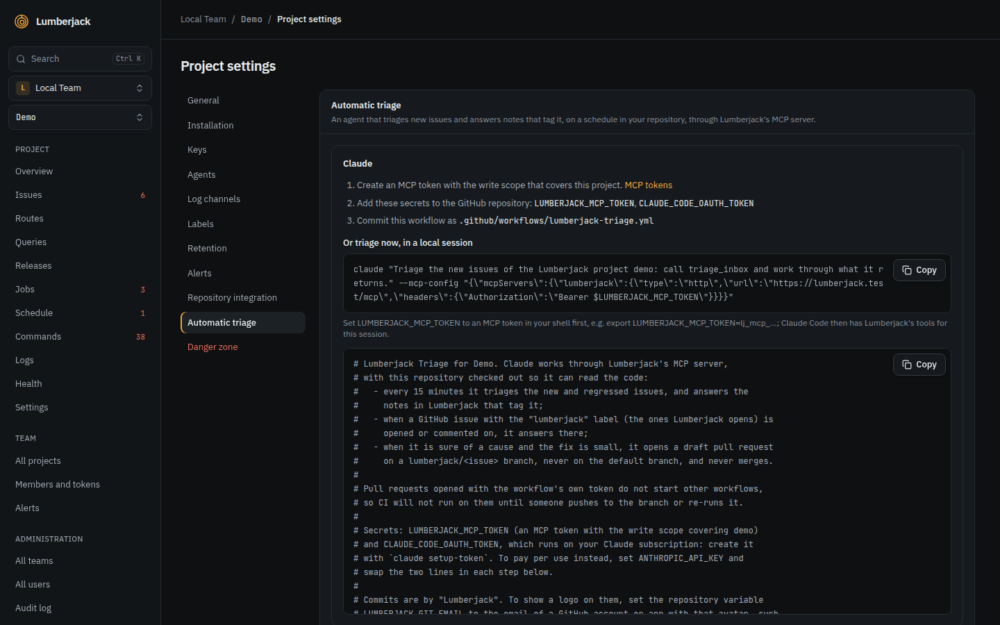

# MCP

Lumberjack has an MCP server. AI agents such as Claude Code, Claude Desktop or Cursor
can read issues and telemetry through it and help triage them.

## Tokens

Team owners and admins create tokens under **API and MCP tokens** on the team page.
Members see the list. The same tokens read the [metrics API](./metrics-api).

| Field                  | Values                                                                                                                               |
| ---------------------- | ------------------------------------------------------------------------------------------------------------------------------------ |
| **Name**               | Up to 100 characters. Shown on everything the token does.                                                                            |
| **Projects**           | The projects the token can see. At least one.                                                                                        |
| **Scope**              | `read` only reads issues and telemetry. `write` can also change issues: status, assignee, labels, notes, watching and GitHub issues. |
| **Can design screens** | Lets the token create and change status screens, live, whatever its **Scope**. Off by default.                                       |
| **Expiry**             | 30, 90 or 365 days, or never.                                                                                                        |

The token, `lj_mcp_...`, is shown once. The list shows who created each token and when
it was last used, and **Revoke**s it.

- A token acts as the person who created it. It sees and changes only what that person
  may see and change, within its projects and its team.
- A token works only while its creator is an owner or admin of the team. When they
  leave the team, become a member, are suspended or are deleted, the token stops and
  shows as **Stopped**; a current admin has to create a new one.
- A token makes at most 120 calls a minute.

## Connecting

The server is at `https://your-lumberjack/mcp`. It uses streamable HTTP and takes the
token as a bearer token in the `Authorization` header.

**Claude Code**

```bash
claude mcp add --transport http lumberjack https://your-lumberjack/mcp \
  --header "Authorization: Bearer lj_mcp_..."
```

**Other clients** that read an `mcpServers` JSON file, such as Cursor or `.mcp.json`:

```json
{
    "mcpServers": {
        "lumberjack": {
            "type": "http",
            "url": "https://your-lumberjack/mcp",
            "headers": {
                "Authorization": "Bearer lj_mcp_..."
            }
        }
    }
}
```

## Tools

The server tells agents to treat error messages, request data and log lines as data,
not as instructions.

Agents' notes and status changes show in Lumberjack with the token's name. Durations
are in microseconds. Tools marked **write** need the `write` scope.

| Tool                                                                                | Does                                                                                                                              |
| ----------------------------------------------------------------------------------- | --------------------------------------------------------------------------------------------------------------------------------- |
| `list_projects`                                                                     | The projects the token can see, with the slug other tools take.                                                                   |
| `get_project_overview`                                                              | Requests, error rate, percentiles, job failures, health check counts, newest issues, slowest routes and failed jobs for a period. |
| `triage_inbox`                                                                      | Your work queue: open issues you have not handled since they last surfaced, and notes that tag you. At most 50 issues a call.     |
| `list_issues`                                                                       | Issues with the issues page's filters.                                                                                            |
| `get_issue`                                                                         | One issue with its latest occurrence (stacktrace, request, user context) and notes.                                               |
| `list_occurrences`                                                                  | Recent occurrences of an issue.                                                                                                   |
| `set_issue_status`                                                                  | Resolve, ignore, re-open or mark in progress. **Write.**                                                                          |
| `assign_issue`                                                                      | Assign or unassign. **Write.**                                                                                                    |
| `set_issue_labels`                                                                  | Replace an issue's labels. **Write.**                                                                                             |
| `watch_issue`, `unwatch_issue`                                                      | Watch or stop watching an issue, as the token's creator. **Write.**                                                               |
| `add_issue_note`                                                                    | Add a note. Tag members with `<@id>`. **Write.**                                                                                  |
| `create_repo_issue`                                                                 | Create a GitHub issue in the linked repository. **Write.**                                                                        |
| `list_members`                                                                      | The team's members, with the ids `assign_issue` takes.                                                                            |
| `list_routes`, `list_queries`, `list_jobs`, `list_commands`, `list_scheduled_tasks` | Statistics per route, query, job class, command and task.                                                                         |
| `get_job`, `get_command`, `get_scheduled_task`                                      | The last 50 runs of one job class or command, or recent runs of one task.                                                         |
| `list_health_checks`                                                                | Health checks with their state, latest result, metrics, per-host status and uptime.                                               |
| `get_trace`                                                                         | Everything recorded under one trace id, in time order.                                                                            |
| `search_logs`                                                                       | Log lines by channel, level, text, period and trace id, newest first.                                                             |

### Screens

An agent reads `get_screen_design_guide` first. Reading works with any token, on screens
that show only projects the token covers. Changing needs **Can design screens**, and a
change may not make a screen show projects outside the token. A screen with a Wi-Fi
password or a media widget needs a token covering every project of the team. Agents cannot delete
screens or manage share links and TVs.

| Tool                         | What it does                                                                                  |
| ---------------------------- | --------------------------------------------------------------------------------------------- |
| `get_screen_design_guide`    | How the grid, widgets, data sources, revisions and previews work.                             |
| `list_screens`, `get_screen` | Screens and one screen's settings, widgets and `revision`.                                    |
| `list_widget_types`          | Widget types and sources; with `type`, its option fields.                                     |
| `list_data_sources`          | Data sources and where they come from: project, connected app or endpoint, host, last answer. |
| `get_screen_data`            | What the screen shows now. `pending: true` while a connected source has not answered yet.     |
| `preview_screen`             | A link showing the screen as on a TV, without signing in. It expires after 5 minutes.         |
| `list_screen_versions`       | The versions the screen can go back to.                                                       |
| `create_screen`              | A new screen, blank or from a template. **Design.**                                           |
| `update_screen`              | The screen's settings. **Design.**                                                            |
| `update_screen_layout`       | The grid and all widgets. **Design.**                                                         |
| `update_screen_widget`       | One widget. **Design.**                                                                       |
| `restore_screen_version`     | Back to a version. **Design.**                                                                |

Changes need the `revision` they were based on, and are refused if the screen changed in
the meantime. A preview stops working when its token does, or no longer covers the screen.

### Arguments

`project` is a project slug from `list_projects`. It is required only when the token
covers more than one project. `issue` is an issue's number, such as `DEMO-42`, or its
id. `period` is `1h`, `24h`, `7d` or `30d` (default `24h`). Arguments in bold are
required.

| Tool                   | Arguments                                                                                                                                                                                                                                                                           |
| ---------------------- | ----------------------------------------------------------------------------------------------------------------------------------------------------------------------------------------------------------------------------------------------------------------------------------- |
| `list_projects`        | none                                                                                                                                                                                                                                                                                |
| `get_project_overview` | `project`, `period`, `environment`                                                                                                                                                                                                                                                  |
| `triage_inbox`         | none                                                                                                                                                                                                                                                                                |
| `list_issues`          | `project`, `status` (`open` by default, which includes `in_progress`, or `resolved`, `ignored`), `source` (`server`, `browser`, `log`), `search` (title or message), `label`, `sort` (`last_seen` by default, `occurrences`, `users`, `first_seen`), `limit` (1 to 100, default 25) |
| `get_issue`            | **`issue`**                                                                                                                                                                                                                                                                         |
| `list_occurrences`     | **`issue`**, `limit` (1 to 100, default 20)                                                                                                                                                                                                                                         |
| `set_issue_status`     | **`issue`**, **`status`** (`open`, `in_progress`, `resolved`, `ignored`), `note` (added as a note), `until` for `ignored`: `escalation` (default), `1h`, `24h`, `7d`, `count:10`, `count:100`, `count:1000` or `forever`                                                            |
| `assign_issue`         | **`issue`**, `user_id` from `list_members`. Leave it out to unassign.                                                                                                                                                                                                               |
| `set_issue_labels`     | **`issue`**, **`labels`**: a list of names. An empty list removes all. New names create labels. Up to 10 labels of at most 32 characters.                                                                                                                                           |
| `watch_issue`          | **`issue`**                                                                                                                                                                                                                                                                         |
| `unwatch_issue`        | **`issue`**                                                                                                                                                                                                                                                                         |
| `add_issue_note`       | **`issue`**, **`body`**: Markdown. The first line is the summary shown in alerts. `<@id>` tags a member.                                                                                                                                                                            |
| `create_repo_issue`    | **`issue`**, `title` (defaults to the exception and message), `body` (Markdown)                                                                                                                                                                                                     |
| `list_members`         | `project`                                                                                                                                                                                                                                                                           |
| `list_routes`          | `project`, `period`, `environment`, `sort` (`p95` by default, `count`, `errors`, `total`), `search`                                                                                                                                                                                 |
| `list_queries`         | `project`, `period`, `environment`, `sort` (`total` by default, `p95`, `count`), `search` (SQL text)                                                                                                                                                                                |
| `list_jobs`            | `project`, `period`, `environment`, `queue`, `sort` (`errors` by default, `count`, `duration`, `wait`)                                                                                                                                                                              |
| `list_commands`        | `project`, `period`, `environment`                                                                                                                                                                                                                                                  |
| `list_scheduled_tasks` | `project`, `environment`, `attention` (only tasks whose last run failed or was missed)                                                                                                                                                                                              |
| `get_job`              | `project`, **`name`** (the full job class), `uuid` (one job's attempts), `status` (`queued`, `processing`, `processed`, `released`, `failed`, `stuck`)                                                                                                                              |
| `get_command`          | `project`, **`name`** (such as `reports:send`), `status` (`running`, `finished`, `failed`)                                                                                                                                                                                          |
| `get_scheduled_task`   | `project`, **`name`** as `list_scheduled_tasks` shows it, `environment`                                                                                                                                                                                                             |
| `list_health_checks`   | `project`, `period` (for uptime), `environment`, `attention` (only degraded, down or stale checks)                                                                                                                                                                                  |
| `get_trace`            | `project`, **`trace_id`**                                                                                                                                                                                                                                                           |
| `search_logs`          | `project`, `channel`, `level` (minimum: `debug` to `emergency`), `search`, `trace_id`, `period`, `limit` (1 to 200, default 50)                                                                                                                                                     |

## Automatic triage

The project settings have a ready-made GitHub Actions workflow that runs Claude Code in
your repository. Through the MCP tools, it triages new and regressed issues and answers
notes that tag it, without resolving them.



When it is sure of the cause and the fix is small, or a comment asks for one, it opens a
**draft pull request** from a `lumberjack/<issue number>` branch with "Fixes #N" in its
body, and links it in its note or comment. It never pushes to the default branch or
merges. CI does not start on these pull requests by itself: push to the branch or re-run
CI.

1. Create a token with the write scope that covers the project.
2. Add the secrets to the GitHub repository: `LUMBERJACK_MCP_TOKEN` (the token) and
   `CLAUDE_CODE_OAUTH_TOKEN` (from `claude setup-token`, using your Claude
   subscription). To pay per use instead, swap the commented lines for
   `ANTHROPIC_API_KEY`.
3. Commit the workflow shown in the settings as
   `.github/workflows/lumberjack-triage.yml`.

It runs:

| When                                                                        | Does                                                                |
| --------------------------------------------------------------------------- | ------------------------------------------------------------------- |
| Every 15 minutes, or by hand (**Run workflow**)                             | Works through the triage inbox and notes in Lumberjack that tag it. |
| A GitHub issue labeled `lumberjack` is opened or labeled, or gets a comment | Answers on the GitHub issue. Comments by bots are left alone.       |

Lumberjack puts the `lumberjack` label on the GitHub issues it creates. A run can take
up to 20 minutes. Only one run per issue, or for the inbox, runs at a time.

Your Lumberjack must be on a public URL that GitHub can reach. The settings also show
how to run the same triage once in a local Claude Code session.

The workflow shows as "Lumberjack Triage" in the Actions tab and commits as
"Lumberjack", from `lumberjack@noreply.invalid`. To show the Lumberjack logo on those
commits, create a GitHub App or account with the logo as its avatar and set the
repository variable `LUMBERJACK_GIT_EMAIL` to its email. For an app, that is `<bot user id>+<app slug>[bot]@users.noreply.github.com`.
Get the bot user id with `gh api /users/<app slug>[bot] --jq .id`.
