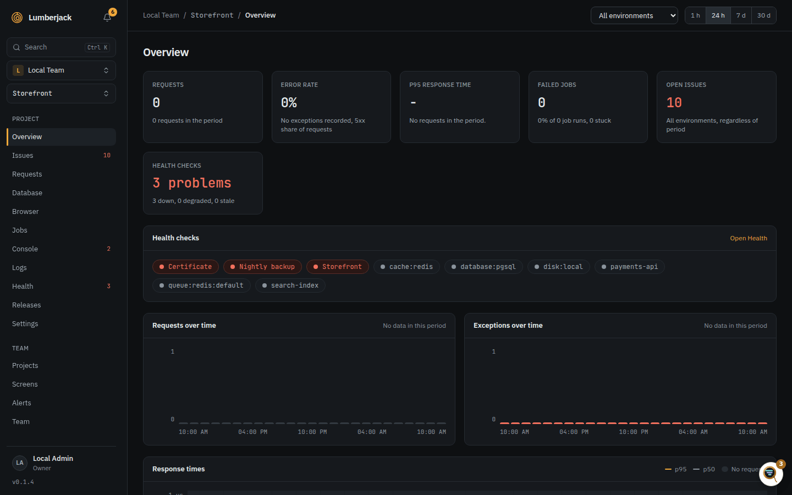
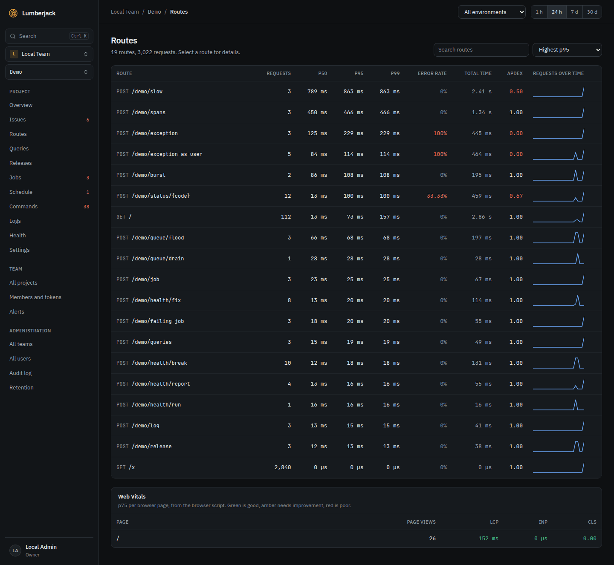
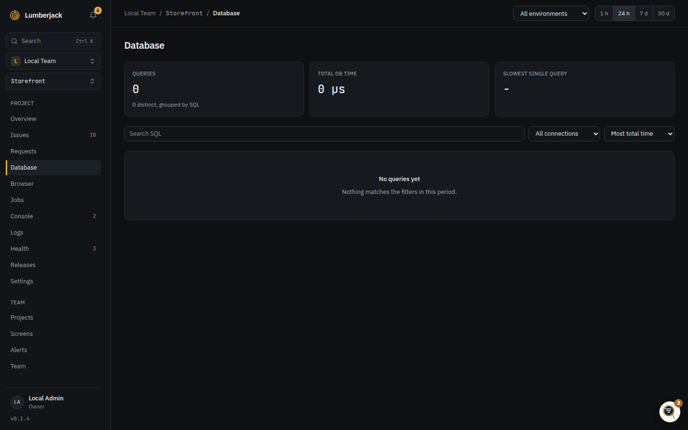
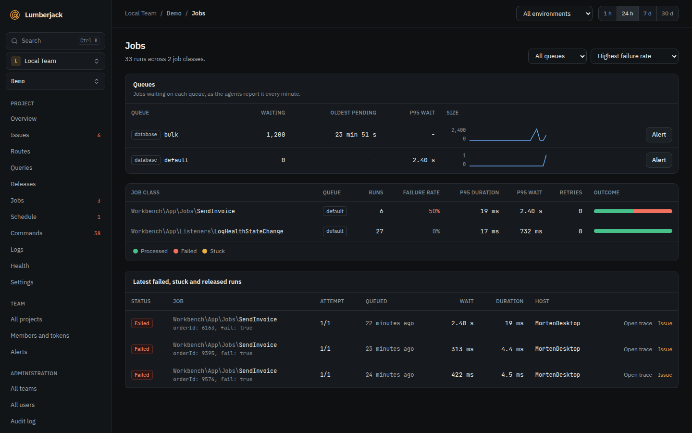
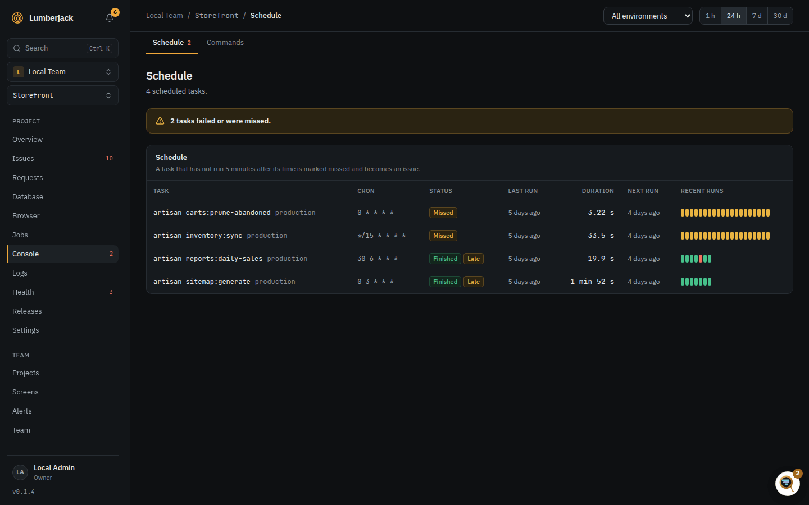
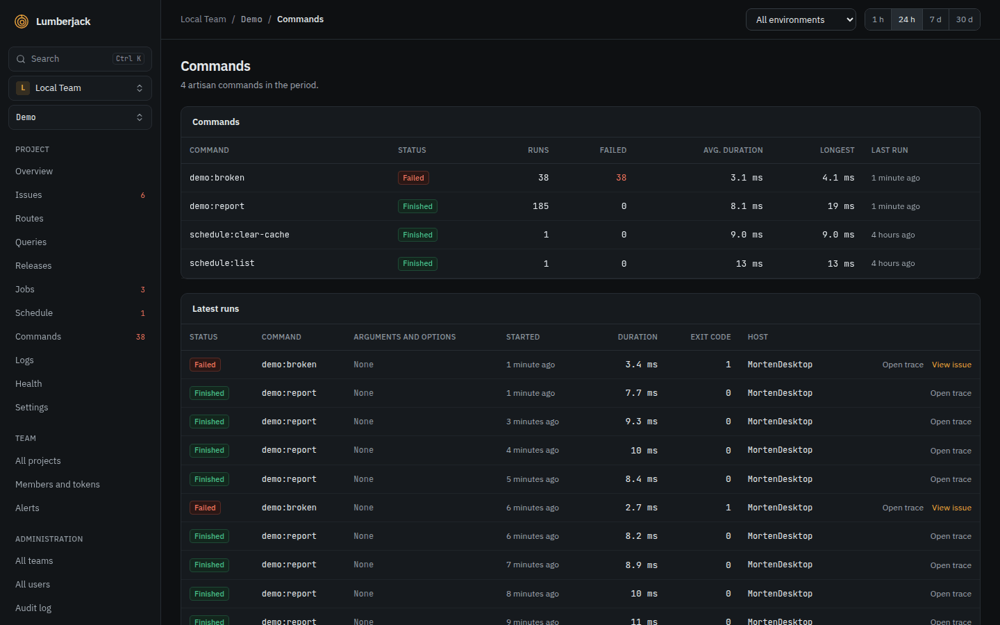
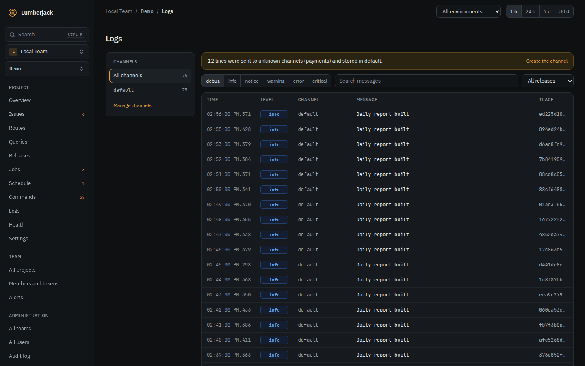
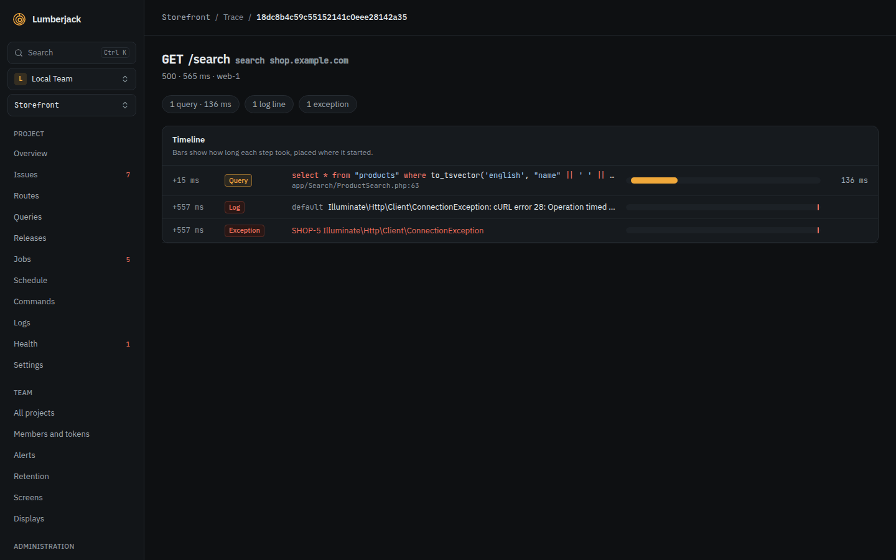

# Performance and traces

Pick a period (1 h, 24 h, 7 d, 30 d) and an environment at the top of each page. The
period starts at 24 h, except on Logs, where it starts at 1 h. Hover a chart to see the
value of each bucket.

The pages update live: the overview, issues, routes, queries, releases, jobs,
schedule, commands, logs, health and agents reload in place as data arrives, at most
once a second.

| Page     | Shows                                                                                                                                                                                                                |
| -------- | -------------------------------------------------------------------------------------------------------------------------------------------------------------------------------------------------------------------- |
| Overview | Requests, error rate, p95, failed jobs, open issues and health checks, with the change from the period before; charts of requests, exceptions and response times; the latest issues, slowest routes and failed jobs. |
| Routes   | Requests, p50/p95/p99, 5xx rate and Apdex per route. Click a route for its p50 and p95 over the period, its status codes (2xx to 5xx) and its 10 slowest requests with their query counts.                           |
| Queries  | Queries grouped by normalized SQL, highlighted (as in traces): calls, total time, share of database time, p95 and max. N+1 patterns are flagged.                                                                     |
| Jobs     | Runs, failure rate, stuck and retried jobs, duration and wait time per job class. Click a job for its runs.                                                                                                          |
| Schedule | Scheduled tasks per environment with their last and next run. A task that does not run when expected is marked missed and becomes an issue.                                                                          |
| Commands | Console commands with runs, failures and duration. Click a command for its runs.                                                                                                                                     |
| Logs     | Log lines by channel and level, with full-text search.                                                                                                                                                               |

## Overview

Open issues count every environment, whatever the period. Failed jobs show the failure
rate and how many are stuck; the p95 shows the p50 and p99 under it.

## Routes

Sort by highest p95 (the default), most requests, highest error rate, most total time
or lowest [Apdex](#apdex). **Search routes or names** uses the [search syntax](./finding-things#search-syntax)
and matches a route's URI or its framework name (`orders.show`), which shows muted next to
the URI.

When requests came in on more than one domain in the period (`shop.example.com` and
`api.example.com`), a **Domain** picker appears next to the search. With **All domains**
the same route on two domains is two rows, each with its domain in a **Domain** column;
picking a domain narrows the table, the detail and the sparklines to it. Requests an
older SDK counted without a domain show as _unknown_.

## Queries

The top shows the number of queries, the total database time and the slowest single
query. Filter by connection, search the SQL, and sort by most total time, highest p95 or
most calls. **Most from** is the line in the app that ran the query most often.
With 7 or 30 days selected, Most from and the N+1 flag look at the last 24 hours only.

A query is flagged **N+1** when the same query runs 5 times or more in one request or
job; the badge says how many times per request.

## Jobs

Filter by queue and sort by highest failure rate, most runs, highest p95 duration or
highest p95 wait. Below the job classes are the **latest failed, stuck and released
runs**, with their parameters, an **Open trace** and the issue they became.

A run is **Queued**, **Processing**, **Processed**, **Released** (put back on the
queue), **Failed** or **Stuck**. It is stuck when it has been processing for longer than
its timeout plus 2 minutes (a job that sends no timeout counts as 10 minutes), checked
every minute. A banner says how many are stuck and links to them.

## Queues

The Jobs page shows a **Queues** card once agents report queue sizes (the queues the SDK
is set to watch). Per connection and queue:

- **Waiting:** jobs on the queue now, from the latest heartbeat. Several agents report
  the same queue, so this is the latest sample, not their sum. Gray when no agent has
  reported it for 5 minutes.
- **Oldest pending:** how long the oldest waiting job has waited, where the queue driver
  can tell (Redis, database).
- **p95 wait:** time from queued to started of the jobs that ran in the period.
- **Size:** the highest size per bucket over the period; hover for each bucket.
- **Alert:** the queue's own [backlog alert](./alerts#queue-backlog) thresholds, for
  whoever may change the project. **custom** marks a queue that has some, **muted** one
  that never alerts.

The card lists at most 20 queues.

Queue size keeps growing when every worker is dead, while no job starts and so no wait
is measured. A [queue backlog alert](./alerts) fires on it.

## Schedule

Each task shows its cron, its latest status (**Running**, **Finished**, **Failed**,
**Skipped** or **Missed**), the last and next run and a strip of its last 20 runs; click
it for the runs with their exit code and host. A run is late after a minute, and
**missed** when it has not started 5 minutes after its time; a missed run becomes an
issue. A task that has not been reported for 24 hours is no longer flagged. **Forget
task** (owners and admins) deletes a task that is gone from the app, with its runs; it
comes back if the app still runs it.

## Commands

Each command shows its runs, failures, average and longest duration, last run and
status; the latest runs below show their arguments and options, exit code and host.
Long-running queue workers are left out: they run until they are stopped.

## Logs

Filter by channel, minimum level (debug to emergency) and release, and search the
messages. The page shows the newest 200 lines; narrow the filters to see older ones.
The search is a full-text search on words, not the `*` syntax of the other search
fields. **Manage channels** opens the project's [log channels](./projects#settings).

New lines appear by themselves while you are at the top. When you have scrolled down
or selected text, the page holds them back and offers **Show new lines** instead.

## Sampling

A busy app's SDK may record only a share of its runs (see its own docs). The pages then
show estimates, marked **Estimated from a 10% sample** (the lowest rate in the period),
and work them out like this:

- **Requests, throughput, error rate and status codes** come from the request counts the
  SDK sends for every request, sampled or not, so they are exact. Where an environment
  has no counts yet (an SDK that does not send them), its request runs are weighed
  instead: a sampled run stands for `1 / sample_rate` requests, a run kept only for being
  slow counts once. From the first counted minute in the period on, an environment uses
  its counts only, so a host left on an older SDK next to one that counts goes uncounted.
- **p50, p95 and p99** come only from sampled runs: runs kept for being slow would pull
  them up. A route whose requests were counted but none sampled shows no percentiles.
- **Apdex** takes the share of satisfied and tolerated requests from the sampled runs and
  applies it to the counted requests that were not a 5xx.
- **Queries** weigh calls and total time the same way: a query of a sampled run stands
  for `1 / sample_rate` calls, one of a run kept for being slow or failed, or a slow query
  kept on its own, counts once. A slow run that was also sampled counts `1 / sample_rate`,
  so slow queries are overcounted by up to `1 - sample_rate` of themselves: a small share
  of the calls. The p95 only reads sampled queries; the max reads all.
- **Releases** have no counts per release, so their requests and error rate weigh the
  request runs; their p95 reads sampled runs only.
- **Jobs, commands and scheduled tasks** are recorded on every run, sampled or not (only
  their queries are sampled), so their counts, failure rates and durations stay exact.

## Apdex

Apdex scores a route from 0 to 1 by how its requests felt. A request within 500 ms is
satisfied, within 2 s counts half, and slower or a 5xx counts nothing. Below 0.85 shows
in amber, below 0.7 in red. Sort by lowest Apdex to find the routes people wait on.

## Web Vitals

The [browser script](./projects#browser-script) measures Core Web Vitals on every page
view and sends them once, when the page is hidden or left. The Routes page lists each
browser page (its path, with numeric and UUID segments grouped as `{id}`) with page
views and the 75th percentile of each vital, colored by Google's thresholds:

| Vital | Good     | Poor     |
| ----- | -------- | -------- |
| LCP   | ≤ 2.5 s  | > 4 s    |
| INP   | ≤ 200 ms | > 500 ms |
| CLS   | ≤ 0.1    | > 0.25   |

Between good (green) and poor (red) is needs improvement (amber). INP is the slowest
interaction of the page view. TTFB and FCP are stored as well. Values below zero or
above a minute are dropped as broken measurements. Web vitals have their own
[retention](./projects#retention), 30 days by default.

## Traces

Everything recorded during one request, job, command or scheduled task shares a trace
id. **Open trace** (on a request, a run or an occurrence) shows it on one time axis:

- the request or job, then
- queries,
- spans: cache reads and writes (hits and misses), outgoing HTTP calls, mails,
  notifications and Redis commands,
- log lines and exceptions.

The header names the request's route, its route name and domain when the SDK sent
them. Each step is a bar placed where it started, as long as it took. Above the timeline a
summary counts the queries, outgoing calls, cache operations and misses, mails,
notifications, Redis commands, log lines and exceptions. A trace shows at most 500
steps. Which spans are recorded is up to the SDK.

Paste a trace id in the [command palette](./finding-things) to open it.
