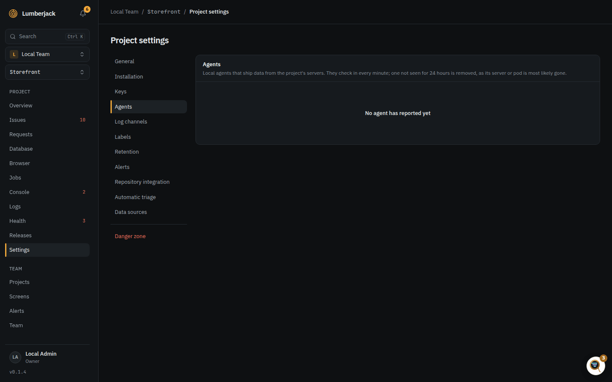
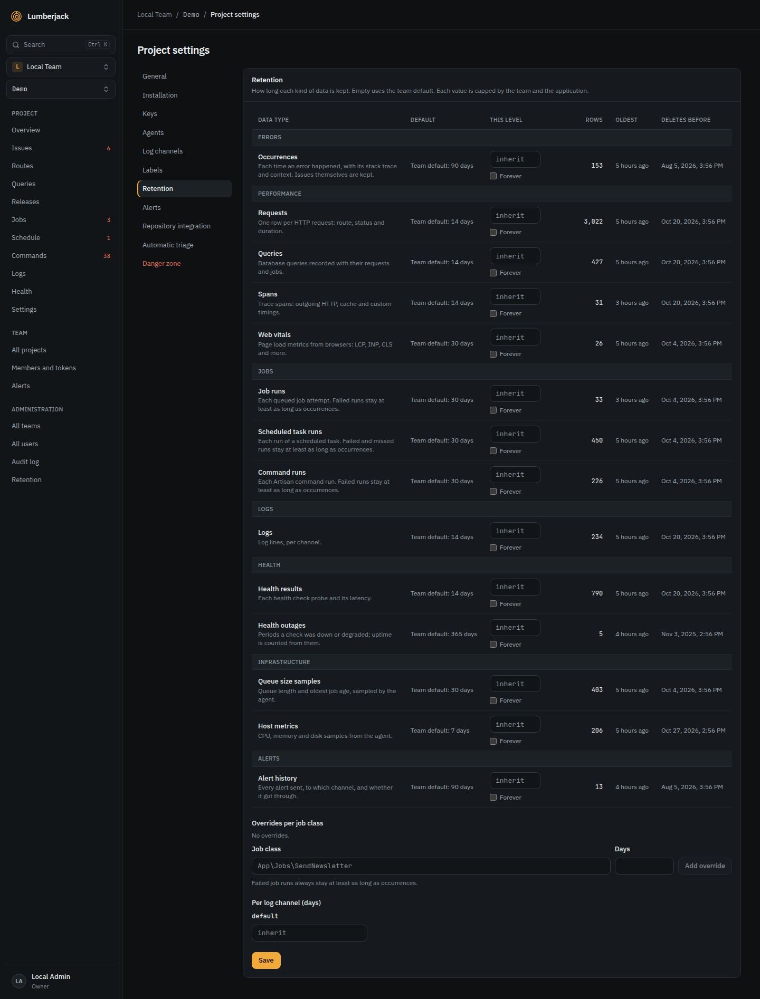

# Projects

A project is one app. It belongs to a team; every member of the team can see it, and
owners and admins can change its settings.

## The projects list

**Projects** in the sidebar shows every project of the team with its open issues, errors, p95
and job failures of the last 24 hours, its errors per hour, and a status: **3 open** or **Calm**. **Agent offline** and **Not seen** warn when the project's
[agents](#agents) stopped checking in, naming each agent with its host ("queue on
web-2", or "unnamed agent on web-2"). **Search projects** filters the list.

## Live updates

Every page updates in place when what it shows changes, whoever changed it: another
member, an MCP tool, a scheduled job or data arriving from the SDK. Your own changes
show at once and are not loaded twice.

- **Project pages**: the overview, issues and an issue, routes, queries, releases,
  jobs, schedule, commands, logs and health, as data arrives (performance at most every
  10 seconds), and when a health check, scheduled task, label or queue alert is changed.
- **Sidebar**: the badge counts of issues, jobs, schedule, health and commands, and the
  team's projects.
- **Projects list**: new, renamed and removed projects, and each card's figures as its
  issues, jobs and agents change. The day's figures may trail by up to a minute.
- **Project settings**: keys, labels, log channels, agents, retention, alerts and the
  repository, and what the project inherits from the team.
- **Team**: members, invitations, MCP tokens, alert channels and rules, and retention.
- **Screens**: the screens list, Displays, and every open kiosk and TV when its screen
  is changed (see [Status screens](./screens)).
- **Administration**: teams, users, the audit log and retention.

A settings page you are typing into is not changed under your hands: it says **This
page changed elsewhere** with a **Reload** button, which loads the new state and drops
your unsaved edits. Saving keeps your edits and brings in the rest.

## Creating a project

Team owners and admins create projects. Give it a name and an issue prefix. The prefix
is suggested from the name (initials for several words, the word itself for one) and is
used for [issue numbers](./issues#issue-numbers): 2 to 8 letters and digits, starting
with a letter, upper-cased, unique in the team.

The new project opens on its **Installation** settings, which show how to install the
SDK, the `.env` values, the agent setup, the browser script and a test command. The
server token is shown once, right after creating; copy it then or rotate it later.

## Switching project

Pick another project in the sidebar or the [command palette](./finding-things) and you
land on the same page in it: from the issues to its issues, from a job to its jobs.
Pages that belong to one thing, like a trace, open the other project's overview.

## Settings

Only team owners and admins change settings, labels, log channels, agents, retention
and the repository. Members see everything and work on issues.

The settings are in sections, one open at a time; the address keeps which (for example
`#agents`), so a link opens the right one.

- **General:** the name, the **slug** (used in URLs and as the project argument in
  MCP; letters, digits, `-` and `_`, unique in the team), the issue prefix, allowed
  origins and extra secret fields.
- **Installation:** what to install and set, as when the project was created.
- **Keys:** the server token (for the agent), the public key (for browser errors) and
  public stats, a secret URL serving the project's aggregates on the
  [metrics API](./metrics-api#authentication) without a token, off by default.
  All three can be rotated; the server token is shown only once.
- **Allowed origins:** browser errors are only accepted from these origins (up to 50,
  each an origin such as `https://shop.example.com`, without a path). Until one is
  added, browser errors are refused.
- **Extra secret fields:** masked as `[filtered]` before storage in headers, session,
  Context and log context, on top of the fields that are always masked (`password`,
  `passwd`, `pwd`, `secret`, `token`, `authorization`, `cookie`, `api_key`, `apikey`,
  `access_key`, `private_key`, `jwt`, `dsn`, `credit_card`, `card_number`, `cvv`,
  `session_id`). Values that look like secrets are masked too, whatever their key; see
  [Security](./administration#security). A plain word masks every key
  containing it (`cpr`), `*` is a wildcard on the key name (`card_*`), and a dotted
  pattern matches the full path (`session.checkout.*`). Up to 50, each at most 64
  characters.
- <a id="agents"></a>**Agents:** each server's agent checks in every minute with what it runs (SDK and
  runtime, e.g. "Laravel 0.1.0 · PHP 8.5.1"; hover for the agent and framework). One
  that has not checked in for 5 minutes is shown as offline, and is removed after 24 hours without a heartbeat,
  since its server or pod is most likely gone (Kubernetes names every pod for
  itself). **Remove** forgets one right away; it comes back if it checks in again.
  The heartbeat also reports the size of the app's queues (the queues the SDK
  is set to watch), kept for 30 days by default for the [Jobs page](./performance#queues), and how busy
  its host is: the table shows the 1 minute load against the cores, memory and disk
  in use (hover for the bytes), with the highest load and memory per hour over the
  last day. Memory and disk turn amber past 90%, load past the number of cores. In a
  container the container's own limits count. Host samples are kept for 7 days by
  default. Both follow [retention](#retention).
- **Alerts:** the project's [own channels, and its rules](./alerts#team-rules-and-project-overrides): the team's by default, or customized for the project.
- **Log channels:** the channels the project's log lines go to, with the lines of the
  last 24 hours and their own [retention](#retention). Names are kebab-case, at most 64
  characters. Lines sent to a channel the project does not have land in `default`,
  which cannot be deleted; deleting another channel moves its lines there. Channels
  that lines were sent to in the last 7 days get a **Create** button here and a banner
  on the Logs page.
- **Labels:** rename, recolor or delete [issue labels](./issues#working-on-an-issue).
- **Retention:** see below.
- **Repository integration:** see [below](#repository-integration).
- **Automatic triage:** see [MCP](./mcp#automatic-triage).
- **Danger zone:** see [Deleting a project](#deleting-a-project).



## Browser script

The project settings show the script tag for browser errors:

```html
<script
    src="https://lumberjack.example/sdk/v1.js"
    data-key="lj_pub_..."
    data-environment="production"
    defer
></script>
```

| Attribute          | Does                                                                    |
| ------------------ | ----------------------------------------------------------------------- |
| `data-key`         | The project's public key. Without it nothing is sent.                   |
| `data-environment` | The environment of the page.                                            |
| `data-release`     | The release, e.g. a commit hash.                                        |
| `data-user`        | The user's id, for [users affected](./issues#users-affected).           |
| `data-trace`       | The trace id of the request that rendered the page.                     |
| `data-announce`    | `true` logs a line in the console when the script is active.            |
| `data-vitals`      | `false` stops measuring [Web Vitals](./performance#web-vitals).         |
| `data-endpoint`    | Where to send, instead of `/api/ingest/browser` on the script's server. |

Crawlers and automated browsers are skipped, in the browser and again on the server.

The script also has a small API on `window.Lumberjack`:

| Call                                          | Does                                                                                                     |
| --------------------------------------------- | -------------------------------------------------------------------------------------------------------- |
| `Lumberjack.init({ ... })`                    | Sets any of the options above, and `ignore`: strings or regular expressions matched against the message. |
| `Lumberjack.setUser(id)`                      | Sets the user, `null` to clear it.                                                                       |
| `Lumberjack.captureException(error, context)` | Sends an error you caught yourself, with extra context.                                                  |
| `Lumberjack.flush()`                          | Sends what is waiting now.                                                                               |
| `Lumberjack.version`                          | The script's version.                                                                                    |

A page view sends at most 100 errors, and at most 5 of the same name and message.
Noise is dropped: "Script error.", "ResizeObserver loop", "Non-Error promise rejection
captured", "Uncaught (in promise)", and errors whose frames all come from browser
extensions.

## Retention

Every kind of data has its own retention, set on three levels. Each level is the
default for the one below it and the most it may keep:

1. **Application**, the whole Lumberjack: **Administration > Retention**, for system
   administrators. Empty uses the built-in default and sets no maximum.
2. **Team**: **Team > Retention** in the sidebar, for team owners and admins (members can read
   it). At most the application value.
3. **Project**: the project's settings, for whoever administers the project. At most
   the team value; job classes and log channels can have their own, also at most the
   team value.

Each value is a number of days (1 to 3650), empty to inherit, or **forever**. A team or
project can only choose forever when the application keeps that data forever itself
(and the team sets no number for its projects); the built-in defaults are never forever.
A team or project value of forever stored earlier falls back to the application value
(or the built-in default) until the application keeps it forever.

Saving more than a level above allows is refused, naming the limit. Lowering a level
does not change what the levels below store: their values are capped right away, shown
as capped, and come back once the limit is raised again. A level that stores nothing
sets no limit, so a project can keep longer than the built-in default as long as
neither its team nor the application says otherwise.



Each table shows per data type what the level inherits, the limit from above, how many
rows are stored (counted up to 100,000; an estimate on the application page) with the
age of the oldest, and the date the daily prune would delete up to.

| Group          | Data type           | Default  | Holds                                                             |
| -------------- | ------------------- | -------- | ----------------------------------------------------------------- |
| Errors         | Occurrences         | 90 days  | Each time an error happened, with stack trace and context         |
| Performance    | Requests            | 14 days  | One row per HTTP request: route, status and duration              |
| Performance    | Queries             | 14 days  | Database queries recorded with their requests and jobs            |
| Performance    | Spans               | 14 days  | Trace spans: outgoing HTTP, cache and custom timings              |
| Performance    | Web vitals          | 30 days  | Page load metrics from browsers                                   |
| Jobs           | Job runs            | 30 days  | Each queued job attempt; can be set per job class                 |
| Jobs           | Scheduled task runs | 30 days  | Each run of a scheduled task                                      |
| Jobs           | Command runs        | 30 days  | Each console command run                                          |
| Logs           | Logs                | 14 days  | Log lines; can be set per channel                                 |
| Health         | Health results      | 14 days  | Each health check probe and its latency                           |
| Health         | Health outages      | 365 days | Periods a check was down or degraded; uptime is counted from them |
| Infrastructure | Queue size samples  | 30 days  | Queue length and oldest job age, sampled by the agent             |
| Infrastructure | Host metrics        | 7 days   | CPU, memory and disk samples from the agent                       |
| Alerts         | Alert history       | 90 days  | Every alert sent, to which channel, and whether it got through    |
| Administration | Audit log           | 365 days | What administrators did; set on the application level only        |

Issues themselves are never pruned, only their occurrences. Failed job runs, failed or
missed scheduled runs and failed command runs stay at least as long as occurrences.
Open outages are kept until they end. Data is pruned once a day, at 03:15
Europe/Copenhagen.

Upgrading keeps what was set: an old Errors value became Occurrences (and Health
outages when it was longer than a year), Performance became Requests, Queries, Spans,
Web vitals and Health results, Jobs became Job runs, Scheduled task runs and Command
runs, and Logs stayed Logs.

## Repository integration

Link a GitHub repository to create GitHub issues from Lumberjack issues, by button or
through MCP. It needs a fine-grained token with only **Issues: read and write** on that
repository; **Create token on GitHub** opens GitHub with the right settings filled in.
Lumberjack warns 14 days before the token expires (GitHub's form is filled in with 90
days). **Test connection** checks the token and says whether the repository is private
or public; creating issues in a public repository has to be allowed explicitly.
Created issues get the labels you list (comma separated).

## Deleting a project

The danger zone deletes the project and all its data, after you type the project's
name. Raw data is removed in the
background in batches and can take several minutes.
