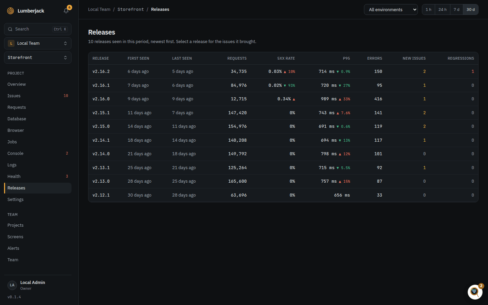

# Releases

A release is the version of your app that handled a request or threw an error, such as
a commit hash or a version number. Lumberjack puts releases side by side so you can
tell which deploy broke something.

## Reporting the release

Every request, error and log line carries the release it ran on:

- **Server:** the SDK sends it with every batch. Its docs describe where it takes the
  release from. In the raw ingest API it is the `release` field of a batch, see
  [Ingest and API](./api.md#batches).
- **Browser:** the [browser script](./projects.md#browser-script) takes it from its
  `data-release` attribute.

A release is at most 64 characters. Nothing else needs setting up: a release shows up
on the Releases page as soon as something on it arrives.

## The Releases page

**Releases** in a project's sidebar lists the releases seen in the period, newest
first. The period and environment at the top apply here too.

| Column      | Shows                                                                           |
| ----------- | ------------------------------------------------------------------------------- |
| First seen  | The first request or error on the release in the period.                        |
| Last seen   | The last request or error on it in the period.                                  |
| Requests    | Requests served by the release.                                                 |
| 5xx rate    | The share of those requests that ended in a server error.                       |
| p95         | The 95th percentile response time.                                              |
| Errors      | Occurrences of any issue on the release.                                        |
| New issues  | Issues first seen in the period whose earliest occurrence carried this release. |
| Regressions | Resolved issues that came back with an occurrence on this release.              |

### The arrows

Next to the 5xx rate and p95 an arrow shows the change from the release before it:

- red and up when it got worse,
- green and down when it got better,
- red without a percent when the release has server errors and the one before had none.

### The issues a release brought

Click a release to list the new issues it brought, with their error counts.
**Issues last seen in this release** opens the issues list filtered by that release.

A new issue belongs to the release of its earliest occurrence. With an environment
picked, it is the earliest occurrence in that environment.

## Releases elsewhere

- **Issues list:** the **Release** filter shows issues whose latest occurrence ran on
  the release, see [The issues list](./issues.md#the-issues-list).
- **Regression alerts:** the mail names the release the issue came back in, with a
  **Compare releases** link to this page.
- **Status screens:** data widgets can be limited to **All** releases, the **Current
  only** or the **Previous** one, and the **Current release** stat shows the release
  running now. See [Scope](./widgets.md#scope) and [Stat](./widgets.md#stat).
- **Metrics API:** `GET /projects/{p}/releases` returns the same numbers, see the
  [Metrics API](./metrics-api.md#endpoints).

## The new release notification

When a project's server reports a release for the first time, members can get a
**Releases** notification: "New release in Shop". It is off by mail and on in app by
default. Change it under [Notifications](./teams.md#notifications) in your account
settings. The first release a project ever reports sends nothing. Releases reported
only by the browser script send nothing either.

## Limits

| What                               | Limit         |
| ---------------------------------- | ------------- |
| Release name                       | 64 characters |
| Releases in the issues list filter | 20 newest     |
| New issues listed for a release    | 25            |
