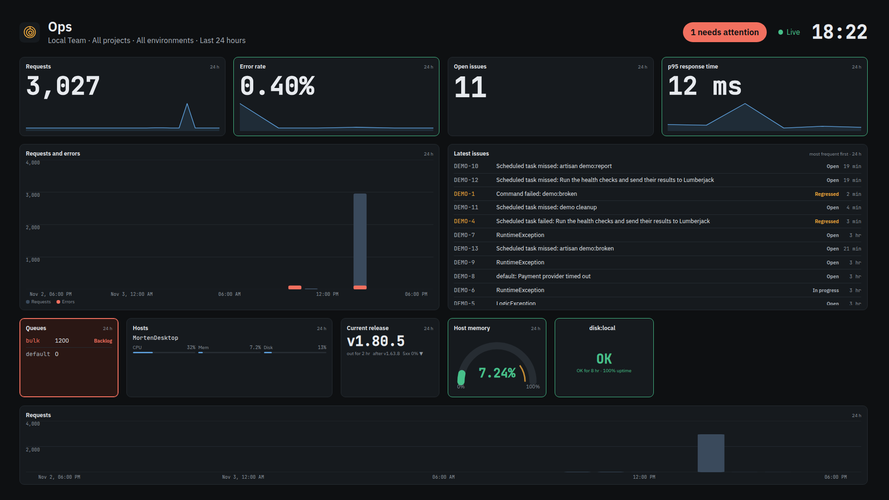
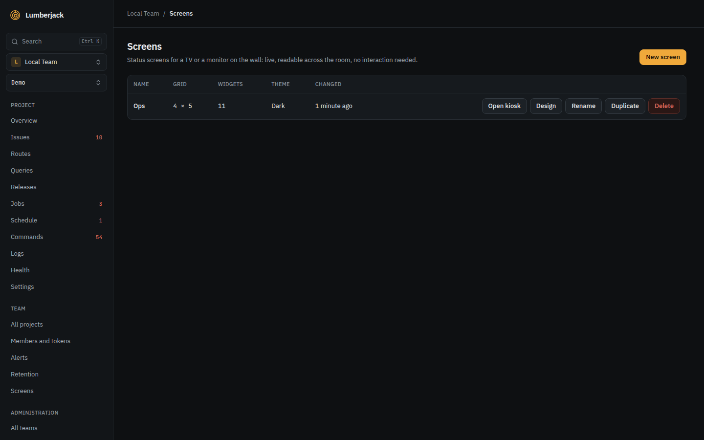
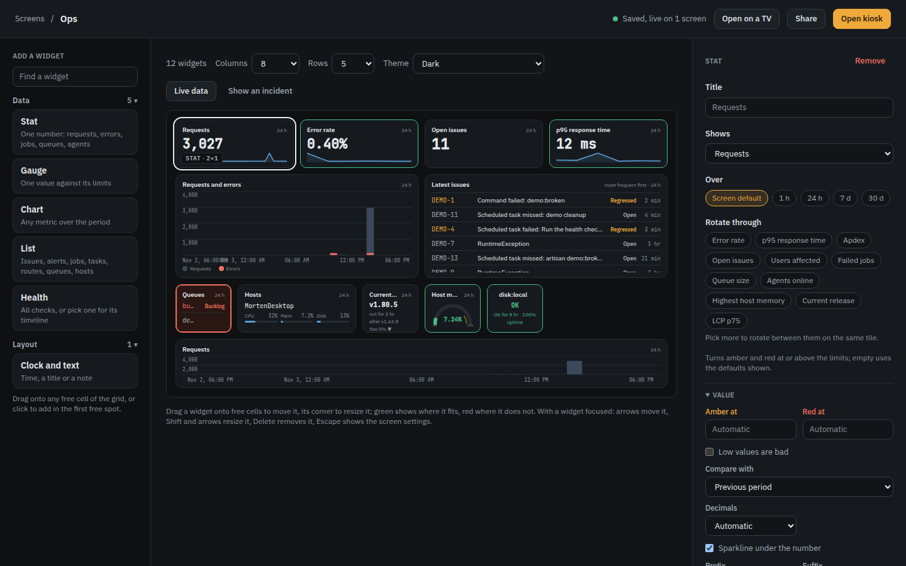
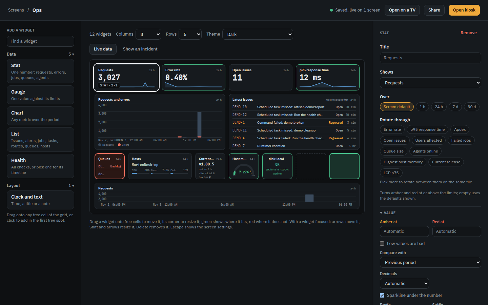
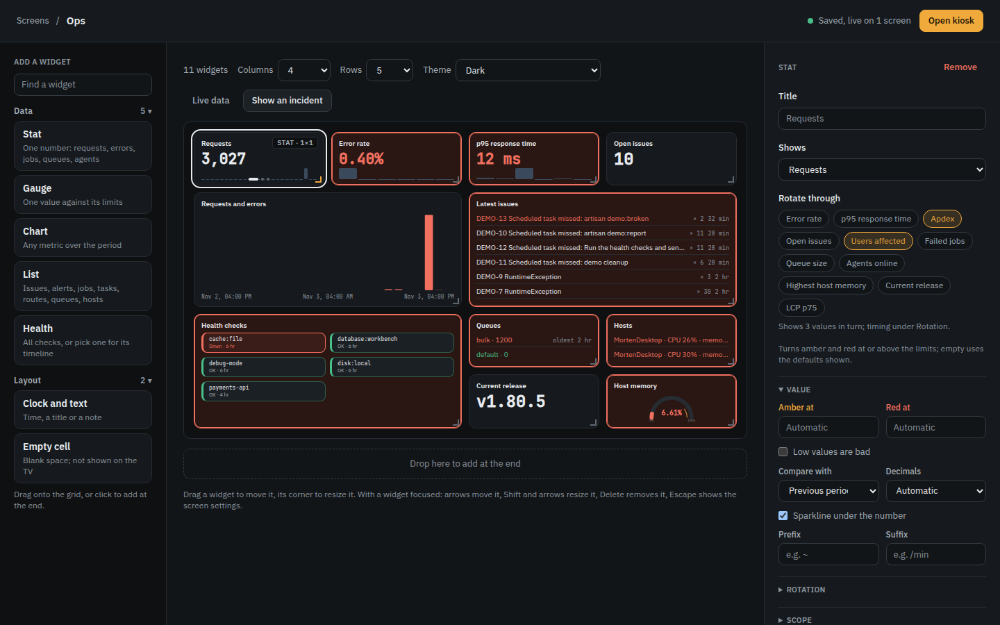
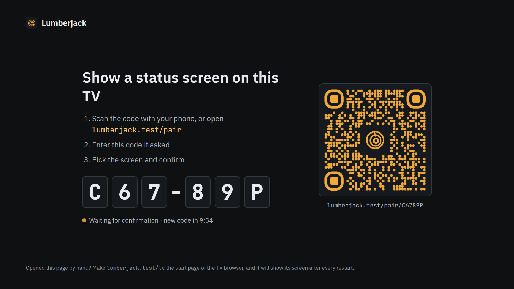
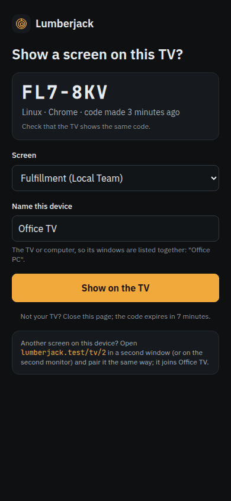
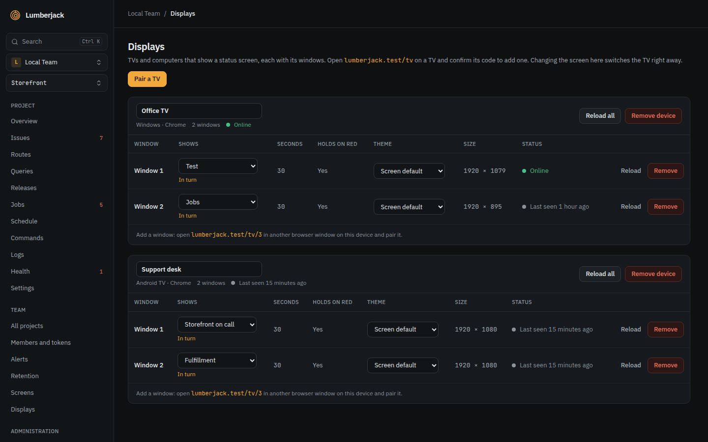
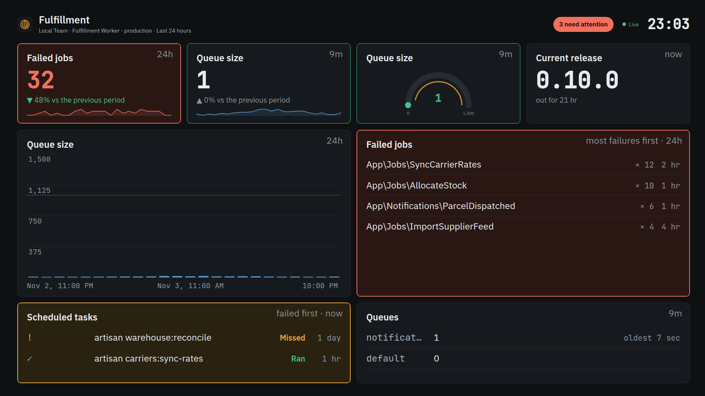

# Status screens

A status screen is a wall of widgets for a TV or a monitor in the room: requests,
errors, latency, issues, queues, hosts and health checks, readable from across the
room and live, with nothing to click. A team has as many screens as it likes ("Ops",
"Checkout team"); every member sees, designs and deletes them, because a screen only
shows what each member can already see on the project pages.

## The list of screens

**Screens** in the sidebar lists the team's screens. **New screen** asks for a name and
a layout to start from, then opens the designer:

- **Overview**: traffic, errors, latency, issues, health, queues and hosts at a glance.
- **On call**: what needs attention: error rate, newest issues, failing checks, alerts.
- **Infrastructure**: CPU, memory and disk per host, agents and every health check.
- **Jobs and schedules**: failed jobs, queue sizes and how scheduled tasks ran.
- **Empty**: a 4 x 4 grid to fill yourself.

Every widget of a template is an ordinary widget: change, move or remove it after. Each row opens the screen full screen (**Open kiosk**, in a new tab),
in the designer (**Design**), or renames, duplicates or deletes it. A TV showing a
deleted screen says so instead of going on with old numbers.

## The designer

The designer has three parts: the widgets you can add on the left, the screen as its
grid in the middle, and the settings of the selected widget on the right. Every change
saves itself a moment later, and every TV showing the screen follows within a second,
without reloading and without losing the data it shows. The top bar says whether the
last change is saved and on how many screens it is live right now.

### The grid

A screen is a grid of 2 to 12 columns and 2 to 6 rows, and the TV shows exactly that
grid, so a widget's size in cells is its size on the TV. Each widget sits on the cells
you put it on; cells no widget covers simply stay empty on the TV.

- **Add**: drag a widget type from the left onto any free cell, or click it to add it
  in the first free spot (row by row from the top left). The search field finds a type
  by what it can show, so "queue" finds Stat, Gauge, Chart and List.
- **Move**: drag a widget to other cells. While you drag, every cell of the grid shows
  as a drop zone and the widget's footprint follows the pointer: green where it fits,
  red where it would cover another widget or reach past the grid. A red drop is refused
  and the widget stays where it was.
- **Resize**: drag any edge or corner; sizes follow whole cells, and the left and top
  edges move the widget as they resize it. A widget only grows into free cells. The
  **Size** buttons in its settings are shortcuts for 1 x 1, 2 x 1, 2 x 2 and 4 x 2 (a
  size without room is grayed out).
- **Keyboard**: with a widget focused, the arrow keys move it one cell, Shift and the
  arrows resize it (both only into free cells), Delete removes it and Escape shows the
  screen's settings.

Making the grid smaller shrinks widgets larger than it, and moves a widget that no
longer fits just far enough back inside when those cells are free. Any other widget is
kept, not deleted: the designer lists it above the grid as not fitting (it does not
show on the TV) until you drag it back onto free cells, make the grid larger again or
remove it.

**Show an incident** previews the screen in trouble (the first issue escalating, a
check down, values past their limits), so the colors and rotation can be judged before
it happens for real. **Live data** goes back to the real numbers.

### Screen settings

With no widget selected (click the grid's background, or press Escape) the right side
shows the screen's own settings: its name, the projects, environment and period every
widget shows unless it picks its own (no project ticked means every project of the team,
new ones included), and the time zone for the clock and the theme schedule.

## Widgets

A widget is a way of showing something; what it shows is picked under **Shows**.

| Widget         | Shows                                                                                                                                                                                                                           |
| -------------- | ------------------------------------------------------------------------------------------------------------------------------------------------------------------------------------------------------------------------------- |
| Stat           | One number with its trend against an earlier period and a sparkline: requests, error rate, p95, Apdex, open issues, users affected, failed jobs, queue size, agents online, highest host memory, current release, LCP p75.      |
| Gauge          | One value on a half circle against its limits: error rate, p95, Apdex, host CPU, memory or disk, queue size, health uptime.                                                                                                     |
| Chart          | A series over the period: requests and errors, requests, error rate, p95, Apdex, users affected, queue size or wait, failed jobs, host CPU or memory, LCP. It can split by route, queue, host, environment, release or project. |
| List           | Rows: latest issues, the alert feed, failed jobs by job, scheduled tasks, slowest routes, queues, hosts, agents.                                                                                                                |
| Health         | The health checks of the projects: a count at 1 x 1, a list when narrow, small cards when two or more fit side by side. With exactly one check picked, that check alone with its uptime, timeline and last message.             |
| Clock and text | The time (12 or 24 hour, any time zone, with seconds or the date), a note for the room, or both.                                                                                                                                |

A list of queues judges each queue like its [backlog alert](./alerts#queue-backlog): red
past the project's thresholds (its own for that queue, or the rule's: 1,000 jobs or 10
minutes by default), amber past half of them, and says why (**Backlog** or **Waiting**).
A muted queue stays calm. Limits set on the widget replace that and count on its size.
A list of hosts shows each host once with CPU, memory and disk meters. Rows that do not fit scroll slowly down and back up, resting at each end; hovering stops it, and **Scroll slowly through rows that do not fit** under Rows turns it off.

Every widget with data names its period in the top right corner (1 h, 24 h, 7 d, 30 d);
**Over** in the inspector picks it per widget, or follows the screen. **Show the period
in the corner** under Display turns the label off.

Each widget's settings are grouped in sections that open and close:

- **Value**, **Scale**, **Chart**, **Rows**, **Checks** or **Clock**: what the type
  itself offers, such as the amber and red limits of a stat or gauge (empty uses the
  defaults shown; shares go from 0 to 1, durations are in milliseconds), whether low
  values are bad (Apdex, uptime), what to compare with, decimals, a prefix and suffix,
  the chart style and how many series, its time axis, value axis and grid lines (each on or off), how many rows a list shows and in which order.
- **Rotation**: a stat, gauge, chart or list can show several values in turn on one
  tile. Pick them under **Rotate through**; the title follows the value shown. They
  switch every 5 seconds to a minute, with a fade, a slide or neither, and all tiles of
  a screen switch together. A value that needs attention (amber or red) holds the tile
  until it clears. In the designer the selected tile stays on its first value.
- **Scope**: the projects, environment, period and release the widget shows, each the
  screen's default unless set, and a filter on the route, queue, job or host (`*`
  matches anything, so `POST /checkout*` or `payments*`).
- **Display**: whether the title shows and how big, whether the tile is colored by its status,
  the text size (fitted to the tile, or small to huge), alignment (left or centered, top or vertically centered), how often it updates
  (live, every minute, every 5 minutes), and whether to hide it while all is ok or while
  it has nothing to show.

Older screens may still have an **Empty cell** widget, from when widgets filled the grid
in order and a gap needed a filler. It still works (dashed in the designer, invisible
on the TV), but it is no longer offered: a free cell is empty on its own, so it can be
removed.

### Status colors

A widget with a state colors itself: a green border when all is ok, an amber border and
background when degraded or past the amber limit, red when down or past red, blue while
a check is recovering and gray when a check is stale. Widgets without a state (a chart,
the clock) keep a plain border. A down check turns the health widget red; a degraded or
recovering one colors only its row or card. A tile that turns red flashes once, so the
change is noticed; there is no sound.

## On the TV

`/screens/<id>` (**Open kiosk**) shows the screen full screen: no sidebar or menu,
large type, the cursor hidden after a few seconds without moving, and the whole picture
shifting a few pixels every few minutes so nothing burns into the panel. The header
shows how many widgets need attention, whether the screen is live, and the time.

The data updates on its own: a widget whose projects change (a new issue, a failed
job, a health result) refetches within seconds, and every widget refetches every minute
in any case (every five, for widgets set to update every 5 minutes). Answers are kept
for 20 seconds, so a room full of TVs asks the database once, not once per TV.

When Lumberjack cannot be reached the screen says **Offline since** with the time,
dims the numbers it has, and tries again every 30 seconds; it never lets old numbers
look current.

A TV does not sign in: it is paired once, with a code, and shows its screen from then
on (see below). `/screens/<id>` is for a browser that is signed in anyway.

## Setting up a TV

Nothing long is ever typed on the TV. Pairing works like a streaming app: the TV shows
a code, and a phone or laptop that is signed in confirms it.

1. On the TV, open `/tv` on your Lumberjack (`lumberjack.example.com/tv`): short enough
   to type with a remote, and a good start page for a kiosk browser (Fire TV Silk,
   Android TV, Fully Kiosk Browser, Chromium `--kiosk` on a Raspberry Pi). It shows a
   six character code such as `K7Q-M2X` (no 0, O, 1 or I, so it reads well across the
   room), a QR code, and how long the code lasts.
2. On your phone, scan the QR code, or open `/pair` and type the code. Sign in if you
   are asked. The page shows which browser asks (**Fire TV · Silk**) and when the code
   was made, so you pair the right TV. Pick the screen, name the TV ("Office TV") and
   press **Show on the TV**.
3. The TV shows the screen within a second. Make `/tv` its start page and it shows its
   screen again after every restart.

A code lasts 10 minutes and works once; the TV shows a new one when it runs out. Only
team admins pair TVs. **Open on a TV** in the designer shows the same steps, with the
`/tv` address as a QR code for a TV stick or kiosk browser with a camera.

### Several screens on one computer

One computer can drive several screens: two monitors, or two browser windows side by
side. Each window is a display of its own: open `/tv` in the first, `/tv/2` in the
second, up to `/tv/9`, and pair each with its own code. The pairing page says which
window it is (**Window 2**), and after confirming, the phone offers the address of the
next window. Displays lists the windows of one computer together.

## Displays

**Displays** in the sidebar (Team settings) lists the team's paired TVs: their name,
the screen each shows, its theme, the browser it runs in, and whether it is online
(heard from in the last three minutes) or when it was last seen.

Team admins change them; every member can see them.

- **Shows**: another screen switches the TV at once, so nobody has to touch it again.
- **In turn**: several screens one after another on the same TV, in the order you set,
  10 seconds to an hour each (30 by default), fading from one to the next. While a
  screen has something red it stays until that clears, unless you turn that off.
- **Theme**: the screen's own theme, or always **Dark**, **Light** or **By time of
  day**, for a TV in a bright room showing a screen that is dark elsewhere.
- **Remove**: the TV goes back to showing a pairing code at once.

## Share links

Where pairing is not possible (a signage system that takes a URL, a page that embeds
one), a screen can have a share link: `/s/<key>`, readable without signing in. Open the
designer, press **Share** and **Share with a link**. The link can be copied, replaced by
a new one (**New link**) or turned off (**Stop sharing**); screens showing a link that
stopped working say **This screen was unshared**. Only team admins share screens.

A share link shows counts and numbers only, no issue titles or names, unless **Show
issue titles and names** is ticked. It may be shown inside another site's page. Every
change to a share link goes in the audit log. Prefer pairing: a paired TV needs no link
that could be passed on.

## QR codes

The QR codes (on the TV's pairing page, in **Open on a TV**, on **Pair a TV** in
Displays and for the share link) carry the Lumberjack mark, amber on the dark panel.
**Download QR for printing** under **Share** gives the share link as a PNG, dark on
white with darker amber corners, for a sticker on the wall.

## What a TV keeps

A paired TV holds a display token, as a cookie only the server can read (and a copy
in the browser's local storage, in case a TV browser drops its cookies). It is never
part of an address, so it cannot leak through history, logs or a Referer, and only its
hash is stored. It lasts a year from the TV's last visit, can only read the screens of
its own team that the display shows, and stops working the moment the display is
removed. A code alone is useless in another browser: the token goes only to the
browser that showed the code. Looking up and confirming codes is limited per user and
per address.

## Theme

Each screen is **Dark** (the default), **Light**, or **Light by day, dark at night**
between two times in the screen's time zone. Changing it switches every open TV with a
short fade and no change of layout. Light is the same design with every color swapped
for its light twin, the status colors darkened enough to read on white.

