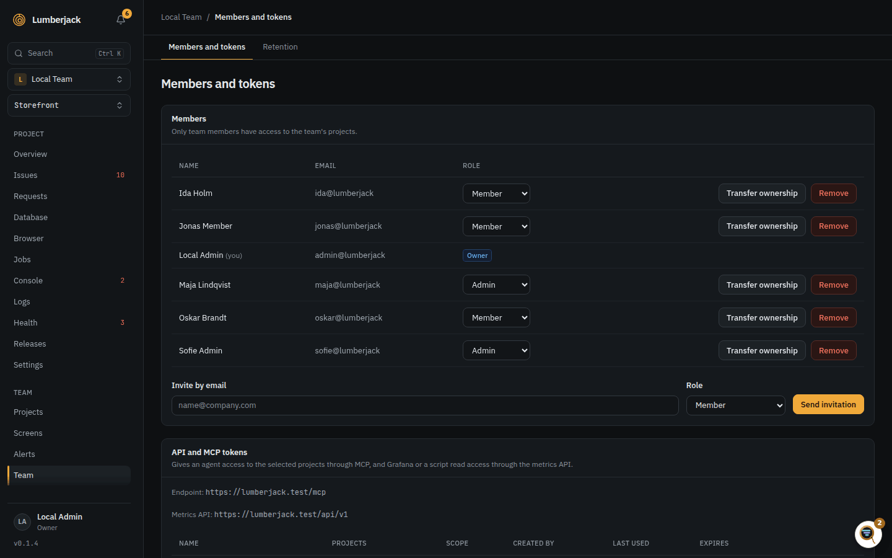
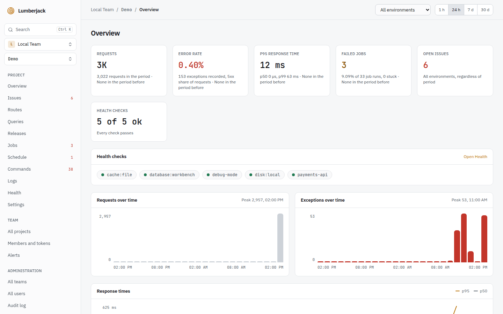

# Teams and accounts

Everything in Lumberjack belongs to a team: its projects, its alert channels and rules,
its API and MCP tokens. People see the teams they are members of; system administrators see
every team (see [Setup and system administration](./administration)).

## Roles

| Role   | Can                                                                                                                                                                                   |
| ------ | ------------------------------------------------------------------------------------------------------------------------------------------------------------------------------------- |
| Owner  | Everything an admin can, and transfer ownership. One per team.                                                                                                                        |
| Admin  | Create projects, change their settings, manage members, invitations, API and MCP tokens, alerts and retention. Pair TVs, manage displays, share screens by link and reload a display. |
| Member | See every project of the team and work on its issues: status, assignee, labels, notes, watching. See, design and delete status screens, and reload the TVs showing one.               |

## The team page

**Team** in the sidebar shows the team, on its **Members and tokens** tab.

- **Members:** change a member's role, or **Remove** them. The owner cannot be removed
  or demoted; **Transfer ownership** (owner only) makes another member the owner, and
  the old owner an admin.
- **Invite by email:** as Admin or Member. Open invitations show when they expire
  (after 7 days), and can be sent again or revoked.
- **API and MCP tokens:** see [MCP](./mcp#tokens) and the [metrics API](./metrics-api#authentication).
- **Retention:** the Team entry's second tab: the team's [retention](./projects#retention),
  read only for members.

Anyone can **Create a team**: it starts empty, with them as the owner. The team switcher
at the top of the sidebar moves between teams.

## Invitations

An invitation link opens a page to join the team:

- without an account, choose a name and a password, then **Create account and join**,
- with an account, **Log in to accept**,
- signed in as someone else, sign out first.

An expired or revoked link says **Invitation expired**; ask for a new one.

## Your account

**Profile and security** under your name at the bottom of the sidebar.

- **Profile:** your name and email (a new email has to be confirmed again), and
  **Notifications**: mail, toast or both for issues you [watch](./issues#watching),
  mentions and assignments.
- **Security:** asks for your password first (again after 3 hours). Change your
  password, and turn on **two-factor authentication**: scan the QR code with an
  authenticator app and confirm with a code. Keep the recovery codes; each signs you in
  once when the app is not at hand. **Regenerate codes** replaces them, **Disable 2FA**
  turns it off.
- **Appearance:** light, dark or the system's.

**Delete account** (on the profile, with your password) also deletes the teams where
you are the only member, with their projects. It is refused for the last active
administrator, and for the owner of a team with other members until ownership is
transferred.

In production a password needs at least 12 characters, upper and lower case, a number
and a symbol, and must not appear in a known data breach (checked with Have I Been
Pwned, so the server needs outbound HTTPS).

Signing in, two-factor codes and password changes are rate limited.

## While Lumberjack is open

Everyone on the team who has Lumberjack open gets a toast when an issue is new,
regresses or escalates, with **View** to open it; browser errors are left out. A short
chime plays with it. **Sound for new errors** in the sidebar turns the chime off or on
for this browser.

Mentions, assignments and updates on issues you watch show as toasts too, as chosen
under Notifications.
