# Widgets

A widget is one tile of a [status screen](./screens). It covers whole cells of the
screen's grid. The designer's palette has two groups:

- **Data** widgets (Stat, Gauge, Chart, List, Health, Project overview, SLO) show
  something Lumberjack measured. Each picks what it shows under **Shows** and uses the
  screen's projects, environment and period unless it sets its own. When the screen has
  projects ticked, a widget's own projects are among them.
- **Layout** widgets (Clock and text, Countdown, Message, QR code, Image, video or page)
  show their own settings. They have no source, scope or period.

The screenshots on this page come from the **Widget gallery** screen. Run
`php artisan db:seed --class=ShowcaseWidgetsSeeder` to add it to the Local Team of a
seeded Lumberjack.

## What every widget has

### Title

When **Title** is empty, a data widget is named after what it shows (**p95 response
time**), a single picked health check after that check, and a layout widget after its
type.

### Display

The gear in the tile's top right corner opens its display settings. **Copy** and
**Paste** at the top of the panel copy the settings from one widget to another.

The examples below show the same p95 stat (amber, past its limit) or the same health
check, each with one setting changed.

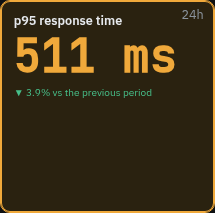 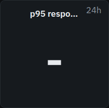

The default, and **Align** center with **Vertically** in the middle.

- **Show title** and **Title size**: **Small**, **Medium**, **Large** or **Huge**.

    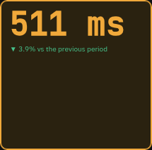 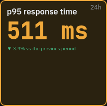

- **Text size**: **Fit to tile** (the default) sizes the main value to the tile.
  **Small**, **Medium**, **Large** and **Huge** fix it.

    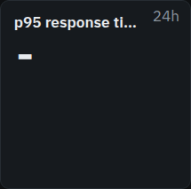

- **Align** left or center, and **Vertically** at the top or in the middle.
- **Show the period in the corner** (data widgets): the period the value covers (**1h**,
  **24h**, **7d**, **30d**), or the age of the latest report (**55s**, **6m**). A list
  also shows its order (**newest first**).

    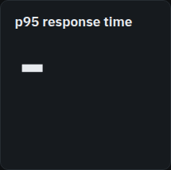

- **Color the tile by status** (data widgets): when off, the value and tile stay neutral
  past a limit. See [Status colors](#status-colors).

    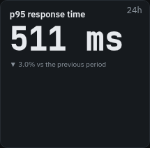

- **Green border while all is ok** (data widgets).
- **Show card**: when off, the tile has no background or border while all is well. They
  come back when it is degraded, down or recovering.

    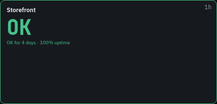  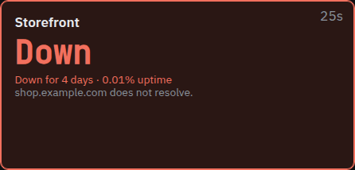

- **Hide when** (data widgets): **Never**, **All is ok** (shown only when amber or red) or
  **Empty** (shown only when a list, the health checks or the overview have something to
  show). The designer shows a hidden tile faded, and the TV leaves its cells empty.

**Update** (data widgets) is in the inspector: **Live** (the default, within seconds of a
change and at least every minute), **Every minute** or **Every 5 minutes**.

### Scope

Data widgets have a **Scope** section. Each setting uses the screen's value unless set:

- **Projects**.
- **Environment**.
- **Period** and **Release** (**All**, **Current only** or **Previous**), for widgets over
  a period. **Over** at the top of the inspector also picks the period.
- **Filter**, for a source that can be narrowed: the route, queue, job, host, database
  check or activity. `*` matches anything, such as `POST /checkout*`. A route filter also
  matches route names such as `orders.*`. An activity filter is `group:name`, such as
  `billing:invoice.paid` or `billing:*`.
- **Domain**, for a source with routes, such as `shop.example.com`.

### Rotation

A stat, gauge, chart, list or health widget can show several values in turn on one tile.
The inspector shows them as tabs, the widget's own value first, and **+** adds one. Each
tab sets what it shows, its title, its period, how many seconds it stays, the type's
first section of settings, and its own scope (**Same as widget** by default). Drag a tab,
or use the arrows above its settings, to reorder.

Under **Whole widget**:

- **Switch every**: 5, 10, 20 or 30 seconds, or a minute. A value's own seconds take
  precedence.
- **Transition**: **Fade**, **Slide**, **Flip** (like a departures board) or **None**.
- **Stay on a value that needs attention**: an amber or red value holds the tile until
  it clears.
- **Show a progress bar until the next value**.

On a health widget, each tab picks its own checks and **Checks** settings. With one check
per tab, a 1 x 1 tile cycles through the checks. A tab with no check picked shows every
check.

### Status colors

A data widget with a state colors itself:

| State                             | Color                       |
| --------------------------------- | --------------------------- |
| All is ok                         | Green border                |
| Degraded, or past the amber limit | Amber border and background |
| Down, or past the red limit       | Red                         |
| A check recovering                | Blue                        |
| A check stale                     | Gray                        |

Widgets without a state, such as a chart or the clock, keep a plain border. A down check
turns the whole health widget red; a degraded or recovering check colors only its row or
card. A tile that turns red flashes once.

### Light theme

Widgets follow the screen's [theme](./screens#theme).

### Share links

Unless **Show issue titles and names, not only counts** is ticked, a
[share link](./screens#share-links) leaves out issue titles, alert channel names and
health check messages, numbers hosts and agents ("host 1"), and shows calendar events
without their titles. Layout widgets show as they are, so put nothing in a message or QR
code that the link should not reveal.

## Stat

One number, with its trend against an earlier period and a sparkline.

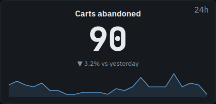

**Shows**:

- **Requests**: requests over the period.
- **Requests per minute**: the rate over the last five minutes.
- **Error rate**: the share of requests answered with a 5xx. Amber at 1%, red at 5%.
- **p95 response time**: amber at 500 ms, red at 1000 ms.
- **Apdex**: amber below 0.85, red below 0.7.
- **Open issues**: issues open now.
- **Users affected**: distinct users that hit an issue in the period.
- **Failed jobs**: amber at 1, red at 10.
- **Queue size**: jobs waiting now. Amber at 100, red at 1000.
- **Queue workers**: workers running now. Red at none.
- **Agents online**: red at none.
- **Highest host CPU**, **Highest host memory**, **Highest host disk**: the busiest host
  now. Amber at 70% CPU or 80% memory and disk, red at 90%.
- **Current release**: the release running now, how long it has been out, and its 5xx
  rate, compared with the previous release when there is one.
- **LCP p75**: the browser's largest contentful paint. Amber at 2500 ms, red at 4000 ms.
- **Database size**, **Database connections**: the latest values from
  [database health checks](./health#database-metrics), added up over the databases in
  scope.
- **Activity**: how often apps recorded [activity](./activity) in the period. Narrow it
  to a group or one activity with the filter.
- **Data source**: a number from a project's data source. See
  [Data source](#data-source).

**Value**:

- **Amber at**, **Red at**: the limits. Empty uses the defaults above. Shares go from 0 to
  1 (0.05 is 5%), durations are in milliseconds, sizes in bytes.
- **Low values are bad**: the limits count downward, as for Apdex, uptime or workers.
- **Compare with**: **Nothing**, **Previous period**, **Same time yesterday** or **Same
  time last week**. The change shows under the number: green when better and amber when
  worse for a value with limits, gray otherwise. Under 2% counts as no change.
- **Decimals**: **Automatic**, 0, 1 or 2.
- **Sparkline under the number**.
- **Prefix** and **Suffix** around the number, such as `/min`.

## Gauge

One value on a half circle, the arc colored by its limits.

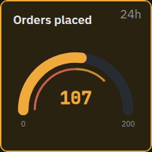

**Shows**: **Requests per minute**, **Error rate**, **p95 response time**, **Apdex**,
**Host CPU**, **Host memory**, **Host disk** (the busiest host), **Queue size**,
**Database connections in use**, **Health uptime**, **Activity** and **Data source**. The
defaults match the stat's, plus:

- **Database connections in use**: the database using the largest share of its maximum.
  Amber at 80%, red at 90%.
- **Health uptime**: the uptime of the checks in scope over the period. Amber below
  99.9%, red below 99%.
- **Activity**: how often the activity in scope happened over the period, against a
  target of your own: set **Red at** (and **Amber at**) to the least you expect, such as
  50 sign-ups a day. Low values are bad, so the arc turns red when it falls short.

**Scale**:

- **Minimum** and **Maximum** of the arc. Empty uses the source's own scale, such as 0 to
  100% for a share.
- **Amber at**, **Red at**, **Low values are bad**: as on a stat.
- **Mark the amber limit on the arc** and **Mark the red limit on the arc**.

## Chart

A series over the period, as bars, an area or a line, or one series per route, queue,
host, activity or project.

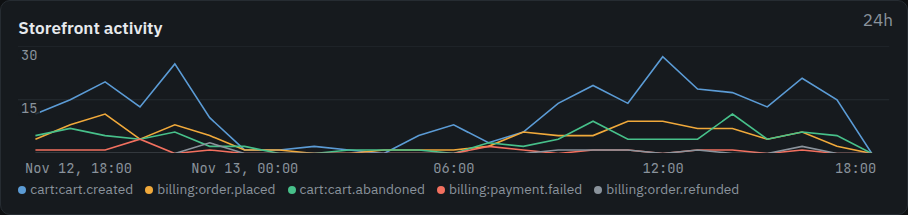

**Shows**: **Requests and errors** (errors in red), **Requests**, **Requests per
minute**, **Error rate**, **p95 response time**, **Apdex**, **Users affected**, **Queue
size**, **Queue workers**, **Queue wait** (how long jobs waited before they ran),
**Failed jobs**, **Host CPU**, **Host memory**, **Host disk**, **LCP p75**, **Database
size**, **Database connections**, **Activity** and **Data source**.

**Chart**:

- **Style**: **Bars**, **Area** or **Line**, and **Smooth lines**.
- **Split by**: **Nothing**, **Route**, **Queue**, **Host**, **Database check**,
  **Activity**, **Environment**, **Release** or **Project**, one series each. **Series** sets how many:
  the top 5, 10 or 20. A split chart always draws lines.
- **Red at**, and **Draw the red limit** as a dashed line.
- **Overlay the previous period**, faint behind the current one.
- **Y axis starts at zero**. Off, the axis starts and ends around the values drawn, so small changes show; a limit outside that range is not drawn.
- **Legend**, **Time axis**, **Value axis** and **Grid lines**.

The time axis uses 24 or 12 hours, like the screen's clock.

## List

Rows, worst or newest first, as many as fit the tile. Rows that do not fit scroll slowly
down and back up.

**Shows**:

- **Latest issues**: each issue's short id, title, status, count and age. Escalating and
  regressed issues are marked.
- **Alert feed**: the alerts sent, newest first.
- **Failed jobs**: failed jobs by job, most failures first.
- **Scheduled tasks**: each task's last run (**Ran**, **Failed**, **Missed**,
  **Running**, **Skipped**), failed first.
- **Slowest routes**: slowest first. Amber at 500 ms, red at 1000 ms.
- **Queues**: each queue with its waiting jobs and, where the agent knows, its workers.
  A queue turns red past its [backlog alert](./alerts#queue-backlog) thresholds (1,000
  jobs or 10 minutes by default) and amber past half of them. A queue whose jobs wait too
  long says **Waiting** and for how long. A muted queue stays calm. Limits set on the
  widget replace these and apply to the queue size.
- **Hosts**: each host with CPU, memory and disk meters colored by their limits.
- **Agents**: each agent, and **Offline** for one that stopped reporting.
- **Data source**: one row per item of an array in a data source.
- **Calendar events**: a calendar's events. See [Calendars](#calendars).

**Rows**:

- **Rows**: **Fit to tile**, or 3, 5, 10 or 20.
- **Sort** (latest issues): **Newest first**, **Most important first**, **Last reported
  first** or **Most frequent**.
- **Only what needs attention**: leaves out the rows that are fine.
- **Show age**, **Show count**, **Show project** and **Wrap long text**.
- **Scroll slowly through rows that do not fit**.

### Calendars

A list can show a calendar's events, such as the on-call rota or the week's releases.

1. On the project, add a data source under **Data sources** with format **iCalendar
   (.ics)** and the calendar's iCal address:
    - Google Calendar: **Secret address in iCal format** in the calendar's settings.
    - Outlook: a calendar published as ICS.
    - iCloud: a public calendar's link, with `webcal://` changed to `https://`.
2. On a list widget, pick **Calendar events**, then the data source under **Rows**.

The address gives access to the calendar, so Lumberjack hides its path after saving and
never sends it to screens, TVs or share links. A fetch that does not return an iCalendar
feed is recorded as an error on the data source.

The list shows events from **Days back** (**From today**, **From yesterday** or **A week
back**) to **Days ahead** (**Rest of today**, **Until tomorrow**, **A week** or **30
days**), in the screen's time zone. Repeating events are expanded, and cancelled ones are
left out. With **Only what has not ended** (on by default), an event leaves the list when
it ends.

Rows are grouped by day, all-day events first, then by start time. An event happening now
says **Now** in amber. A list over more than one day shows the weekday before the time.

### Connected data sources

A source your app offers (see [Connected sources](data-sources.md#connected-sources)) is
picked under **Data source** like any other, with no paths to set. Its shape decides
where it is offered: a number on a stat or gauge, a series on a chart, a list or table on a
list, where a table's first column is the label and its second the value.

On a chart, **Resolution** sets how much time one point covers, from 1 minute to 1 day.
**Automatic** follows the period. A resolution that is as long as the period, or gives
more than 999 points, is treated as **Automatic**.

### Data source

A stat, gauge, chart or list can read a project's data source (**Data sources** on the
project):

- **Data source** picks the source.
- **JSONPath** picks the number in its latest answer, such as `$.data.total`.
- For a list, **JSONPath** points at an array, and **Label path in each item** and
  **Value path in each item** read each row.
- **Configure** shows the latest answer, so you can click the value you want.
- **Unit** says what the number is, and how it is written: percent, durations, bytes (1 KB
  as 1000 or 1024), or bits per second.
  **Custom** writes your own word after the number, up to 20 characters, such as `orders`, `kg` or `/min`,
  **Custom prefix** goes before it, such as `€`, and **Divide by** makes the number smaller: `1000` turns `12300` into `12.3`.
  Sizes and durations scale themselves, so `577838689711` in **Bytes (1 KB = 1000)** reads `577.8 GB`.
  **Amber at** and **Red at** use the number in the chosen unit, after **Divide by** for a custom one.
- A Prometheus data source takes a **Selector** instead.

## Health

The health checks in scope: a count at 1 x 1, a list when narrow, cards when two or more
cells wide. With one check picked, it shows that check with its uptime, timeline and last
message, and for a database check its connections and size.

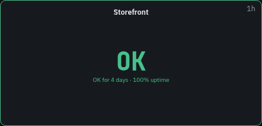

**Shows**: **Health checks**.

**Checks**:

- **Show as**: **Automatic** (by size, as above), **Summary**, **List** or **Cards**.
  Cards fill the widget, one per grid cell.
- **Checks**: none picked shows every check of the projects, new ones included.
- **Only what needs attention**: only checks that are not ok.
- **Show uptime**, **Show the timeline** and **Show the last message** (a single check).
- **Stale counts as**: **Its own state** (gray), **Degraded** or **Ok**.
- **Scroll slowly through rows that do not fit**: sideways on a widget wider than tall.
  When off, the hidden checks are counted at the end, with how many are down or degraded.

A database check shows its connections, amber at 80% of the maximum and red at 90%.

While a maintenance window in scope is open, a line on top says **In maintenance** (blue), or
**Overrun** (amber) once it runs past its expected end, with the environment and message.

## Project overview

Every project in scope as a traffic light: one cell each with its name, its color, and
the reason when it is not green (**2 checks down**, **Backlog on mail**). At 1 x 1 it
shows how many projects are ok and the worst one.

**Shows**: **Project overview**.

A project's color is the worst of these:

- **Red**: a health check is down, an issue escalated in the last hour, or a queue is
  past its backlog thresholds.
- **Amber**: a health check is degraded or stale (unless **Stale counts as** is Ok), a
  queue is past half its backlog thresholds, or the period has new open issues (3 or more
  by default).
- **Green** otherwise.

**Projects**:

- **Problems first**: red, then amber, then green.
- **Only what needs attention**: leaves out the green ones.
- **Show why**: when off, the cell shows the state instead of the reason.
- **Amber from new issues**: 1, 3, 5, 10 or 20.
- **Stale counts as**: **Degraded** or **Ok**.

A project in maintenance shows **In maintenance** in blue, or **Overrun** in amber, instead
of its color and reason.

A muted queue stays green. The tile takes the color of its worst project. Share links show
project names.

## SLO

One service level objective over the period, for the requests in scope, narrowed by a
route filter and domain. It shows how much of the period met the objective, the error
budget left as a bar, and the burn rate.

**Shows**:

- **Availability SLO**: the share of requests without a 5xx, counted over every request.
- **Latency SLO**: the share of requests faster than **Fast enough under (ms)** (500 by
  default), estimated from the sampled requests, of any status.

**Objective**:

- **Target**: 99%, 99.5%, 99.9% (the default), 99.95%, 99.99% or **Other**, with
  **Target in %** from 50 to 99.999.
- **Fast enough under (ms)**, for the latency objective.

The error budget is what the target allows to fail: 0.1% of the requests at 99.9%. The
bar says **Budget spent** once it is used up. The burn rate is how fast the most recent
part of the period uses the budget: at 1 it lasts exactly the period, at 10 it is gone in
a tenth of it.

| Color | When                                                                   |
| ----- | ---------------------------------------------------------------------- |
| Red   | No budget left.                                                        |
| Amber | The burn rate is over 1, or less than a quarter of the budget is left. |
| Green | Otherwise.                                                             |

Without requests it shows **No requests yet**.

## Clock and text

The time, a note for the room, or both, with the time in other cities below.

**Clock**:

- **Shows**: **Clock**, **Text only** or **Clock and text**.
- **Format**: **24 hour** or **12 hour**.
- **Time zone**: empty uses the screen's, or else the TV's own.
- **Other time zones**: up to 12.
- **Seconds** and **Date**.
- **Text**: the note, such as "Quiet hours after 18:00".

## Countdown

The time left to a moment or to a calendar's next event. Far off it counts in days and
hours, and in the last day it shows a clock, with a line saying what it counts down to.

**Countdown**:

- **Counts down to**: **A moment** or **A calendar's events**.
- For a moment:
    - **When**, in each TV's own time.
    - **What it counts down to**: the line under it, such as "Release 3.0".
    - **Once it is past**: **Count the time since**, **Stay at zero** or **Show only the
      text**.
- For a calendar:
    - **Data source**: an iCalendar data source. See [Calendars](#calendars).
    - **Count**: **To the end of the event on, else to the next start**, **Only to the end
      of the event on** or **Only to the next start**.
    - **Says**: **The event's title** or **Busy until or available until**, for a room door.
    - **Format**: 24 or 12 hour, for the times it shows.

    All-day events are skipped. With no event coming, it says **No event coming up**.

- **Seconds**.

## Message

A note for the room, or a ticker running across the tile. Its tone colors the tile like a
status.

**Message**:

- **Message**: up to 500 characters. Line breaks are kept, and a ticker joins the lines.
  With **Text size** at **Fit to tile**, a longer message gets smaller type to fit.
- **Tone**: **Plain**, **Info (blue)**, **Warning (amber)** or **Critical (red)**.
- **Run across like a ticker**: the text scrolls from right to left. Use a wide tile one
  row high.

## QR code

A link, a wifi network or any text as a QR code.

**QR code**:

- **Holds**:
    - **A link**: **Link**, http or https.
    - **A wifi network**: **Network name**, **Security** (WPA, WEP or none), **Password**
      and **Hidden network**.
    - **Text**.
- **Line under the code**: such as "Guest wifi".

Share links show the code too, wifi password included.

## Image, video or page

An image, a camera, a video or a web page, loaded by the TV itself. Several addresses
take turns as a slideshow.

**Media**:

- **Shows**: **An image or camera** (an MJPEG camera stream too), **A video** (MP4 or
  WebM, muted and looping) or **A web page or YouTube** (YouTube and Vimeo links play
  muted and looping).
- **Addresses**: up to 20, one per line. Several show in turn, the same one on every TV.
- **Next after**: 5 seconds to 5 minutes, for a slideshow.
- **Fit** (image and video): **Whole (contain)**, **Fill, cropped (cover)**, **Stretch
  (fill)**, **Actual size (none)** or **Shrink only (scale-down)**.
- **Load again** (image and page): **Never**, or every minute to every hour, for an image
  or page that changes at the same address.
- **Subtitles (YouTube and Vimeo)** (page).
- **Space around it**: when off, the media runs to the tile's edges.
- **Line under the code**: a caption.

The address must be http or https, reachable from the TV, and https when Lumberjack runs
on https. Pages that forbid framing stay blank.

## Empty cell

Older screens may have an **Empty cell** widget. It still works but is no longer offered,
since free cells are already empty, so you can remove it.
