# Widgets

A widget is one tile of a [status screen](./screens): a number, a gauge, a chart, a list,
the health checks, a clock, a note for the room. It covers whole cells of the screen's
grid, and its size in cells is its size on the TV. The designer's palette on the left
holds them in two groups:

- **Data** widgets (Stat, Gauge, Chart, List, Health, Project overview, SLO) show
  something Lumberjack measured. Each picks what it shows under **Shows** (its source),
  for the screen's projects, environment and period unless it sets its own, and updates
  itself live.
- **Layout** widgets (Clock and text, Countdown, Message, QR code, Image, video or page)
  are drawn by the TV from their own settings. They have no source, scope or period.

The screenshots on this page are tiles of the **Widget gallery** screen, which
`php artisan db:seed --class=ShowcaseWidgetsSeeder` adds to the Local Team of a seeded
Lumberjack (it is part of the showcase seed).

## What every widget has

### Title

**Title** in the inspector names the tile. Left empty, a data widget is named after what
it shows (**p95 response time**), a single picked health check after that check, and a
layout widget after its type.

### Display

Behind the gear in a tile's top right corner (it shows while the pointer is on the tile,
it has focus or it is selected, never on the TV) are the display settings. They open in a
small panel beside the tile and save like any other change; **Copy** and **Paste** at its
top carry them from one widget to another.

- **Show title**, and **Title size** (small, medium, large or huge).
- **Show card**: off, the tile has no background or border while all is well, and gets
  them back while degraded, down or recovering.
- **Show the period in the corner** (data widgets): the period the value covers (**1h**,
  **24h**, **7d**, **30d**), or for a value that is the latest report (host CPU, memory and
  disk, queue sizes, agents, open issues, the current release, health, databases) how old
  that report is (**55s**, **6m**). A list puts its order in front (**newest first**).
- **Color the tile by status** (data widgets), and **Green border while all is ok**: see
  [Status colors](#status-colors).
- **Text size**: **Fit to tile** (the default) sizes the big value to the tile;
  **Small**, **Medium**, **Large** and **Huge** fix it.
- **Align** left or center, and **Vertically** at the top or in the middle.
- **Hide when** (data widgets): **Never**, **All is ok** (hidden until it turns amber or
  red) or **Empty** (hidden while a list, the health checks or the overview have nothing
  to show). The designer shows a hidden tile faded; the TV leaves its cells empty.

**Update** (data widgets) stays in the inspector, as it is about the data: **Live** (the
default: within seconds of a change in its projects, and every minute in any case),
**Every minute** or **Every 5 minutes**.

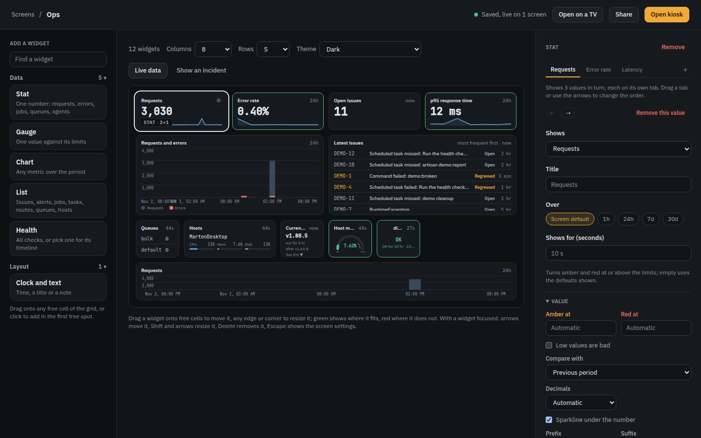

### Scope

Data widgets have a **Scope** section: **Projects** (none ticked uses the screen's),
**Environment**, and for widgets over a period **Period** and **Release** (**All**,
**Current only** or **Previous**), each the screen's unless set. **Over** at the top of the
inspector picks the period too. A source that can narrow something has a **Filter** named
after it: the route, queue, job, host or database check (`*` matches anything, so
`POST /checkout*` or `payments*`); a route filter also matches route names such as
`orders.*`. A source that narrows a route also has a **Domain**, suggesting the domains
requests came in on in the last 7 days, such as `shop.example.com`. The queue, host and
database check filters suggest the team's own while you type.

### Rotation

A stat, gauge, chart, list or health widget can show several values in turn on one tile.
The inspector shows them as tabs, the widget's own source first; **+** adds the next
value, and each tab holds what it shows, its title, its period, how many seconds it stays
on screen, the type's first section of settings and its own scope (left empty, it uses
the widget's: **Same as widget**). Drag a tab, or use the arrows above its settings, to
change the order. Under **Whole widget**, **Rotation** holds:

- **Switch every**: 5, 10, 20 or 30 seconds, or a minute; a value's own seconds win.
- **Transition**: **Fade**, **Slide**, **Flip** (as on a departures board) or **None**.
- **Stay on a value that needs attention**: an amber or red value holds the tile until
  it clears.
- **Show a progress bar until the next value**, along the tile's bottom edge.

A health widget's values are sets of checks: each tab picks its own checks and the other
settings under **Checks**. Pick one check per tab and a 1 x 1 tile cycles through the
checks, each named after its check; a tab with no check picked shows every check, not
the widget's. See
[the designer](./screens#widgets) for how the tabs are stored.

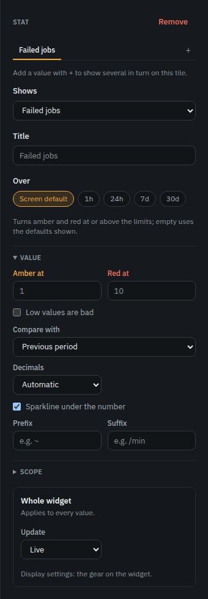

### Status colors

A data widget with a state colors itself: a green border when all is ok, an amber border
and background when degraded or past the amber limit, red when down or past red, blue
while a check is recovering and gray when a check is stale. Widgets without a state (a
chart, the clock) keep a plain border. A down check turns the health widget red; a
degraded or recovering one colors only its row or card. A tile that turns red flashes
once, so the change is noticed; there is no sound. A message's tone colors its tile the
same way.

### Light theme

Widgets follow the screen's [theme](./screens#theme): the same tiles on a light screen.

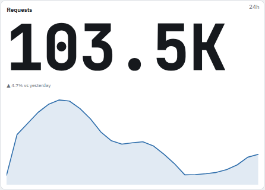

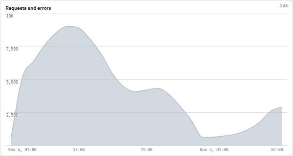

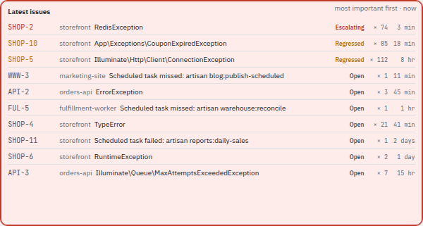

### Share links

A [share link](./screens#share-links) shows every widget as the TV does, except that
unless **Show issue titles and names** is ticked it leaves out issue titles, alert channel
names and health check messages, numbers hosts and agents ("host 1"), and shows a
calendar's times without their titles. Layout widgets show as they are: put nothing in a
message or QR code that the link should not give away.

## Stat

One number, with its trend against an earlier period and a sparkline of the period under
it. A stat with limits turns its number and tile amber or red past them.

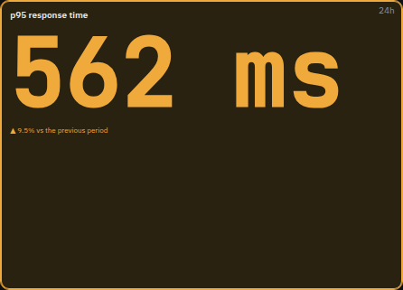

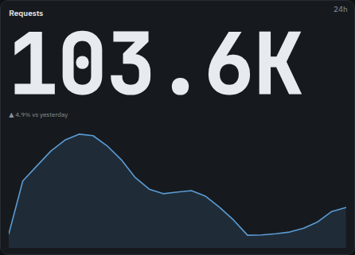

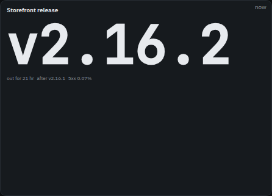

**Shows**:

- **Requests**: requests over the period.
- **Requests per minute**: requests a minute over the last five minutes, now.
- **Error rate**: the share of requests answered with a 5xx; amber at 1%, red at 5%.
- **p95 response time**: amber at 500 ms, red at 1000 ms.
- **Apdex**: amber below 0.85, red below 0.7.
- **Open issues**: issues open now.
- **Users affected**: different users that ran into an issue in the period.
- **Failed jobs**: amber at 1, red at 10.
- **Queue size**: jobs waiting now; amber at 100, red at 1000.
- **Queue workers**: workers running now; red at none.
- **Agents online**: red at none.
- **Highest host CPU**, **Highest host memory**, **Highest host disk**: the busiest host
  now; amber at 70% CPU (80% memory and disk), red at 90%.
- **Current release**: the release running now, how long it has been out, and its 5xx
  rate (and against the release before it, when there is one).
- **LCP p75**: the browser's largest contentful paint; amber at 2500 ms, red at 4000 ms.
- **Database size**, **Database connections**: what [database health checks](./health#database-metrics)
  report, the latest of each database added up over the databases in scope; a database
  several servers report counts once.
- **External JSON**: a number from a project's data source (see [External JSON](#external-json)).

**Value**:

- **Amber at**, **Red at**: the limits; empty uses the defaults above. Shares go from 0 to
  1 (0.05 is 5%), durations are in milliseconds, sizes in bytes.
- **Low values are bad**: the limits count downward (Apdex, uptime, workers).
- **Compare with**: **Nothing**, **Previous period**, **Same time yesterday** or **Same
  time last week**. The change shows under the number, green when better and amber when
  worse for a value with limits, gray for one without; under 2% counts as no change.
- **Decimals**: **Automatic**, 0, 1 or 2.
- **Sparkline under the number**.
- **Prefix** and **Suffix** around the number, such as `~` or `/min`.

## Gauge

One value on a half circle against its limits, the arc colored by them.

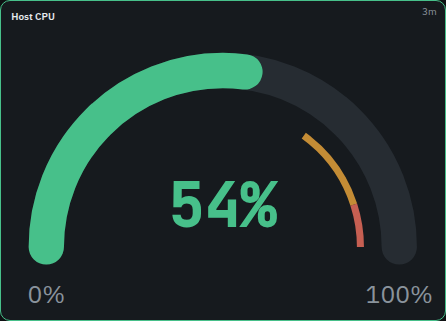

**Shows**: **Requests per minute**, **Error rate**, **p95 response time**, **Apdex**,
**Host CPU**, **Host memory**, **Host disk** (the busiest host), **Queue size**,
**Database connections in use** (the database with the largest share of its maximum in
use; amber at 80%, red at 90%), **Health uptime** (the uptime of the checks in scope over
the period; amber below 99.9%, red below 99%) and **External JSON**. The
defaults are the stat's.

**Scale**:

- **Minimum** and **Maximum** of the arc; empty uses the source's own scale (0 to 100% for a share).
- **Amber at**, **Red at**, **Low values are bad**: as on a stat.
- **Mark the amber limit on the arc** and **Mark the red limit on the arc**: with red
  hidden, the amber mark runs to the end.

## Chart

A series over the period, as bars, an area or a line, or one series per route, queue,
host or project.

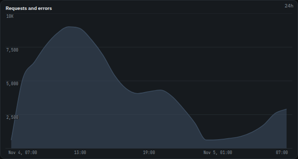

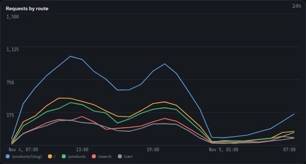

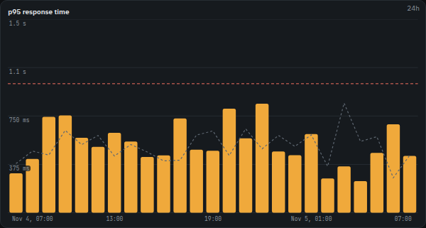

**Shows**: **Requests and errors** (both, errors in red), **Requests**, **Requests per
minute**, **Error rate**, **p95 response time**, **Apdex**, **Users affected**, **Queue
size**, **Queue workers**, **Queue wait** (how long jobs waited before they ran),
**Failed jobs**, **Host CPU**, **Host memory**, **Host disk**, **LCP p75**, **Database
size**, **Database connections** and **External JSON**.

**Chart**:

- **Style**: **Bars**, **Area** or **Line**, and **Smooth lines**.
- **Split by**: **Nothing**, **Route**, **Queue**, **Host**, **Database check**,
  **Environment**, **Release** or **Project**, one series each, and **Series**: the top 5,
  10 or 20. A split always draws lines.
- **Red at**, and **Draw the red limit** as a dashed line.
- **Overlay the previous period**, faint behind the current one.
- **Y axis starts at zero**, **Legend**, **Time axis**, **Value axis** and **Grid lines**,
  each on or off.

The time axis says its times in 24 or 12 hours, as the screen's clock does. A split by
host or project names them; see [Share links](#share-links).

## List

Rows, worst or newest first, as many as fit the tile. Rows that do not fit scroll slowly
down and back up, resting at each end; hovering stops it.

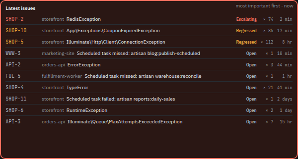

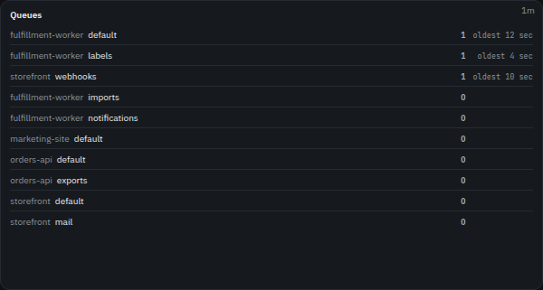

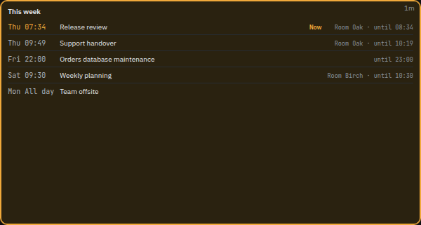

**Shows**:

- **Latest issues**: each issue's short id, title, status and how often and how long ago
  it happened; escalating and regressed ones are marked.
- **Alert feed**: the alerts sent, newest first.
- **Failed jobs**: failed jobs by job, most failures first.
- **Scheduled tasks**: each task's last run (**Ran**, **Failed**, **Missed**,
  **Running**, **Skipped**), failed first.
- **Slowest routes**: slowest first, amber at 500 ms and red at 1000 ms.
- **Queues**: each queue's full name, the jobs waiting on the right, and the workers on it
  where the agent knows. A queue is judged like its [backlog alert](./alerts#queue-backlog):
  red past the project's thresholds (its own for that queue, or the rule's: 1,000 jobs or
  10 minutes by default), amber past half of them; a queue whose jobs wait too long says
  **Waiting** and for how long. A muted queue stays calm. Limits set on the widget replace
  that and count on its size.
- **Hosts**: each host once, with CPU, memory and disk meters colored by their limits.
- **Agents**: each agent, and **Offline** for one that stopped reporting.
- **External JSON**: one row per item of an array in a data source.
- **Calendar events**: a calendar's events (see [Calendars](#calendars)).

**Rows**:

- **Rows**: **Fit to tile**, or 3, 5, 10 or 20.
- **Sort** (latest issues): **Newest first**, **Most important first**, **Last reported
  first** or **Most frequent**.
- **Only what needs attention**: leaves out the rows that are fine.
- **Show age**, **Show count**, **Show project** and **Wrap long text**.
- **Scroll slowly through rows that do not fit**: off, the list stays still and shows
  the rows that fit.

### Calendars

A list can show a calendar's events: today's meetings next to the meeting room door, the
on-call rota, the week's releases. Add the calendar as a data source of a project
(**Data sources**, format **iCalendar (.ics)**) with the address it is published at in
iCal format: in Google Calendar the **Secret address in iCal format** under the
calendar's settings, in Outlook a calendar published as ICS, in iCloud a public
calendar's link (`webcal://` as `https://`), or any `.ics` address. Lumberjack fetches it
on its interval like any data source and records an error when the answer is not an
iCalendar feed. That address is a key to the calendar: after saving, the data sources page
shows it without its path, and screens, TVs and share links never get it.

Then pick **Calendar events** for a list widget and the data source under **Rows**. It
shows the events from **Days back** (**From today**, **From yesterday** or **A week
back**) to **Days ahead** (**Rest of today**, **Until tomorrow**, **A week** or **30
days**), in the screen's time zone (else the server's), with repeating events expanded,
their skipped and moved dates included, and cancelled ones left out. With **Only what has
not ended** (on by default) an event leaves the list when it ends. Rows go by day, each
day's all-day events first, then by start: the start time (or **All day**), the title,
and the place and end time where there is room; an event on now says **Now** in amber. A
list over more than one day puts the weekday before the time. On a share link without
names the rows show the times only.

### External JSON

A stat, gauge, chart or list can read a project's data source (**Data sources** on the
project): **Data source** picks it and **JSONPath** the number in its latest answer, such
as `$.data.total`; a list's JSONPath points at an array and **Label path in each item**
and **Value path in each item** read each row. **Configure** shows the latest answer to
click a value in. A Prometheus data source takes a **Selector** instead.

## Health

The health checks of the scope: a count at 1 x 1, a list when narrow, cards when two or
more cells wide. One check picked shows that check alone, with its uptime, its timeline
and its last message, and for a database check its connections and size.

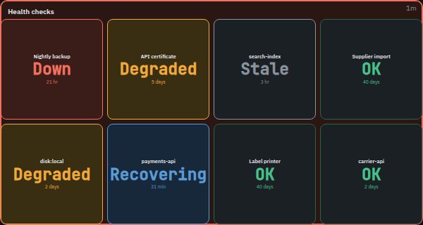

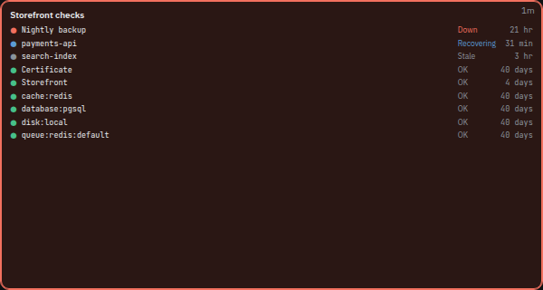

**Shows**: **Health checks**, the one source.

**Checks**:

- **Show as**: **Automatic** (by size, as above), **Summary**, **List** or **Cards**.
  The cards are one per grid cell the widget covers and run to the widget's edges.
- **Checks**: none picked shows every check of the projects, new ones included.
- **Only what needs attention**: only checks that are not ok.
- **Show uptime**, **Show the timeline** and **Show the last message** (a single check).
- **Stale counts as**: **Its own state** (gray), **Degraded** or **Ok**.
- **Scroll slowly through rows that do not fit**: what does not fit scrolls into view
  (sideways on a widget wider than tall); off, it is counted at the end instead, with how
  many of those are down or degraded.

A database check shows its connections, amber at 80% of the maximum and red at 90%.

## Project overview

Every project of the scope as a traffic light: one cell each with its name, green, amber
or red, and why when it is not green (**2 checks down**, **Backlog on mail**, **3 new
issues**). The cells share the tile in as square a grid as their count allows; a long
name takes a second line before it is cut. At 1 x 1
it shows how many are ok and the worst one.

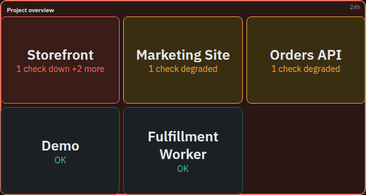

**Shows**: **Project overview**, the one source.

A project's light is the worst of what it has:

- **Red**: a health check is down, an issue is escalating (it escalated within the last
  hour), or a queue is past its backlog thresholds.
- **Amber**: a health check is degraded or stale (unless **Stale counts as** is Ok), a
  queue is past half its backlog thresholds, or the period brought new issues: open ones
  first seen in it, 3 or more by default.
- **Green** otherwise, also for a project with nothing to report.

**Projects**:

- **Problems first**: red, then amber, then green.
- **Only what needs attention**: leaves the green ones out.
- **Show why**: off, the cell shows the state word instead of its worst reason.
- **Amber from new issues**: 1, 3, 5, 10 or 20.
- **Stale counts as**: **Degraded** or **Ok**.

Checks are judged as on the health widget, queues as on a list of queues (a muted queue
stays green). The tile takes the color of its worst project. Every project of the scope
is read in the same few queries, however many there are. Share links show project names,
as charts split by project do.

## SLO

One service level objective over the period, for the requests of the scope (a route
filter and domain narrow it): how much of the period met it, the error budget left as a
bar, and the burn rate.

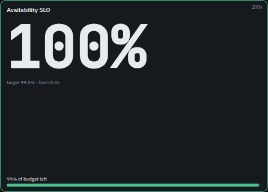

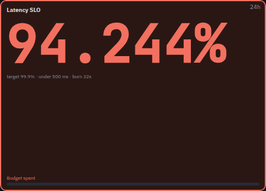

**Shows**:

- **Availability SLO**: the share of requests without a 5xx, from the SDK's request
  counts (every request, not only the sampled ones).
- **Latency SLO**: the share of requests that took at most **Fast enough under (ms)**
  milliseconds (500 by default). This reads the runs the SDK sampled, like the
  percentiles do, so it is an estimate from the sample, and counts every status.

**Objective**:

- **Target**: 99%, 99.5%, 99.9% (the default), 99.95%, 99.99% or **Other**, with
  **Target in %** from 50 to 99.999.
- **Fast enough under (ms)**, for the latency objective.

The error budget is what the target leaves: 0.1% of the requests at 99.9%. The budget
left is how much of it the period has not used (below zero once overspent, shown as
**Budget spent**). The periods are rolling (the last hour, day, 7 or 30 days), so the
burn rate reads the latest twenty-fourth of the period (the last hour of a day, at least
five minutes): its share of bad requests over the budget. A burn rate of 1 spends exactly
the budget over the period; 10 would spend it in a tenth of it. The tile turns red with
no budget left, amber while the burn rate is over 1 or under a quarter of the budget is
left, green otherwise; without requests it shows **No requests yet**.

## Clock and text

The time, a note for the room, or both, and the time in other cities under it.

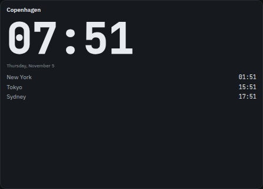

**Clock**:

- **Shows**: **Clock**, **Text only** or **Clock and text**.
- **Format**: **24 hour** or **12 hour**.
- **Time zone**: empty uses the screen's, else the TV's own.
- **Other time zones**: up to 12, each showing its city and time under the clock, for a
  world clock.
- **Seconds** and **Date**.
- **Text**: the note, such as a team name or "Quiet hours after 18:00".

## Countdown

The time left to a moment: a release, an event, a deadline. While far off it counts in
days and hours, in the last day as a clock, with a line saying what it counts down to.
Or it follows a calendar's events, for a meeting room door.

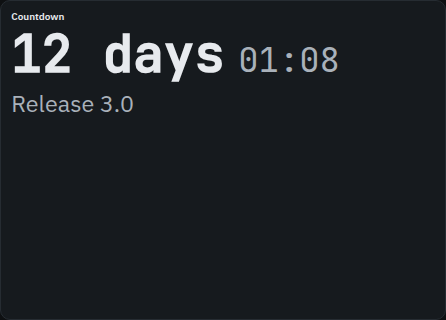

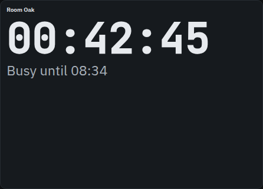

**Countdown**:

- **Counts down to**: **A moment** or **A calendar's events**.
- For a moment: **When** (in each TV's own time), **What it counts down to** (the line
  under it, such as "Release 3.0"), and **Once it is past**: **Count the time since**,
  **Stay at zero** or **Show only the text**.
- For a calendar: **Data source** (an iCalendar data source, see
  [Calendars](#calendars)); **Count**: **To the end of the event on, else to the next
  start**, **Only to the end of the event on** or **Only to the next start**; **Says**:
  **The event's title** or **Busy until or available until** (for a room door); and
  **Format**, 24 or 12 hour, for the times it says. All-day events are skipped; with no
  event to come it says **No event coming up**.
- **Seconds**.

## Message

A note for the room, or a ticker running across the tile. Its tone colors the tile like
a status, so a warning reads from across the room.

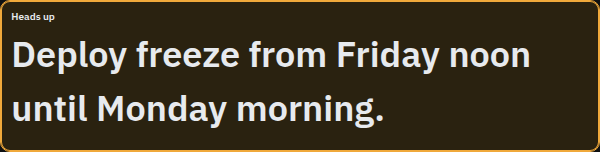

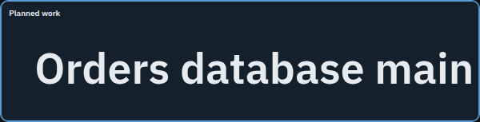

**Message**:

- **Message**: up to 500 characters; line breaks are kept (a ticker joins the lines).
  At **Fit to tile** (Text size, behind the gear) a longer message gets smaller type, so
  all of it fits the tile.
- **Tone**: **Plain**, **Info (blue)**, **Warning (amber)** or **Critical (red)**.
- **Run across like a ticker**: the text runs from right to left, over and over; give
  it a wide, one row tile.

## QR code

A link, a wifi network or any text as a QR code in the brand style, for phones in the
room to scan. The code is drawn on the server.

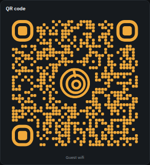

**QR code**:

- **Holds**: **A link** (**Link**, http or https), **A wifi network** (**Network
  name**, **Security**: WPA, WEP or none, **Password**, **Hidden network**) or **Text**.
- **Line under the code**: such as "Guest wifi".

It shows on share links too, password and all.

## Image, video or page

An image, a camera, a video or a web page the TV loads itself; nothing goes through
Lumberjack. Several addresses take turns as a slideshow.

**Media**:

- **Shows**: **An image or camera** (a camera's MJPEG stream too), **A video** (MP4 or
  WebM, muted and looping) or **A web page or YouTube** (a YouTube or Vimeo link plays
  muted and looping).
- **Addresses**: up to 20, one a line; several show in turn, the same one on every TV
  at once.
- **Next after**: 5 seconds to 5 minutes, for a slideshow.
- **Fit** (image and video): **Whole (contain)**, **Fill, cropped (cover)**, **Stretch
  (fill)**, **Actual size (none)** or **Shrink only (scale-down)**.
- **Load again** (image and page): **Never**, or every minute to every hour, for a
  snapshot that changes behind the same address.
- **Subtitles (YouTube and Vimeo)** (page).
- **Space around it**: off, the media runs to the tile's edges.
- **Line under the code**: a caption under it.

The TV loads the address itself, so it must be http(s), reachable from the TV, and https
on an https Lumberjack. Pages that forbid framing stay blank.

## Empty cell

Older screens may still have an **Empty cell** widget, from when widgets filled the grid
in order and a gap needed a filler. It still works (dashed in the designer, invisible on
the TV), but it is no longer offered: a free cell is empty on its own, so it can be
removed.
